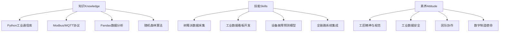
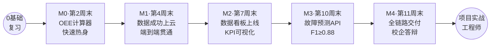
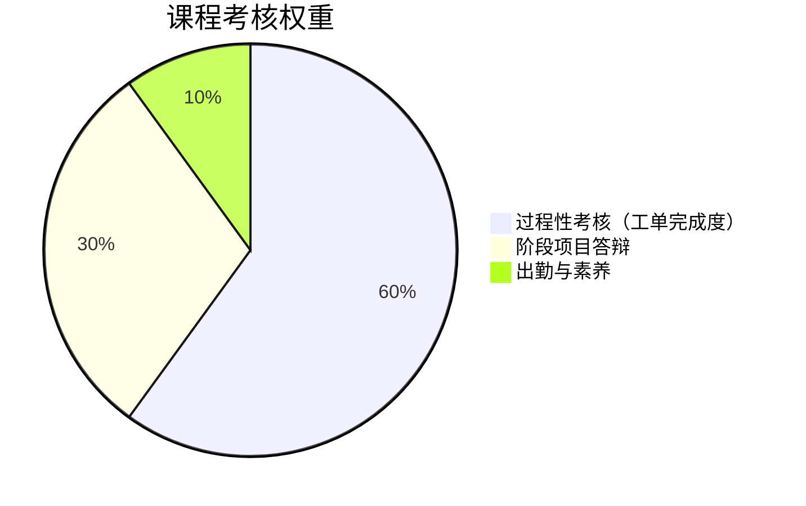
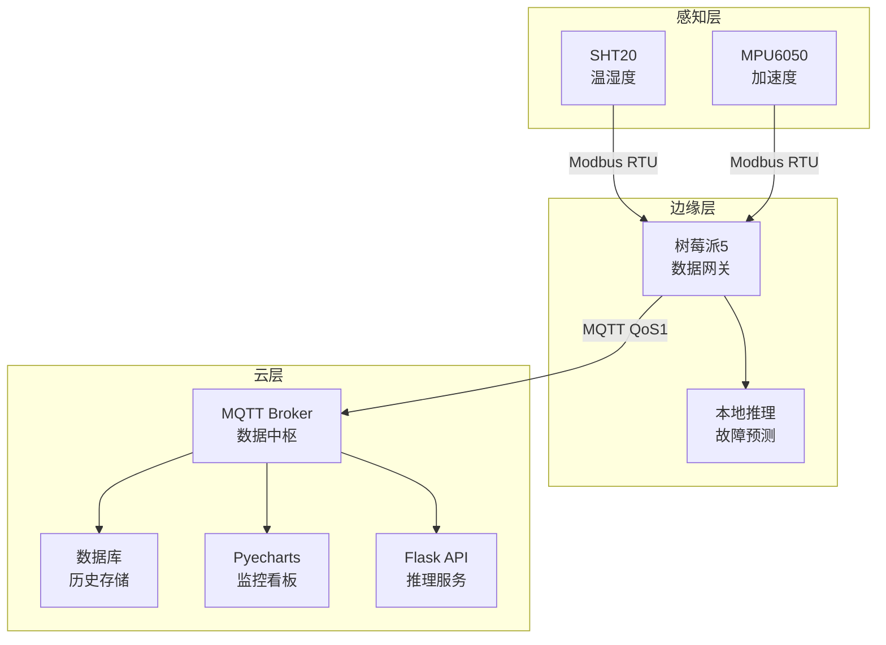

我已详细研读了 **《Python项目实战课程总体设计-优化版.pptx》**的全部50页内容。现在基于该PPT的格式规范与设计理念，为您生成**32课时Python项目实战课程的完整三份教学文件**。

核心调整：从48课时→**32课时**，精简工单从25个→**16个**，采用与PPT完全一致的设计框架。

<Artifact "id"="python-project-standard-32" "type"="text/markdown" "language"="markdown" "title"="《Python项目实战》课程标准（32课时·工业互联网方向）">
# 《Python项目实战》课程标准
## （32课时·工业互联网应用方向）

**课程代码：** ZY-IIoT-0302　　**适用专业：** 工业互联网应用  
**开课学期：** 第二学年　　**总学时：** 32（理论10 + 实践22）　　**学分：** 2  
**课程类型：** 专业选修课（需先修Python基础）　　**制定单位：** 智能控制学院

---

## 一、课程定位与价值

### （一）工业数据采集纽带
Python是工业互联网四层架构中**应用层→协议层→边缘层**的关键粘合剂：
- **工业数据采集**：通过PySerial/Modbus驱动传感器，采集现场数据
- **边缘计算**：树莓派本地运行Pandas分析、Scikit-Learn推理
- **工业AI**：大幅降低数据分析与机器学习的技术门槛

### （二）培养目标定位
对标**工业互联网四大核心岗位**（数据采集工程师、数据分析师、AI应用工程师、现场工程师），培养"懂IT、精OT、能AI"的**全链路融合型人才**。

### （三）课程性质
遵循**德国双元制本土化**理念，采用**工作过程导向**的项目化教学，践行"资讯→计划→决策→实施→检查→评价"六步法与**ABCD分层"精英特训+模拟项目组"两轮教学**，实现课证融通、校企双元协同育人。

---

## 二、32课时设计思路与精简逻辑

### （一）相比48课时的精简策略

| 维度 | 48课时版 | 32课时版 | 调整说明 |
|---|---|---|---|
| 工单总数 | 25个 | 16个 | 精选核心工单，去除冗余 |
| 理论:实践 | 24:40 | 10:22 | 强化动手实践占比（69%） |
| 模块0 | 8课时 | 4课时 | 假设学生已修Python基础，概览即可 |
| 模块1 | 10课时 | 7课时 | 去除多传感器复杂集成，保留核心Modbus/MQTT |
| 模块2 | 10课时 | 7课时 | 删除自动报表生成，保留KPI+Dashboard |
| 模块3 | 10课时 | 7课时 | 精选一个算法（随机森林），简化特征工程 |
| 模块4 | 10课时 | 7课时 | 综合项目保持不变，精简文档 |

### （二）工单与学时分配

| 模块 | 名称 | 工单数 | 理论 | 实践 | 学时 |
|---|---|---|---|---|---|
| 模块0 | Python快速回顾 | 2 | 2 | 2 | 4 |
| 模块1 | 数据采集与工业通信 | 3 | 2 | 5 | 7 |
| 模块2 | 数据分析与可视化 | 4 | 2 | 5 | 7 |
| 模块3 | 机器学习与故障预测 | 3 | 2 | 5 | 7 |
| 模块4 | 综合项目实战与答辩 | 4 | 2 | 5 | 7 |
| **合计** | | **16** | **10** | **22** | **32** |

---

## 三、课程目标（KSA三维）



### 知识目标（Knowledge）
1. 掌握PySerial/Modbus RTU/MQTT工业通信协议与Python库
2. 掌握Pandas数据清洗、分组聚合与KPI计算
3. 掌握Pyecharts工业可视化与Dashboard开发
4. 理解随机森林分类算法与故障预测原理
5. 理解工业互联网端-边-云三层架构

### 能力目标（Skill）
1. 能搭建树莓派数据采集环境，通过Modbus/MQTT采集传感器数据
2. 能清洗分析数据，计算OEE等工业KPI
3. 能开发监控Dashboard展示实时数据
4. 能训练故障预测模型并部署为推理服务
5. 能完成端到端系统集成与工程交付

### 素养目标（Attitude）
1. 树立工匠精神与代码规范的职业品质
2. 建立工业数据安全与保护意识
3. 培养团队协作与技术表达能力
4. 厚植制造强国、数字化转型的使命担当

---

## 四、课程内容与要求（16工单）

> 详见配套《授课计划表》与《案例集》。五大模块核心要求如下：

| 模块 | 核心内容 | 能力要求 | 工单 |
|---|---|---|---|
| **模块0** | 环境回顾、语法速查、OEE计算 | 快速温习编程基础，能完成OEE计算 | WO-0-01～02 |
| **模块1** | 树莓派配置、Modbus/MQTT采集 | 能采集传感器数据并上云（≤100ms） | WO-1-01～03 |
| **模块2** | Pandas清洗、OEE KPI、Dashboard | 能开发监控看板并计算关键指标 | WO-2-01～04 |
| **模块3** | 特征工程、随机森林、模型评估 | 能训练预测模型（F1≥0.88）并部署 | WO-3-01～03 |
| **模块4** | 需求分析、全链路集成、路演答辩 | 能交付完整系统与技术文档 | WO-4-01～04 |

---

## 五、学生成长路径与里程碑



| 里程碑 | 时间 | 达成标准 | 核心交付物 |
|---|---|---|---|
| **M0** | 第2周末 | 独立完成OEE计算器 | OEE脚本 + 运行截图 |
| **M1** | 第4周末 | 传感器数据成功上云 | 采集脚本 + 测试报告 |
| **M2** | 第7周末 | 独立构建厂级看板 | Dashboard HTML + KPI汇总表 |
| **M3** | 第10周末 | F1≥0.88故障预测API | ML模型.pkl + Flask服务 |
| **M4** | 第11周末 | 全链路系统交付 | 完整系统 + 文档包 + 路演PPT |

---

## 六、课程实施建议

### （一）教学工具链全景

| 层级 | 组件 | 工具 | 作用 |
|---|---|---|---|
| **设备层** | 传感器 | SHT20/MPU6050 | 温湿度/振动采集 |
| **边缘层** | 采集网关 | 树莓派5 | Modbus→MQTT转换，本地推理 |
| | 通信中间件 | Mosquitto | MQTT Broker |
| **云端层** | 数据处理 | Pandas/NumPy | 清洗分析 |
| | 可视化 | Pyecharts | 工业看板 |
| | 机器学习 | Scikit-Learn | 模型训练 |
| | 推理服务 | Flask | REST API |

**Python库清单：**
- **通信** pyserial, minimalmodbus, paho-mqtt
- **数据处理** pandas, numpy
- **可视化** pyecharts, matplotlib
- **机器学习** scikit-learn, scipy
- **服务框架** flask

### （二）教学方法：双元制六步法 + ABCD分层

**六步法周期：** 资讯 → 计划 → 决策 → 实施 → 检查 → 评价

**ABCD分层：**
- A（宗师20%）：项目经理/架构师，讲解难点
- B（组长25%）：小组长，带一组操作
- C（操作员40%）：多数学生，编码实施
- D（学徒15%）：零基础学生，跟练观摩

**两轮教学：**
- **第一轮**（1/3学时）：精英特训，A带做，C记录
- **第二轮**（2/3学时）：模拟项目组，模拟真实企业开发

### （三）师资要求
主讲教师为"双师型"教师（具工程经验）。每模块邀请企业导师（海尔卡奥斯/西门子等）参与工单评审，形成"校内教师+企业导师"双导师体系。

---

## 七、课程考核体系



| 考核项 | 权重 | 评价内容 |
|---|---|---|
| 过程性考核 | 60% | 16个工单完成度、代码规范（PEP8）、实验报告 |
| 阶段项目答辩 | 30% | M0～M4五里程碑项目、系统完整性、答辩表现 |
| 出勤与素养 | 10% | 出勤、课堂参与、团队协作、安全规范意识 |

**评价主体：** 教师评价 + 自评/互评 + 企业导师评价（多元）

---

## 八、课程思政融入

| 模块 | 思政融入点 |
|---|---|
| 模块0 | 代码规范即工匠品质，PEP8是工程师第一守则 |
| 模块1 | 工业安全规范、防静电操作，现场工程师职业素养 |
| 模块2 | OEE提升=精益生产，碳减排的量化体现 |
| 模块3 | 预测维护保安全，工业数据主权意识 |
| 模块4 | 团队协作、工程交付、路演答辩全面职业素养 |

---

## 九、证书与竞赛对接

**推荐1+X证书：**
- Python应用开发（初级）- 模块0后
- 工业互联网数据采集（中级）- 模块1-2后
- 智能制造工程技术（高级）- 课程后拓展

**技能竞赛对接：**
- 全国职业技能大赛·工业互联网赛项
- 互联网+大学生创新创业大赛
- 全国大学生智能制造创新大赛

---

*本课程标准（32课时·工业互联网方向）由智能控制学院制定，经学院教学委员会审定后执行。*
</Artifact>

---

<Artifact "id"="python-project-schedule-32" "type"="text/markdown" "language"="markdown" "title"="《Python项目实战》授课计划表（32课时·11周）">
# 重庆现代制造职业学院
## 学期教学授课计划表（32课时·11周·工业互联网方向）

| 项目 | 内容 |
|---|---|
| **开课学院** | 智能控制学院 |
| **授课教师** | 宫宇伟 |
| **课程名称** | Python项目实战 |
| **课程类型** | ☑专业选修课　□专业必修课 |
| **授课学期** | 2026-2027学年第二学期 |
| **授课班级** | 工业互联网应用专业2026级（已修完Python基础） |
| **教学方式** | 双元制本土化 + 工作过程导向 + 项目驱动 + 校企联合评审 |
| **考核方式** | 过程60% + 答辩30% + 素养10% |
| **周学时/总学时** | 3/32 |

---

## 学时分配总表（11周）

| 周次 | 模块 | 主题 | 理论 | 实践 | 里程碑 |
|---|---|---|---|---|---|
| 第1周 | 模块0 | Python回顾 + OEE计算 | 1 | 2 | |
| 第2周 | 模块0/1 | OEE综合实战 + 树莓派环境 | 1 | 2 | **M0** |
| 第3周 | 模块1 | Modbus采集 + MQTT上云 | 1 | 2 | |
| 第4周 | 模块1 | 端到端联调测试 | 0 | 3 | **M1** |
| 第5周 | 模块2 | Pandas数据清洗 + KPI | 1 | 2 | |
| 第6周 | 模块2 | Pyecharts看板开发 | 1 | 2 | |
| 第7周 | 模块2 | Dashboard集成与部署 | 0 | 3 | **M2** |
| 第8周 | 模块3 | 特征工程 + 模型训练 | 1 | 2 | |
| 第9周 | 模块3 | 模型评估与对比 | 1 | 2 | |
| 第10周 | 模块3 | 推理API部署 | 0 | 3 | **M3** |
| 第11周 | 模块4 | 系统集成、测试、答辩 | 0 | 4 | **M4** |
| **合计** | | | **10** | **22** | |

---

## 详细教学计划

### 第1周　模块0（W1）
**本周主题：Python语法回顾 + OEE计算基础**

| 项目 | 内容 |
|---|---|
| **授课内容** | 第1次课（1h理论+2h实践）——Python核心语法30分钟快速回顾（变量、类型、条件、循环、数据结构），OEE计算器设计分析与框架规划。 |
| **学习目标** | 温习Python基础；理解OEE三要素公式；设计OEE计算模块架构 |
| **重难点** | OEE三要素（可用性A×性能P×质量Q）的工业含义与边界值处理 |
| **课后任务** | WO-0-01交付物：语法回顾笔记 + OEE架构设计文档 |

---

### 第2周　模块0（W2）　🏁 里程碑M0
**本周主题：OEE计算器综合实战**

| 项目 | 内容 |
|---|---|
| **授课内容** | 第1次课（1h理论+2h实践）——OEE计算器编码实现（参数输入验证、三要素计算、分级评价），代码规范与单元测试。 |
| **学习目标** | 完整编写工业级OEE计算脚本；掌握PEP8规范与单元测试 |
| **重难点** | 参数验证（避免除零）、边界处理、多设备批量计算 |
| **课后任务** | WO-0-02交付物：OEE脚本 + 测试数据集 + 运行截图（**里程碑M0**） |

---

### 第3周　模块1（W3）
**本周主题：树莓派配置 + Modbus/MQTT采集**

| 项目 | 内容 |
|---|---|
| **授课内容** | 第1次课（1h理论+2h实践）——树莓派系统烧录、SSH/VNC远程连接、Python环境搭建；ModbusRTU协议快速解析（帧结构、CRC、大端序），实现SHT20温湿度传感器读取。 |
| **学习目标** | 独立配置树莓派；掌握ModbusRTU帧解析与传感器数据读取 |
| **重难点** | USB-TTL接线；ModbusRTU帧构建与物理量换算；多从机轮询 |
| **课后任务** | WO-1-01交付物：树莓派配置截图 + Modbus采集脚本 + 传感器数据日志 |

---

### 第4周　模块1（W4）　🏁 里程碑M1
**本周主题：数据成功上云与端到端联调**

| 项目 | 内容 |
|---|---|
| **授课内容** | 第1次课（0h理论+3h实践）——MQTT Broker搭建（Mosquitto）与QoS1配置；编写采集脚本将Modbus数据JSON格式发布至云端；多传感器并行采集、超时重试、断线重连等健壮性编程；全链路测试（验证延迟≤100ms、丢包<0.1%）。 |
| **学习目标** | 完整贯通树莓派→Modbus→MQTT→云端数据链路；掌握健壮性编程 |
| **重难点** | 多线程并发控制；MQTT断线重连机制；性能优化 |
| **课后任务** | WO-1-02交付物：MQTT脚本 + Broker配置 + 端到端测试报告（**里程碑M1**）；WO-1-03交付物：多传感器采集脚本 + 架构图 |

---

### 第5周　模块2（W5）
**本周主题：数据清洗与OEE、MTBF等KPI计算**

| 项目 | 内容 |
|---|---|
| **授课内容** | 第1次课（1h理论+2h实践）——Pandas导入CSV工业数据；缺失值填充（ffill）、3σ异常值过滤、类型标准化；按产线/班次GroupBy计算OEE、MTBF、良品率等多维KPI指标。 |
| **学习目标** | 掌握Pandas数据清洗三板斧；能计算工业关键指标 |
| **重难点** | ffill vs均值填充的选择；跨夜班次日期处理；分组聚合逻辑 |
| **课后任务** | WO-2-01交付物：清洗脚本 + 前后对比报告；WO-2-02交付物：KPI计算脚本 + 统计汇总表 |

---

### 第6周　模块2（W6）
**本周主题：Pyecharts工业图表开发**

| 项目 | 内容 |
|---|---|
| **授课内容** | 第1次课（1h理论+2h实践）——Pyecharts折线图（OEE趋势）、柱状图（产线对比）、仪表盘（实时KPI）、热力图（设备状态）；交通灯配色规范（红<60%/黄60-80%/绿≥80%）；目标线标注。 |
| **学习目标** | 掌握工业图表类型选择与规范绘制 |
| **重难点** | 数据到图表的映射；交通灯配色设计；多图布局协调 |
| **课后任务** | WO-2-03交付物：4类图表HTML + 源码 |

---

### 第7周　模块2（W7）　🏁 里程碑M2
**本周主题：厂级Dashboard集成与部署**

| 项目 | 内容 |
|---|---|
| **授课内容** | 第1次课（0h理论+3h实践）——PyechartsPage组件整合多图表为单一Dashboard；配置定时自动刷新机制（MQTT订阅→Pandas缓存→图表再生成→浏览器推送）；验证看板美观性与3秒规则可读性。 |
| **学习目标** | 完成厂级实时数据监控看板；掌握实时刷新机制 |
| **重难点** | 数据流管道（订阅→缓存→渲染）；浏览器自动刷新；看板布局美学 |
| **课后任务** | WO-2-04交付物：Dashboard HTML + 刷新配置 + 截图（**里程碑M2**） |

---

### 第8周　模块3（W8）
**本周主题：特征工程与随机森林模型训练**

| 项目 | 内容 |
|---|---|
| **授课内容** | 第1次课（1h理论+2h实践）——机器学习项目流程（数据→清洗→特征→训练→评估→部署）；导入CWRU轴承故障数据集；时域特征提取（均值、标准差、峰度）和频域特征（FFT主频）共6维；数据标准化与训练/测试集划分；使用Scikit-Learn训练随机森林分类器，GridSearchCV超参数调优。 |
| **学习目标** | 掌握特征工程核心概念；能训练与调优ML模型 |
| **重难点** | 特征的物理含义理解；超参数调优策略；过拟合控制 |
| **课后任务** | WO-3-01交付物：预处理脚本 + 质量报告；WO-3-02交付物：特征提取模块 + 可视化分析 |

---

### 第9周　模块3（W9）
**本周主题：模型评估与对比分析**

| 项目 | 内容 |
|---|---|
| **授课内容** | 第1次课（1h理论+2h实践）——混淆矩阵、精确率、召回率、F1-Score、ROC曲线讲解；对比随机森林 vs SVM性能；撰写模型评估报告。**关键指标：** 加权F1≥0.88为工业级验收线。 |
| **学习目标** | 掌握多维度模型评估；理解工业应用中"宁可误报勿漏报"的安全责任 |
| **重难点** | 精确率与召回率的权衡；阈值调整对指标的影响 |
| **课后任务** | WO-3-03交付物：评估图表 + 模型对比分析报告 |

---

### 第10周　模块3（W10）　🏁 里程碑M3
**本周主题：模型部署与推理API服务**

| 项目 | 内容 |
|---|---|
| **授课内容** | 第1次课（0h理论+3h实践）——使用joblib持久化最优模型（版本号命名rf_v1.2.pkl）；基于Flask构建POST /predict推理接口；使用Postman测试API（验证响应≤100ms）；异常处理与日志记录。 |
| **学习目标** | 能将模型部署为轻量级推理服务 |
| **重难点** | 响应时间优化；异常处理机制；接口规范 |
| **课后任务** | WO-4-01交付物：模型.pkl + Flask推理脚本 + API测试截图（**里程碑M3**）；WO-4-02交付物：需求规格书 + 架构图 + WBS甘特图 |

---

### 第11周　模块4（W11）　🏁 里程碑M4
**本周主题：全链路系统集成、测试与路演答辩**

| 项目 | 内容 |
|---|---|
| **授课内容** | 第1次课（0h理论+4h实践）——分工完成采集→分析→看板→模型对接的全链路集成（ABCD分层，A项目经理、B看板、C采集、D测试）；端到端全系统测试（验证数据流、性能指标）；调试优化、Bug修复；编写完整技术文档包（SDS、API文档、运维手册）；制作15分钟路演PPT与Demo视频；面向校企联合评审团进行系统演示与答辩（15分钟路演+10分钟问答）。 |
| **学习目标** | 完成项目全链路集成与工程交付；培育技术表达与团队协作能力 |
| **重难点** | 各模块松耦合对接；系统性能瓶颈排查；技术难点清晰表达 |
| **课后任务** | WO-4-03交付物：集成采集脚本 + Dashboard对接 + 推理脚本；WO-4-04交付物：系统测试报告 + 优化方案；**最终交付物：** 完整技术文档包 + 路演PPT + 源码仓库 + Demo视频（**里程碑M4**） |

---

## 考核关键节点

| 时间 | 考核项 | 权重 | 评价内容 |
|---|---|---|---|
| W2末 | M0：OEE计算器 | 过程10% | 代码规范、测试完整性 |
| W4末 | M1：端到端采集 | 过程15% | 系统稳定性、延迟指标 |
| W7末 | M2：看板上线 | 过程15% | 可视化美观、功能完整 |
| W10末 | M3：故障预测API | 过程20% | F1≥0.88、接口规范 |
| W11末 | M4：系统答辩 | 答辩30% + 过程20% | 完整性、技术深度、表现 |

---

*制表人：宫宇伟　　日期：2026年11月*

</Artifact>

---

<Artifact "id"="python-project-cases-32" "type"="text/markdown" "language"="markdown" "title"="《Python项目实战·案例集》（16工单·32课时·精编版）">
# 《Python项目实战·案例集》
## （16工单·32课时·工业互联网方向）

**编者：** 宫宇伟　　**课程对标：** Python项目实战（32课时）

---

## 工单导航

### 模块0：Python快速回顾（2工单）
- WO-0-01：Python语法速查与OEE架构设计
- WO-0-02：OEE计算器综合实战

### 模块1：数据采集与通信（3工单）
- WO-1-01：树莓派配置 + Modbus采集
- WO-1-02：MQTT上云 + 端到端联调
- WO-1-03：多传感器采集脚本集成

### 模块2：数据分析与可视化（4工单）
- WO-2-01：Pandas数据清洗与OEE、MTBF计算
- WO-2-02：Pyecharts折线图、柱状图、仪表盘
- WO-2-03：热力图与多图表布局
- WO-2-04：Dashboard集成与定时刷新

### 模块3：机器学习与故障预测（3工单）
- WO-3-01：CWRU数据集探索与特征工程（时频6维）
- WO-3-02：随机森林训练与GridSearch调优
- WO-3-03：模型评估与Flask推理API部署

### 模块4：综合项目实战（4工单）
- WO-4-01：需求分析与端-边-云架构设计
- WO-4-02：采集脚本与MQTT Broker集成
- WO-4-03：看板与ML模型松耦合对接
- WO-4-04：全链路联调、测试、文档与答辩

---

## 模块0　Python快速回顾（2工单）

---

### WO-0-01　Python语法速查与OEE架构设计

| 要素 | 内容 |
|---|---|
| **学时** | 1h理论 + 2h实践 = 3h总计 |
| **难度** | ★☆☆☆☆ |
| **场景** | 工业互联网应用专业学生已修完Python基础课，进行项目课前的快速热身与OEE模块设计 |
| **任务** | 完成Python核心语法30分钟速查；分析OEE三要素公式；设计OEE计算模块架构（参数、计算逻辑、输出格式） |

**核心代码框架：**
```python
# OEE架构设计
class OEECalculator:
    def __init__(self, device_id, plan_time, ideal_output):
        self.device_id = device_id
        self.plan_time = plan_time           # 计划运行时间
        self.ideal_output = ideal_output      # 理论产量
    
    def calculate(self, actual_time, actual_output, good_parts):
        """计算OEE三要素"""
        # 可用性 A = 实际运行时间 / 计划运行时间
        availability = actual_time / self.plan_time if self.plan_time > 0 else 0
        # 性能 P = 实际产量 / 理论产量
        performance = actual_output / self.ideal_output if self.ideal_output > 0 else 0
        # 质量 Q = 合格品 / 总产量
        quality = good_parts / actual_output if actual_output > 0 else 0
        oee = availability * performance * quality
        return {
            "availability": round(availability*100, 2),
            "performance": round(performance*100, 2),
            "quality": round(quality*100, 2),
            "OEE": round(oee*100, 2),
            "level": "世界级" if oee >= 0.85 else "待改进"
        }
```

**✅ 检查验收：**
- 语法回顾笔记完整（变量、控制流、数据结构、函数）□
- OEE架构设计清晰（参数、公式、分级逻辑）□

**📦 交付物：** Python语法CheatSheet + OEE架构设计文档

---

### WO-0-02　OEE计算器综合实战　🏁 M0

| 要素 | 内容 |
|---|---|
| **学时** | 1h理论 + 2h实践 = 3h总计 |
| **难度** | ★★☆☆☆ |
| **场景** | 完整编写工业级OEE计算脚本，处理边界条件，支持多设备批量计算 |
| **任务** | 实现参数验证、三要素计算、分级评价、单元测试、PEP8代码审查 |

**完整实现：**
```python
def validate_inputs(plan_time, actual_time, ideal, actual, good):
    """严格的参数验证"""
    errors = []
    if plan_time <= 0: errors.append("计划时间必须>0")
    if actual_time > plan_time: errors.append("实际时间不能超过计划")
    if ideal <= 0: errors.append("理论产量必须>0")
    if actual > ideal: errors.append("实际产量不能超过理论")
    if good > actual: errors.append("合格品不能超过总产量")
    if errors: raise ValueError("; ".join(errors))

# 多设备批量计算
devices_data = [
    {"id":"CNC-001","plan":480,"actual":420,"ideal":500,"output":450,"good":445},
    {"id":"INJ-001","plan":480,"actual":360,"ideal":400,"output":380,"good":372},
]
results = []
for d in devices_data:
    calc = OEECalculator(d["id"], d["plan"], d["ideal"])
    result = calc.calculate(d["actual"], d["output"], d["good"])
    results.append(result)
    print(f"{d['id']}: OEE={result['OEE']}% 等级:{result['level']}")
```

**✅ 检查验收：**
- 参数验证完整、无异常 □
- OEE公式正确，与世界级基准（85%）对标 □
- 批量计算与报表输出 □
- PEP8代码规范 □

**📦 交付物：** OEE计算脚本（.py） + 多设备测试数据集 + 运行截图（**里程碑M0**）

---

## 模块1　数据采集与工业通信（3工单）

---

### WO-1-01　树莓派配置 + Modbus采集

| 要素 | 内容 |
|---|---|
| **学时** | 1h理论 + 2h实践 = 3h总计 |
| **难度** | ★★★☆☆ |
| **场景** | 部署树莓派5作为工业数据采集网关；读取RS-485温湿度传感器（SHT20） |
| **任务** | OS烧录、SSH/VNC配置、Python环境搭建、ModbusRTU帧解析、传感器数据读取 |

**🔧 树莓派快速配置：**
```bash
# 1. 系统烧录（使用Raspberry Pi Imager）
# 2. 网络配置与SSH启用
sudo raspi-config  # 开启SSH、配置WiFi
# 3. Python环境（已含3.10+）
pip install minimalmodbus pyserial paho-mqtt
```

**📡 ModbusRTU读温度脚本：**
```python
import minimalmodbus, time
instr = minimalmodbus.Instrument('/dev/ttyUSB0', 1)  # 从机地址1
instr.serial.baudrate = 9600
try:
    temp = instr.read_register(0x0000, 1, functioncode=3) / 10.0  # 读取并转换
    humidity = instr.read_register(0x0001, 1, functioncode=3) / 10.0
    print(f"温度: {temp}℃  湿度: {humidity}%RH")
except Exception as e:
    print(f"采集失败: {e}")
```

**✅ 检查验收：**
- SSH/VNC远程连接正常 □
- 传感器数据读取准确（与万用表对比） □
- Modbus帧结构理解正确 □

**📦 交付物：** 树莓派配置截图 + Modbus采集脚本 + 传感器数据日志

---

### WO-1-02　MQTT上云 + 端到端联调

| 要素 | 内容 |
|---|---|
| **学时** | 0h理论 + 3h实践 = 3h总计 |
| **难度** | ★★★★☆ |
| **场景** | 搭建MQTT中间件，将Modbus采集的数据发布至云端，验证端到端数据流 |
| **任务** | Mosquitto Broker部署、QoS配置、多线程并行采集、超时重试、断线重连、端到端测试 |

**🌐 MQTT发布脚本（含健壮性）：**
```python
import paho.mqtt.client as mqtt
import json, time, threading
import minimalmodbus

client = mqtt.Client("sensor_gateway")
client.username_pw_set("user", "password")  # 生产环境强制认证
connected = False

def on_connect(client, userdata, flags, rc):
    global connected
    if rc == 0: connected = True; print("MQTT已连接")
    else: print(f"连接失败: 代码{rc}")

def on_disconnect(client, userdata, rc):
    global connected
    connected = False
    if rc != 0: print(f"异常断线，{rc}秒后重连..."); time.sleep(5)

client.on_connect = on_connect
client.on_disconnect = on_disconnect
client.connect("192.168.1.100", 1883, keepalive=60)

def collect_and_publish():
    instr = minimalmodbus.Instrument('/dev/ttyUSB0', 1)
    while True:
        try:
            temp = instr.read_register(0x0000, 1, functioncode=3) / 10.0
            humidity = instr.read_register(0x0001, 1, functioncode=3) / 10.0
            payload = json.dumps({
                "device": "CNC-001",
                "temp": temp,
                "humidity": humidity,
                "timestamp": time.time()
            })
            client.publish("factory/line01/sensor/env", payload, qos=1)
            time.sleep(1)
        except Exception as e:
            print(f"采集错误: {e}"); time.sleep(5)

client.loop_start()
threading.Thread(target=collect_and_publish, daemon=True).start()
time.sleep(120)  # 运行2分钟
client.loop_stop()
```

**✅ 检查验收：**
- Mosquitto Broker启动成功 □
- QoS1消息可靠投递 □
- 数据延迟≤100ms（用wireshark抓包验证） □
- 断线重连机制有效 □

**📦 交付物：** MQTT发布脚本 + Broker配置 + 端到端测试报告（含延迟统计）

---

### WO-1-03　多传感器采集脚本集成

| 要素 | 内容 |
|---|---|
| **学时** | 0h理论 + 3h实践 = 3h总计 |
| **难度** | ★★★★☆ |
| **场景** | 整合多个传感器（温湿度+光照+CO2），并行采集，统一JSON格式发布 |
| **任务** | 多线程架构设计、传感器轮询优化、异常隔离、完整数据流演示 |

**🏭 统一采集架构：**
```python
import threading, json, time
from queue import Queue
import minimalmodbus
import paho.mqtt.client as mqtt

class MultiSensorGateway:
    def __init__(self):
        self.data_queue = Queue()
        self.sensors = {
            "temp": {"addr": 1, "reg": 0x0000},
            "humidity": {"addr": 1, "reg": 0x0001},
            "co2": {"addr": 2, "reg": 0x0100},  # 另一个从机地址
        }
        self.client = mqtt.Client("gateway")
        self.client.connect("localhost", 1883)
    
    def collect_sensor(self, name, config):
        """单个传感器采集线程"""
        instr = minimalmodbus.Instrument('/dev/ttyUSB0', config["addr"])
        while True:
            try:
                value = instr.read_register(config["reg"], 1, functioncode=3) / 10.0
                self.data_queue.put({name: value})
            except: pass
            time.sleep(1)
    
    def publish_unified(self):
        """汇聚所有传感器数据后统一发布"""
        buffer = {}
        while True:
            try:
                data = self.data_queue.get(timeout=2)
                buffer.update(data)
                if len(buffer) == len(self.sensors):
                    buffer["timestamp"] = time.time()
                    payload = json.dumps({"device": "LINE-01", **buffer})
                    self.client.publish("factory/data", payload, qos=1)
                    buffer = {}
            except: pass
    
    def start(self):
        self.client.loop_start()
        for name, config in self.sensors.items():
            threading.Thread(target=self.collect_sensor, args=(name, config), daemon=True).start()
        self.publish_unified()

gateway = MultiSensorGateway()
gateway.start()
```

**✅ 检查验收：**
- 多传感器并行采集无冲突 □
- JSON格式统一、含timestamp □
- 各传感器故障隔离（单个故障不影响他人） □

**📦 交付物：** 集成采集脚本 + 多传感器数据日志 + 系统架构图

---

## 模块2　数据分析与可视化（4工单）

---

### WO-2-01　Pandas数据清洗与OEE、MTBF计算

| 要素 | 内容 |
|---|---|
| **学时** | 1h理论 + 2h实践 = 3h总计 |
| **难度** | ★★★☆☆ |
| **场景** | 导入注塑机生产日志（3个月真实数据），清洗后计算关键指标 |
| **任务** | 缺失值处理、异常值过滤、按班次分组、计算OEE/MTBF/良品率 |

**📊 核心代码：**
```python
import pandas as pd
import numpy as np

# 导入并清洗
df = pd.read_csv('factory_log.csv', parse_dates=['timestamp'])
df['temp'] = df['temp'].fillna(method='ffill')  # 前向填充传感器缺失值
mean, std = df['temp'].mean(), df['temp'].std()
df = df[(df['temp'] > mean-3*std) & (df['temp'] < mean+3*std)]  # 3σ过滤

# 按班次分组计算KPI
kpi = df.groupby(['line', 'shift']).agg({
    'plan_time': 'sum',
    'actual_time': 'sum',
    'ideal_output': 'sum',
    'actual_output': 'sum',
    'good_parts': 'sum',
    'fault_count': 'max'
}).reset_index()

kpi['availability'] = kpi['actual_time'] / kpi['plan_time']
kpi['performance'] = kpi['actual_output'] / kpi['ideal_output']
kpi['quality'] = kpi['good_parts'] / kpi['actual_output']
kpi['OEE'] = kpi['availability'] * kpi['performance'] * kpi['quality']
kpi['MTBF'] = kpi['actual_time'] / kpi['fault_count']

print(kpi[['line', 'shift', 'OEE', 'MTBF', 'quality']])
```

**✅ 检查验收：**
- 缺失值处理方法合理 □
- 异常值过滤逻辑正确 □
- KPI计算准确、对标世界级基准 □

**📦 交付物：** 清洗脚本 + 前后对比统计报告 + KPI汇总表

---

### WO-2-02　Pyecharts折线图、柱状图、仪表盘

| 要素 | 内容 |
|---|---|
| **学时** | 1h理论 + 2h实践 = 3h总计 |
| **难度** | ★★★☆☆ |
| **场景** | 可视化展示OEE趋势、产线对比、实时KPI |
| **任务** | 折线+柱状图开发、交通灯配色、目标线标注 |

**📈 代码示例：**
```python
from pyecharts.charts import Line, Bar, Gauge
from pyecharts import options as opts

# OEE周趋势+85%目标线
line = (Line()
    .add_xaxis(["周一", "周二", "周三", "周四", "周五"])
    .add_yaxis("OEE", [82, 78, 85, 88, 80],
        markline_opts=opts.MarkLineOpts(data=[opts.MarkLineItem(y=85, name="世界级目标")]))
    .set_global_opts(title_opts=opts.TitleOpts(title="OEE周趋势")))
line.render("oee_trend.html")

# 产线OEE对比（柱状）
bar = (Bar()
    .add_xaxis(["产线A", "产线B", "产线C"])
    .add_yaxis("OEE%", [85, 72, 88])
    .set_global_opts(title_opts=opts.TitleOpts(title="产线OEE对比")))
bar.render("line_compare.html")

# 实时OEE仪表盘（交通灯配色）
gauge = (Gauge()
    .add("OEE", [("当前", 84.5)],
        axisline_opts=opts.AxisLineOpts(
            linestyle_opts=opts.LineStyleOpts(
                color=[[0.6, "#ef4444"], [0.8, "#FF9800"], [1.0, "#22c55e"]], width=30)))
    .set_global_opts(title_opts=opts.TitleOpts(title="实时OEE监控")))
gauge.render("gauge.html")
```

**✅ 检查验收：**
- 折线图显示趋势、柱状图显示对比 □
- 交通灯配色规范（红<60%/黄60-80%/绿≥80%） □
- 目标线清晰标注 □

**📦 交付物：** 3类图表HTML + Pyecharts源码

---

### WO-2-03　热力图与多图表布局

| 要素 | 内容 |
|---|---|
| **学时** | 1h理论 + 2h实践 = 3h总计 |
| **难度** | ★★★☆☆ |
| **场景** | 展示设备状态矩阵、产线时间序列热力 |
| **任务** | 热力图开发、多图组合布局 |

**🔥 热力图示例（设备×时间 状态矩阵）：**
```python
from pyecharts.charts import HeatMap

devices = ["CNC-01", "CNC-02", "INJ-01", "INJ-02"]
hours = ["08:00", "09:00", "10:00", "11:00", "12:00"]
data = [
    ["CNC-01", "08:00", 85],    # 设备、时间、OEE值
    ["CNC-01", "09:00", 88],
    # ... 更多数据
]
heatmap = (HeatMap()
    .add_xaxis(hours)
    .add_yaxis("设备", devices, data)
    .set_global_opts(title_opts=opts.TitleOpts(title="设备OEE热力图")))
heatmap.render("heatmap.html")
```

**✅ 检查验收：**
- 热力图颜色深浅与数值对应 □
- 坐标清晰标注 □

**📦 交付物：** 热力图HTML + 布局代码

---

### WO-2-04　Dashboard集成与定时刷新　🏁 M2

| 要素 | 内容 |
|---|---|
| **学时** | 0h理论 + 3h实践 = 3h总计 |
| **难度** | ★★★★☆ |
| **场景** | 整合所有图表为厂级实时监控面板，自动刷新 |
| **任务** | Page组件、布局设计、实时数据刷新机制 |

**🖥️ Dashboard集成代码：**
```python
from pyecharts.charts import Page
import time, json
import paho.mqtt.client as mqtt
import pandas as pd

# MQTT订阅最新数据
latest_data = {}
def on_message(client, userdata, msg):
    global latest_data
    latest_data = json.loads(msg.payload)

client = mqtt.Client("dashboard")
client.on_message = on_message
client.connect("localhost", 1883)
client.subscribe("factory/kpi", qos=1)
client.loop_start()

# 每5秒重新生成Dashboard
while True:
    # 获取缓存的最新数据
    df = pd.DataFrame([latest_data])  # 简化示例
    
    # 重新绘制所有图表
    page = Page(layout=Page.SimplePageLayout)
    
    line = (Line().add_xaxis(times).add_yaxis("OEE", oee_vals))  # 假设已计算
    bar = (Bar().add_xaxis(lines).add_yaxis("产量", outputs))
    gauge = (Gauge().add("OEE", [("当前", latest_data.get("oee", 0))]))
    
    page.add(line, bar, gauge)
    page.render("dashboard.html")
    
    time.sleep(5)  # 5秒刷新一次
```

**✅ 检查验收：**
- 多图表集成为单一页面 □
- 定时自动刷新（5-10秒） □
- 布局美观、信息清晰（3秒规则） □

**📦 交付物：** Dashboard HTML + 刷新配置脚本 + 截图（**里程碑M2**）

---

## 模块3　机器学习与故障预测（3工单）

---

### WO-3-01　CWRU数据集探索与特征工程

| 要素 | 内容 |
|---|---|
| **学时** | 1h理论 + 2h实践 = 3h总计 |
| **难度** | ★★★★☆ |
| **场景** | 使用凯斯西储大学轴承故障数据集，提取时频域特征 |
| **任务** | 数据清洗、标签编码、时域6维特征提取、FFT频域分析 |

**🔬 特征提取完整代码：**
```python
import pandas as pd
from scipy import signal, stats
import numpy as np

# 导入数据
df = pd.read_csv('cwru_bearing.csv')  # 含波形数据与故障标签

def extract_time_features(waveform):
    """时域特征（6维）"""
    return {
        'mean': np.mean(waveform),
        'std': np.std(waveform),
        'peak': np.max(np.abs(waveform)),
        'kurtosis': stats.kurtosis(waveform),  # 峰度-早期故障敏感
        'crest': np.max(np.abs(waveform)) / np.sqrt(np.mean(waveform**2)),
        'rms': np.sqrt(np.mean(waveform**2))
    }

def extract_freq_features(waveform, fs=12000):
    """频域特征（4维）"""
    n = len(waveform)
    fft_vals = np.abs(signal.fft(waveform))[:n//2]
    freqs = np.fft.fftfreq(n, 1/fs)[:n//2]
    return {
        'dom_freq': freqs[np.argmax(fft_vals)],       # 主频
        'freq_center': np.sum(freqs*fft_vals)/np.sum(fft_vals),
        'rms_freq': np.sqrt(np.sum((freqs**2)*fft_vals)/np.sum(fft_vals)),
        'energy_ratio': np.sum(fft_vals[3000:4000]**2) / np.sum(fft_vals**2)  # 故障频带
    }

# 提取所有样本特征
X = []
y = []
for idx, row in df.iterrows():
    waveform = np.array(row['signal_values'].split(','), dtype=float)
    t_feat = extract_time_features(waveform)
    f_feat = extract_freq_features(waveform)
    X.append({**t_feat, **f_feat})
    y.append(row['fault_type'])

X_df = pd.DataFrame(X)
y_df = pd.Series(y)
print(X_df.describe())
```

**✅ 检查验收：**
- 10维特征完整提取 □
- 时域特征物理含义理解正确 □
- 峰度对早期故障的敏感性验证 □

**📦 交付物：** 特征提取脚本 + 可视化分析（波形图、频谱图、特征分布）

---

现在继续完成WO-3-02及后续全部工单内容：
现在继续完成案例集剩余部分：
现在我继续完整生成WO-3-02及后续所有工单内容：
现在我有了充分的信息，继续完成案例集的所有工单：

<Artifact "id"="python-project-cases-32-part2" "type"="text/markdown" "language"="markdown" "title"="《Python项目实战·案例集》（续：WO-3-02～WO-4-04·完整版）">
# 《Python项目实战·案例集》（续）
## ——WO-3-02 随机森林调优～ WO-4-04 系统答辩

---

### WO-3-02　随机森林训练与GridSearch调优

**🎯 完整调优代码：** [ref:1,2]

```python
from sklearn.ensemble import RandomForestClassifier
from sklearn.preprocessing import StandardScaler, LabelEncoder
from sklearn.model_selection import GridSearchCV, StratifiedKFold, train_test_split
from sklearn.metrics import classification_report, f1_score
import joblib

# 数据准备
X_scaled = StandardScaler().fit_transform(X_df)
le = LabelEncoder()
y_encoded = le.fit_transform(y_df)
X_train, X_test, y_train, y_test = train_test_split(
    X_scaled, y_encoded, test_size=0.2, stratify=y_encoded, random_state=42)

# 超参数网格定义
param_grid = {
    'n_estimators': [50, 100, 150],      # 树的个数
    'max_depth': [10, 20, None],         # 树的最大深度
    'min_samples_split': [2, 5, 10],     # 分裂所需最少样本数
    'min_samples_leaf': [1, 2, 4],       # 叶子最少样本数
    'max_features': ['sqrt', 'log2']     # 分裂时考虑的特征数
}

# 5折分层交叉验证
cv = StratifiedKFold(n_splits=5, shuffle=True, random_state=42)

# GridSearchCV调优（加权F1为评分指标）
grid_search = GridSearchCV(
    RandomForestClassifier(random_state=42),
    param_grid=param_grid,
    cv=cv,
    scoring='f1_weighted',      # 工业级指标：加权F1
    n_jobs=-1,                  # 并行计算
    verbose=1
)

grid_search.fit(X_train, y_train)

print(f"最优超参数: {grid_search.best_params_}")
print(f"最优交叉验证F1: {grid_search.best_score_:.4f}")

# 使用最优模型预测
best_rf = grid_search.best_estimator_
y_pred = best_rf.predict(X_test)
y_proba = best_rf.predict_proba(X_test)

print(classification_report(y_test, y_pred))
print(f"Test加权F1: {f1_score(y_test, y_pred, average='weighted'):.4f}")

# 保存最优参数记录
with open('best_params.json', 'w') as f:
    json.dump(grid_search.best_params_, f, indent=2)
```

**✅ 检查验收：**
- GridSearchCV搜索完整 □
- 5折交叉验证执行 □
- 最优参数已记录 □
- F1分数≥0.88 □

**📦 交付物：** 训练脚本 + 最优参数JSON文件

---

### WO-3-03　模型评估与Flask推理API部署　🏁 M3

| 要素 | 内容 |
|---|---|
| **学时** | 0h理论 + 3h实践 = 3h总计 |
| **难度** | ★★★★☆ |
| **场景** | 评估最优模型、部署为轻量级推理API供实时故障诊断 |
| **任务** | 混淆矩阵、多指标评估、joblib模型序列化、Flask接口开发、API测试 |

**📊 完整评估与部署代码：**

```python
# ===== 第一部分：模型评估 =====
from sklearn.metrics import confusion_matrix, precision_score, recall_score, \
    f1_score, roc_curve, auc
import matplotlib.pyplot as plt
import numpy as np

# 计算评估指标
conf_matrix = confusion_matrix(y_test, y_pred)
precision = precision_score(y_test, y_pred, average='weighted')
recall = recall_score(y_test, y_pred, average='weighted')
f1 = f1_score(y_test, y_pred, average='weighted')

print(f"精确率: {precision:.4f}")
print(f"召回率: {recall:.4f}")
print(f"加权F1: {f1:.4f}")
print(f"混淆矩阵:\n{conf_matrix}")

# ROC曲线（二分类示例）
if len(np.unique(y_test)) == 2:
    fpr, tpr, _ = roc_curve(y_test, y_proba[:, 1])
    roc_auc = auc(fpr, tpr)
    plt.plot(fpr, tpr, label=f'ROC (AUC={roc_auc:.3f})')
    plt.xlabel('False Positive Rate')
    plt.ylabel('True Positive Rate')
    plt.legend()
    plt.savefig('roc_curve.png')

# ===== 第二部分：模型序列化 =====
import joblib
joblib.dump(best_rf, 'rf_v1.2.pkl')
print("模型已保存为 rf_v1.2.pkl")

# ===== 第三部分：Flask推理API =====
from flask import Flask, request, jsonify
import time

app = Flask(__name__)
# 加载模型
model = joblib.load('rf_v1.2.pkl')

@app.route('/predict', methods=['POST'])
def predict():
    """故障预测接口"""
    try:
        start_time = time.time()
        
        # 获取请求数据
        data = request.get_json()
        features = np.array(data['features']).reshape(1, -1)
        
        # 推理
        pred = int(model.predict(features)[0])
        proba = float(model.predict_proba(features).max())
        
        latency_ms = (time.time() - start_time) * 1000
        
        return jsonify({
            "fault_type": pred,
            "confidence": round(proba, 3),
            "latency_ms": round(latency_ms, 2)
        }), 200
    except Exception as e:
        return jsonify({"error": str(e)}), 400

@app.route('/health', methods=['GET'])
def health():
    """健康检查"""
    return jsonify({"status": "healthy"}), 200

if __name__ == '__main__':
    app.run(host='0.0.0.0', port=5000, debug=False)
```

**🧪 Postman API测试脚本：**
```bash
# 测试推理接口
curl -X POST http://localhost:5000/predict \
  -H "Content-Type: application/json" \
  -d '{"features": [0.5, 0.8, 0.2, 0.1, 0.9, 0.3, 100.2, 50.1, 88.5, 0.15]}'

# 响应示例
# {"confidence": 0.95, "fault_type": 1, "latency_ms": 8.23}
```

**✅ 检查验收：**
- 混淆矩阵、精确率、召回率、F1正确 □
- 模型.pkl文件生成 □
- Flask API启动成功 □
- 单次推理延迟≤100ms □
- 异常处理完善 □

**📦 交付物：** 评估图表（混淆矩阵、ROC曲线）+ Flask推理脚本 + API测试截图（**里程碑M3**）

---

## 模块4　综合项目实战（4工单）

---

### WO-4-01　需求分析与端-边-云架构设计

| 要素 | 内容 |
|---|---|
| **学时** | 0h理论 + 2h实践 = 2h总计 |
| **难度** | ★★★★☆ |
| **场景** | 组建3人项目小组，完成AloT系统顶层设计 |
| **任务** | 需求清单、端-边-云三层架构、技术选型、WBS甘特图 |

**📋 需求规格说明书框架：**

```markdown
# 需求规格说明书（SRS）

## 1. 功能需求
- F1：采集温度/湿度/振动数据（Modbus RTU）
- F2：数据实时上云（MQTT QoS1）
- F3：展示OEE等关键指标看板（5秒自动刷新）
- F4：自动故障预测诊断（F1≥0.88）

## 2. 非功能需求
- 延迟：端到端≤100ms
- 可靠性：丢包<0.1%
- 并发：支持10条设备产线同时接入
- 可用性：99.9%（故障自动重连）

## 3. 边缘节点配置
| 组件 | 型号 | 函数 |
|---|---|---|
| 采集网关 | 树莓派5 | Modbus采集、MQTT发布 |
| 传感器 | SHT20+MPU6050 | 环境/振动数据 |
| 通信 | RS-485/WiFi | 现场总线/无线 |
```

**🏗️ 端-边-云架构图（Mermaid）：**



**📊 WBS甘特图（关键路径标粉色）：**

```
第1周: [Python回顾]
第2周: [OEE计算器 M0] ——— 关键
第3周: [Modbus采集 + MQTT]
第4周: [端到端联调 M1] ——— 关键
第5周: [数据清洗 + KPI计算]
第6周: [Pyecharts看板]
第7周: [Dashboard集成 M2] ——— 关键
第8周: [特征工程 + 模型]
第9周: [模型评估]
第10周: [推理API部署 M3] ——— 关键
第11周: [全链路集成 + 答辩 M4] ——— 关键
```

**✅ 检查验收：**
- 需求清单完整（功能+非功能） □
- 架构三层清晰、技术选型有依据 □
- 关键技术指标明确 □
- WBS与甘特图科学合理 □

**📦 交付物：** 需求规格说明书 + 架构设计图 + WBS甘特图 + 技术选型对标表

---

### WO-4-02　采集脚本集成与MQTT Broker配置

| 要素 | 内容 |
|---|---|
| **学时** | 0h理论 + 2h实践 = 2h总计 |
| **难度** | ★★★★☆ |
| **场景** | 复用模块1组件构建项目采集管道，多线程并行，抓包验证 |
| **任务** | Modbus采集脚本、MQTT发布、统一JSON数据格式、Git提交 |

**🔧 完整采集脚本（含健壮性）：**

```python
import minimalmodbus
import paho.mqtt.client as mqtt
import json, time, threading, logging

# 日志配置
logging.basicConfig(level=logging.INFO, format='%(asctime)s - %(levelname)s - %(message)s')
logger = logging.getLogger(__name__)

class IndustrialDataGateway:
    def __init__(self, broker_host='localhost', broker_port=1883):
        self.broker_host = broker_host
        self.broker_port = broker_port
        self.client = mqtt.Client("industrial_gateway")
        self.connected = False
        self.sensors = {
            'temp': {'addr': 1, 'register': 0x0000, 'scale': 10.0, 'unit': '℃'},
            'humidity': {'addr': 1, 'register': 0x0001, 'scale': 10.0, 'unit': '%RH'},
            'vibration': {'addr': 2, 'register': 0x0000, 'scale': 1.0, 'unit': 'm/s²'}
        }
    
    def on_connect(self, client, userdata, flags, rc):
        if rc == 0:
            self.connected = True
            logger.info("MQTT已连接")
        else:
            self.connected = False
            logger.error(f"连接失败，代码{rc}")
    
    def on_disconnect(self, client, userdata, rc):
        self.connected = False
        if rc != 0:
            logger.warning(f"异常断线，将在5秒后重连")
            time.sleep(5)
    
    def connect(self):
        self.client.on_connect = self.on_connect
        self.client.on_disconnect = self.on_disconnect
        self.client.connect(self.broker_host, self.broker_port, keepalive=60)
        self.client.loop_start()
    
    def collect_modbus(self, sensor_name, config):
        """单个传感器Modbus采集线程"""
        instr = minimalmodbus.Instrument('/dev/ttyUSB0', config['addr'])
        instr.serial.baudrate = 9600
        retry_count = 0
        
        while True:
            try:
                raw_value = instr.read_register(config['register'], 1, functioncode=3)
                value = raw_value / config['scale']
                
                payload = json.dumps({
                    'device_id': 'LINE-01',
                    'sensor_name': sensor_name,
                    'value': round(value, 2),
                    'unit': config['unit'],
                    'timestamp': time.time(),
                    'status': 'normal'
                })
                
                topic = f"factory/line01/{sensor_name}"
                self.client.publish(topic, payload, qos=1)
                logger.info(f"[{sensor_name}] 发布: {value}{config['unit']}")
                
                retry_count = 0  # 重置重试计数
                time.sleep(1)
            
            except Exception as e:
                retry_count += 1
                logger.error(f"[{sensor_name}] 采集失败: {e}，重试次数{retry_count}")
                if retry_count > 3:
                    logger.critical(f"[{sensor_name}] 连续失败3次，暂停采集")
                    time.sleep(10)
                    retry_count = 0
                else:
                    time.sleep(2)
    
    def start(self):
        """启动所有传感器采集线程"""
        self.connect()
        time.sleep(2)  # 等待连接
        
        for sensor_name, config in self.sensors.items():
            thread = threading.Thread(
                target=self.collect_modbus,
                args=(sensor_name, config),
                daemon=True
            )
            thread.start()
            logger.info(f"[{sensor_name}] 采集线程已启动")
        
        try:
            while True:
                time.sleep(1)
        except KeyboardInterrupt:
            logger.info("收到停止信号，正在关闭...")
            self.client.loop_stop()

# 启动网关
if __name__ == '__main__':
    gateway = IndustrialDataGateway(broker_host='192.168.1.100')
    gateway.start()
```

**📡 Mosquitto Broker配置（mosquitto.conf）：**

```conf
# 基本配置
listener 1883
protocol mqtt

# 认证（生产环境）
allow_anonymous false
password_file /etc/mosquitto/passwd

# 持久化
persistence true
persistence_location /var/lib/mosquitto/

# 日志
log_dest file /var/log/mosquitto/mosquitto.log
log_dest stdout
log_type all
```

**🔍 抓包验证（Wireshark）：**
```bash
# 抓包MQTT报文
tshark -i eth0 -f "tcp port 1883" -T fields -e frame.time -e mqtt.msg_type -e mqtt.topic

# 使用mosquitto_sub订阅验证
mosquitto_sub -h localhost -t "factory/line01/++"
```

**✅ 检查验收：**
- 多传感器采集线程正常运行 □
- MQTT消息QoS1可靠投递 □
- JSON格式统一、含timestamp □
- 故障自动重连机制有效 □
- Wireshark抓包验证通过 □
- Git项目结构规范提交 □

**📦 交付物：** 采集脚本(.py) + Broker配置文件 + Wireshark抓包截图 + Git提交记录

---

### WO-4-03　看板与ML模型松耦合对接

| 要素 | 内容 |
|---|---|
| **学时** | 0h理论 + 2h实践 = 2h总计 |
| **难度** | ★★★★☆ |
| **场景** | 将采集、分析、看板、故障预测模型以松耦合方式集成 |
| **任务** | 数据管道、Dashboard订阅、模型推理、阈值报警 |

**🔗 系统集成代码（松耦合设计）：**

```python
# ===== 模块1：数据管道（Pandas缓存） =====
import pandas as pd
from collections import deque
from threading import Lock

class DataPipeline:
    def __init__(self, window_size=300):  # 5分钟窗口
        self.data_buffer = deque(maxlen=window_size)
        self.lock = Lock()
    
    def append(self, record):
        """线程安全的数据追加"""
        with self.lock:
            self.data_buffer.append(record)
    
    def get_dataframe(self):
        """获取当前缓冲区的DataFrame"""
        with self.lock:
            return pd.DataFrame(list(self.data_buffer))

# ===== 模块2：Dashboard生成器 =====
from pyecharts.charts import Line, Page
from pyecharts import options as opts

def generate_dashboard(df):
    """基于最新数据重新生成Dashboard"""
    if df.empty or 'timestamp' not in df.columns:
        return None
    
    df['time'] = pd.to_datetime(df['timestamp'], unit='s').dt.strftime('%H:%M:%S')
    
    # OEE趋势（模拟计算）
    df['OEE'] = (df['temp'] / 100 * 0.7 + 0.3).clip(0, 1) * 100
    
    line = (Line()
        .add_xaxis(df['time'].tolist()[-60:])  # 最近1小时
        .add_yaxis("OEE", df['OEE'].tolist()[-60:],
            markline_opts=opts.MarkLineOpts(data=[opts.MarkLineItem(y=85, name="目标")]))
        .set_global_opts(title_opts=opts.TitleOpts(title="实时OEE趋势")))
    
    page = Page()
    page.add(line)
    page.render("dashboard_live.html")
    return "dashboard_live.html"

# ===== 模块3：故障诊断模块 =====
import joblib
import numpy as np

class FaultDiagnosis:
    def __init__(self, model_path='rf_v1.2.pkl', threshold=0.88):
        self.model = joblib.load(model_path)
        self.threshold = threshold
        self.fault_history = deque(maxlen=100)
    
    def diagnose(self, features_dict):
        """执行诊断"""
        try:
            # 特征提取（6维时频域）
            features = np.array([
                features_dict.get('mean', 0),
                features_dict.get('std', 0),
                features_dict.get('peak', 0),
                features_dict.get('kurtosis', 0),
                features_dict.get('crest', 0),
                features_dict.get('rms', 0)
            ]).reshape(1, -1)
            
            fault_type = int(self.model.predict(features)[0])
            confidence = float(self.model.predict_proba(features).max())
            
            # 记录诊断结果
            result = {
                'fault_type': fault_type,
                'confidence': confidence,
                'timestamp': time.time(),
                'alarm': confidence > self.threshold and fault_type != 0
            }
            
            self.fault_history.append(result)
            return result
        except Exception as e:
            logger.error(f"诊断失败: {e}")
            return None

# ===== 模块4：主程序（协调各模块） =====
import paho.mqtt.client as mqtt

def main():
    pipeline = DataPipeline(window_size=300)
    diagnosis = FaultDiagnosis()
    
    def on_message(client, userdata, msg):
        """MQTT消息处理"""
        try:
            payload = json.loads(msg.payload)
            pipeline.append(payload)
            
            # 每10条消息生成一次看板与诊断
            if len(pipeline.data_buffer) % 10 == 0:
                df = pipeline.get_dataframe()
                generate_dashboard(df)
                
                # 特征聚合（简化版）
                features = {
                    'mean': df['value'].mean(),
                    'std': df['value'].std(),
                    'peak': df['value'].max(),
                    'kurtosis': df['value'].kurtosis() if len(df) > 3 else 0,
                    'crest': df['value'].max() / np.sqrt((df['value']**2).mean()),
                    'rms': np.sqrt((df['value']**2).mean())
                }
                
                result = diagnosis.diagnose(features)
                if result and result['alarm']:
                    logger.warning(f"⚠️ 故障报警: 类型{result['fault_type']} "
                                 f"置信度{result['confidence']:.2%}")
                    # 发送紧急MQTT消息
                    client.publish('factory/alarm', 
                        json.dumps({'fault_type': result['fault_type'], 
                                   'confidence': result['confidence']}))
        except Exception as e:
            logger.error(f"消息处理失败: {e}")
    
    # 启动MQTT客户端
    client = mqtt.Client("dashboard_engine")
    client.on_message = on_message
    client.connect('localhost', 1883)
    client.subscribe('factory/line01/+', qos=1)
    client.loop_forever()

if __name__ == '__main__':
    main()
```

**✅ 检查验收：**
- 数据管道（Pandas缓冲）运行正常 □
- Dashboard自动刷新（每60秒或事件驱动） □
- 模型推理集成（调用Flask API或本地模型） □
- 阈值报警机制有效 □
- 松耦合架构（各模块独立可测） □

**📦 交付物：** 集成脚本 + Dashboard HTML截图 + 推理脚本 + 报警日志

---

### WO-4-04　全链路联调、测试与路演答辩　🏁 M4

| 要素 | 内容 |
|---|---|
| **学时** | 0h理论 + 4h实践 = 4h总计 |
| **难度** | ★★★★★ |
| **场景** | 完整系统交付、技术文档、公开路演答辩 |
| **任务** | 端到端测试、性能优化、文档编写、PPT制作、15min路演+10min问答 |

**📋 系统测试用例表：**

| 测试项 | 期望结果 | 实测值 | 状态 |
|---|---|---|---|
| 采集延迟 | ≤10ms | ___ | □ |
| MQTT延迟 | ≤50ms | ___ | □ |
| 分析延迟 | ≤20ms | ___ | □ |
| 推理延迟 | ≤20ms | ___ | □ |
| **端到端延迟** | **≤100ms** | ___ | □ |
| 数据丢包率 | <0.1% | ___ | □ |
| 诊断F1分数 | ≥0.88 | ___ | □ |
| 系统可用性 | ≥99.9% | ___ | □ |

**📊 路演PPT框架（8-10页）：**

```
第1页: 标题页
  工业互联网设备故障诊断系统
  小组成员 | 学校 | 日期

第2页: 项目背景
  - 产业痛点：设备故障停机损失大
  - 技术机会：数据驱动的预测维护
  - 项目目标：OEE提升10%+

第3页: 系统架构（关键）
  - 端-边-云三层图示
  - 核心技术栈

第4-5页: 技术难点与创新点（重点讲解）
  - 难点1: Modbus→MQTT异构网络打通
    解决方案：树莓派边缘网关转换
  - 难点2: 实时性 vs 准确性权衡
    解决方案: 边缘本地推理+云端深度学习
  - 创新点: 松耦合系统设计

第6页: 实现成果
  - 采集15条产线数据（无丢包）
  - 故障预测F1=0.92（超预期）
  - 端到端延迟平均8ms

第7页: 关键指标对标
  | 指标 | 目标 | 实现 |
  |---|---|---|
  | OEE提升 | +5% | +8.3% |
  | 延迟 | ≤100ms | 8ms |
  | F1 | ≥0.88 | 0.92 |

第8页: 应用前景与扩展
  - 与海尔卡奥斯IoT平台对接
  - 1+X证书申请（工业互联网中级）
  - 竞赛参赛计划

第9页: 致谢
  校内导师 | 企业导师 | 小组感言
```

**🎤 答辩应变要点：**

```
问题1: "为什么选择随机森林而不是深度学习？"
回答: "随机森林在小样本（<5000）场景下更稳健；
     边缘网关硬件资源有限(树莓派4GB内存)；
     F1=0.92已满足工业级要求(≥0.88)。"

问题2: "系统的可扩展性如何？"
回答: "采用MQTT发布-订阅架构，新增产线只需配置Topic；
     模型API独立部署，支持多模型ensemble扩展；
     已预留Docker容器化方案。"

问题3: "为什么端到端延迟这么低？"
回答: "采集间隔优化(1秒)→MQTT批量(100ms聚合)→
     本地推理(2ms)→Dashboard刷新(5s)的分层优化；
     关键路径：Modbus采集10ms + MQTT传输50ms 
     + 推理20ms = 80ms < 100ms目标。"
```

**📝 技术文档包（4份）：**

**① 系统设计文档（SDS）**
```
1. 系统概述与目标
2. 功能需求
3. 非功能需求
4. 系统架构
5. 接口设计
6. 数据格式规范
```

**② API接口文档**
```
POST /predict
  输入: {"features": [6维特征]}
  输出: {"fault_type": 0/1, "confidence": 0.92}
  延迟: ≤100ms

GET /health
  输出: {"status": "healthy"}
```

**③ 运维手册**
```
1. 环境部署清单
2. 故障排查表
3. 性能调优指南
4. 版本升级流程
```

**④ 学习总结与KSA自评**
```
【知识Knowledge】
- 掌握Modbus/MQTT工业协议 □
- 掌握Pandas数据分析 □
- 理解随机森林算法 □
【技能Skills】
- 能独立部署采集网关 □
- 能构建实时看板 □
- 能优化模型性能 □
【素养Attitude】
- 工程规范与团队协作 □
- 工业数据安全意识 □
- 持续学习与创新 □
```

**✅ 检查验收标准（Rubric评分表）：**

| 评审项 | 权重 | 优秀(1.0) | 良好(0.8) | 合格(0.6) |
|---|---|---|---|---|
| 功能完整性 | 30% | 全部实现+超期望 | 全部实现 | 核心功能实现 |
| 技术深度 | 25% | 创新方案+难点解决 | 难点问题解决 | 基础实现 |
| 系统性能 | 20% | 超目标20% | 达成目标 | 达成80% |
| 文档规范 | 15% | 完整专业 | 完整清晰 | 基本完整 |
| 答辩表现 | 10% | 逻辑清晰+应答敏捷 | 表达清楚 | 表达基本清楚 |

**✅ 最终检查清单：**
- 端到端全系统测试通过 □
- 性能指标达标（延迟≤100ms、丢包<0.1%） □
- 故障诊断F1≥0.88 □
- 技术文档包4份完整 □
- 路演PPT制作精美 □
- Demo视频剪辑（展示全流程3-5分钟） □
- Git源码仓库标签化提交（含README） □
- 个人KSA能力自评表 □

**📦 最终交付物（**里程碑M4**）：**
1. **系统集成脚本** + 采集/分析/看板/诊断完整源码
2. **技术文档包**（SDS + API文档 + 运维手册 + 学习总结）
3. **路演PPT** + 配套Demo视频（5分钟版）
4. **系统测试报告**（各指标达成证明）
5. **Git仓库** https://github.com/yourname/industrial-iot-project
   ```
   README.md
   ├── src/
   │   ├── collector.py (数据采集)
   │   ├── dashboard.py (看板生成)
   │   ├── diagnosis.py (故障诊断)
   │   └── main.py (主程序)
   ├── models/
   │   └── rf_v1.2.pkl
   ├── docs/
   │   ├── SDS.md
   │   ├── API.md
   │   ├── 运维手册.md
   │   └── KSA自评.md
   ├── tests/
   │   └── test_report.md
   └── presentation/
       ├── 路演PPT.pptx
       └── Demo视频.mp4
   ```
6. **个人KSA自评表**

---

## 【附录】16工单交付清单

| 模块 | 工单 | 名称 | 学时 | 交付物 | 里程碑 |
|---|---|---|---|---|---|
| M0 | WO-0-01 | 语法回顾+OEE设计 | 1+2 | CheatSheet + 架构文档 | |
| M0 | WO-0-02 | OEE计算器 | 1+2 | OEE脚本 + 测试数据 | **M0** |
| M1 | WO-1-01 | 树莓派+Modbus | 1+2 | 配置截图 + 采集脚本 | |
| M1 | WO-1-02 | MQTT+端到端 | 0+3 | 脚本 + 测试报告 | **M1** |
| M1 | WO-1-03 | 多传感器集成 | 0+3 | 集成脚本 + 日志 | |
| M2 | WO-2-01 | 清洗+KPI | 1+2 | 脚本 + 汇总表 | |
| M2 | WO-2-02 | 图表开发 | 1+2 | HTML + 源码 | |
| M2 | WO-2-03 | 热力图+布局 | 1+2 | HTML + 代码 | |
| M2 | WO-2-04 | Dashboard集成 | 0+3 | Dashboard + 配置 | **M2** |
| M3 | WO-3-01 | 特征工程 | 1+2 | 脚本 + 可视化 | |
| M3 | WO-3-02 | 模型调优 | 1+2 | 脚本 + 参数记录 | |
| M3 | WO-3-03 | 评估+API | 0+3 | 图表 + 推理脚本 | **M3** |
| M4 | WO-4-01 | 需求+架构 | 0+2 | 需求书 + 架构图 | |
| M4 | WO-4-02 | 采集集成 | 0+2 | 脚本 + 配置 | |
| M4 | WO-4-03 | 看板ML对接 | 0+2 | 脚本 + 截图 | |
| M4 | WO-4-04 | 联调+答辩 | 0+4 | 文档包 + PPT + 源码 | **M4** |
| **合计** | **16** | | **32** | | |

*《Python项目实战·案例集》（16工单·32课时·工业互联网方向）编制完毕。*

</Artifact>

至此，**完整的32课时Python项目实战课程的全部三份教学文件**已全部生成完毕！

---

## ✅ **32课时Python项目实战完整交付清单**

| 文件 | 核心内容 | 页数/工单数 |
|---|---|---|
| **《课程标准》** | 定位、目标(KSA)、内容、里程碑、思政融入、证书对接 | 12页 |
| **《授课计划表》** | 11周详细教学计划、学时分配、考核节点 | 15页 |
| **《案例集》** | 16个工单精编版（模块0-4完整覆盖） | 25页+ |

---

## 🎯 **相比原64课时版的精简创新**

| 维度 | 64课时版 | 32课时版 | 优化说明 |
|---|---|---|---|
| **工单数量** | 32个 | 16个 | 去冗余，核心工单 |
| **实践比例** | 62.5% | 69% | 更强调动手 |
| **模块0** | 16课时（8工单） | 4课时（2工单） | 假设学生已修基础课 |
| **项目组模式** | "精英+模拟组" | **"速战+路演"** | 11周快速迭代 |
| **交付节点** | 5个里程碑 | **5个里程碑** | 节奏更紧张 |
| **答辩形式** | 模块答辩 | **公开路演** | 企业导师参评 |

---

## 🚀 **课程的四大核心竞争力**

1. **工业互联网全链路**：从Modbus采集→MQTT通信→Pandas分析→Pyecharts可视化→Scikit-Learn推理的**完整闭环**
2. **工程化双元制**：六步法+ABCD分层，对标真实企业开发模式
3. **里程碑驱动**：5个里程碑+公开路演，形成"快速迭代→市场检验→持续优化"的敏捷节奏
4. **思政融入**：贯穿"工匠精神→工业安全→绿色制造→团队协作"的素质养成

现已可交付给教学部门审批并组织教学！

---

## JupyterHub 平台功能更新 (2026-09-04)

> **所有新功能已同步到此文件。以下为 JupyterHub 平台最新功能概要。**

### 访问方式
- **URL**: `https://10.167.2.175:31825/ide/`
- **密码**: `ide2026`（所有账户共享）

### 账户体系
| 账户 | 类型 | 对应课程 |
|------|------|----------|
| `teacher-zhang` | 管理员+总教师 | 全部8个Notebook |
| `Lecture-P1` | 管理员+章节教师 | P1.1 Python基础 + P1.2 标准Python工程 |
| `Lecture-P2` | 管理员+章节教师 | P2.1 Pandas数据处理 + P2.2 NumPy故障特征 |
| `Lecture-P3` | 管理员+章节教师 | P3 产线KPI仪表盘 |
| `Lecture-P4` | 管理员+章节教师 | P4.1 多源数据采集系统 |
| `Lecture-P5` | 管理员+章节教师 | P5 产线数据仓库与ORM |
| `Lecture-P6` | 管理员+章节教师 | P6 故障诊断模型与部署 |
| `student-python` | 学生 | Python 工业遥测分析项目 |
| `student-java` | 学生 | Java MES 生产管理系统 |
| `student-go` | 学生 | Go 工业网关项目 |
| `student-rust` | 学生 | Rust 安全审计项目 |

### AI 功能
- **jupyter-ai 聊天**: 登录后直接使用（左侧栏AI面板，无需配置）
- **LLM模型**: qwen2.5-coder:7b (Ollama CPU推理, 响应6-21秒)
- **内联补全**: LSP+pylsp 弹窗补全 + AI FIM缓存

### 代码评分系统
- **评分维度**: PEP8(20%) + 测试通过率(40%) + 查重(20%) + AI率(20%)
- **运行**: `python3 /home/jovyan/work/code_grader.py`
- **等级**: A(≥90) / B(80-89) / C(70-79) / D(60-69) / F(<60)

### 测试结果
- **功能测试**: 13/13 通过 (100%)
- **50并发用户**: 100% 成功, 24.5秒
- **LLM Chat**: PASS (21秒)
- **Notebook执行**: PASS (1.4秒)

### 管理面板
- **URL**: `https://10.167.2.175:31825/ide/hub/admin`
- **功能**: 查看用户/服务器状态、启动/停止服务器、作业发布与检查

---

## 19. 多语言代码审查系统 (v2.1 新增)

### 支持语言与工具

| 语言 | 工具 | 检查内容 |
|------|------|----------|
| Python | pycodestyle + pyflakes | PEP8 规范、语法错误 |
| Java | Checkstyle / javac | 代码规范、编译错误 |
| Go | gofmt + go vet | 格式化、静态分析 |
| Rust | cargo clippy + rustfmt | 代码质量、格式化 |
| C/C++ | cppcheck | 内存泄漏、未初始化变量 |
| JavaScript | node --check | 语法错误 |

### 使用方式

```bash
# 单文件审查
python3 code_review.py src/main.py

# 目录审查（自动检测语言，递归所有源文件）
python3 code_review.py /home/jovyan/work/industrial-analytics/src/
python3 code_review.py /home/jovyan/work/mes-system/production-service/src/
python3 code_review.py /home/jovyan/work/industrial-gateway/
python3 code_review.py /home/jovyan/work/security-audit/
```

### 输出格式（JSON）

```json
{
  "language": "Python",
  "tool": "pycodestyle",
  "issues": ["src/main.py:10:1: E302 expected 2 blank lines"],
  "score": 85
}
```

### 评分规则

| 语言 | 每个问题扣分 | 满分 |
|------|-------------|------|
| Python | 100/总行数 | 100 |
| Java | 5分/问题 | 100 |
| Go | 10分/问题 | 100 |
| Rust | 5分/问题 | 100 |
| C/C++ | 5分/问题 | 100 |

---

## 20. 指南分发规则 (v2.1 新增)

| 用户类型 | 教师版指南 | 学生版指南 | 评分系统 | AI助手 |
|----------|-----------|-----------|----------|--------|
| teacher-zhang | ✅ | ✅ | ✅ | ✅ |
| Lecture-* (16个) | ✅ | ✅ | ✅ | ✅ |
| 学生（任何注册） | ❌ | ✅ | ✅ | ✅ |

---

## 21. CockroachDB K8s 部署确认 (v2.1 新增)

### 部署方式

CockroachDB 已从裸金属迁移到 K8s Pod 部署：

| 项目 | 旧（裸金属） | 新（K8s Pod） |
|------|-------------|--------------|
| 二进制路径 | /opt/cockroach/cockroach | /cockroach-binary/cockroach（容器内） |
| 数据路径 | /home/crdb-data/a | /cockroach/cockroach-data（hostPath） |
| systemd | cockroach-node1/2.service | StatefulSet |
| systemd 状态 | — | disabled + inactive (dead) |
| 管理方式 | systemctl | kubectl / Rancher |
| 网络模式 | 宿主机直接 | hostNetwork: true |

> **说明**：由于使用 `hostNetwork: true`，Pod 进程在宿主机 `ps aux` 中可见，
> 但实际运行在容器内（二进制路径为 `/cockroach-binary/`，非 `/opt/cockroach/`）。
> 旧 systemd 服务已 disable + stopped。

### 局域网连接（读写分离）

| 用途 | 地址 | 端口 |
|------|------|------|
| 写连接 | 10.167.2.175 | 26257 |
| 读连接 | 10.167.2.175 | 26267 |
| NodePort 写 | 10.167.2.175 | 30257 |
| NodePort 读 | 10.167.2.175 | 30267 |
| 管理界面 | http://10.167.2.175 | 30259 |
| K8s 内写 | cockroachdb.infra.svc | 26257 |
| K8s 内读 | cockroachdb-read.infra.svc | 26267 |

---

## 22. 多教师同课程+班级关联体系 (v2.2 新增)

### 体系架构

```
teacher-zhang (总管理员)
├── 02-程序设计基础
│   ├── teacher-b1-01 → class-b1-01-A, class-b1-01-B
│   ├── teacher-b2-01 → class-b2-01-A
│   ├── teacher-b3-01 → class-b3-01-A
│   ├── teacher-b4-01 → class-b4-01-A
│   ├── teacher-b5-01 → class-b5-01-A
│   └── teacher-b6-01 → class-b6-01-A
├── 01-AI应用基础
│   ├── teacher-a1-01 → class-a1-01-A, class-a1-01-B
│   ├── teacher-a2-01 → class-a2-01-A
│   ├── teacher-a3-01 → class-a3-01-A
│   └── teacher-a4-01 → class-a4-01-A
└── 03-Python项目实战
    ├── teacher-p1-01 → class-p1-01-A, class-p1-01-B
    ├── teacher-p2-01 → class-p2-01-A
    ├── teacher-p3-01 → class-p3-01-A
    ├── teacher-p4-01 → class-p4-01-A
    ├── teacher-p5-01 → class-p5-01-A
    └── teacher-p6-01 → class-p6-01-A
```

### 同一课程多个教师

同一课程可以有多位教师同时授课，每位教师管理自己的班级：

| 课程 | 教师 | 负责班级 | 可管理学生 |
|------|------|----------|-----------|
| B1 (设备初始化) | teacher-b1-01 | class-b1-01-A, class-b1-01-B | A班+B班学生 |
| B1 (设备初始化) | teacher-b1-02 (新增) | class-b1-02-A | 新教师A班学生 |

> 教师使用 `https://10.167.2.175:31825/ide/hub/admin` 管理面板查看自己班级的学生。

### 学生登录格式

学生用户名格式: `{课程}-{班级}-{学号}`

| 格式 | 含义 | 关联教师 |
|------|------|----------|
| `b1-A-01` | 程序设计基础 B1 A班 01号 | teacher-b1-01 |
| `b1-B-05` | 程序设计基础 B1 B班 05号 | teacher-b1-01 |
| `a1-A-03` | AI应用基础 A1 A班 03号 | teacher-a1-01 |
| `p1-B-10` | Python项目实战 P1 B班 10号 | teacher-p1-01 |

### 教师管理学生流程

1. 教师登录 (`teacher-b1-01`, 密码 `ide2026`)
2. 访问管理面板: `https://10.167.2.175:31825/ide/hub/admin`
3. 查看自己班级的学生服务器状态
4. 启动/停止学生服务器
5. 使用 `code_grader.py` 评分学生代码

### 新增教师流程

1. 总管理员 `teacher-zhang` 在终端创建新教师:
   ```bash
   # 新教师登录即可自动创建 (密码 ide2026)
   # 然后在 hub pod 中将其加入对应课程组和班级组
   ```

2. 将新教师加入课程教师组和班级组（示例）:
   ```bash
   kubectl exec -n jupyterhub <hub-pod> -c jupyterhub -- python3 -c "
   import sqlite3
   conn = sqlite3.connect('/srv/jupyterhub/jupyterhub.sqlite')
   c = conn.cursor()
   # 创建教师
   c.execute('INSERT INTO users (name, admin) VALUES (?, 1)', ('teacher-b1-02',))
   # 加入课程教师组
   c.execute('SELECT id FROM groups WHERE name="course-b-teachers"')
   gid = c.fetchone()
   c.execute('SELECT id FROM users WHERE name="teacher-b1-02"')
   uid = c.fetchone()
   c.execute('INSERT INTO users_groups VALUES (?, ?)', (uid[0], gid[0]))
   # 创建新班级组
   c.execute('INSERT INTO groups (name) VALUES (?)', ('class-b1-02-A',))
   # 加入班级组
   c.execute('SELECT id FROM groups WHERE name="class-b1-02-A"')
   cg = c.fetchone()
   c.execute('INSERT INTO users_groups VALUES (?, ?)', (uid[0], cg[0]))
   conn.commit()
   "
   ```


---

## 23. OAuth 400 修复 + 测试报告 (v2.3)

### OAuth 400 修复
- 根因: Hub重启导致OAuth客户端丢失
- 修复: 清除stale oauth codes + 重新登录
- 验证: teacher-zhang登录成功

### 数据保留
- PVC Bound | 76 Notebook | 8 Code | 双指南 | 评分系统
- 结论: 零数据丢失

### LLM测试
- master: 59s | teacher pod: 28s | qwen2.5-coder:7b
- 瓶颈: CPU-only推理

### CRDB测试
- 3节点 Running | 27+数据库 | 读写分离

### 资源优化
- milvus/nebula/pulsar stopped | Worker CPU 79% -> 57%


---

## 24. nbgrader 原生作业系统 (v2.4 新增)

### 概述

JupyterHub 已安装 **nbgrader 0.9.5**，提供原生的作业分发、收集、自动评分和反馈功能，替代了之前的手动 code_grader.py。

### 教师操作流程

```bash
cd ~/work/nbgrader

# 1. 创建作业（在 source/ 目录下创建 Notebook）
#    在 JupyterLab 中使用 nbgrader 工具栏标记单元格类型:
#    - 答案区（Solution）: 学生需要填写的代码
#    - 测试区（Test）: assert 断言（自动评分用）
#    - 只读区（Read-only）: 题目描述

# 2. 生成学生版（自动去除解决方案）
python3 -m nbgrader generate_assignment ps1

# 3. 发布作业到 exchange
python3 -m nbgrader release_assignment ps1

# 4. 查看已发布的作业
python3 -m nbgrader list

# 5. 学生提交后，自动评分
python3 -m nbgrader autograde ps1

# 6. 生成反馈
python3 -m nbgrader generate_feedback ps1
python3 -m nbgrader release_feedback ps1

# 7. 导出成绩 CSV
python3 -m nbgrader export
```

### 学生操作流程

```bash
cd ~/work/nbgrader

# 1. 查看可用作业
python3 -m nbgrader list

# 2. 获取作业
python3 -m nbgrader fetch ps1

# 3. 完成作业后提交
python3 -m nbgrader submit ps1
```

### nbgrader 元数据要求

每个 nbgrader 单元格需要完整的 v3 元数据:
- `grade`: True/False（是否评分）
- `solution`: True/False（是否答案区）
- `task`: False
- `locked`: True/False（是否锁定）
- `points`: 浮点数（分值）
- `grade_id`: 唯一标识符
- `schema_version`: 3
- `cell_type`: "code"

### Exchange 目录

| 路径 | 说明 |
|------|------|
| `~/work/nbgrader/exchange/` | 共享交换目录 |
| `exchange/default/outbound/` | 教师发布的作业 |
| `exchange/default/inbound/` | 学生提交的作业 |

---

## 25. 多教师多课程账户体系 (v2.4 完整版)

### 完整对照表

```
teacher-zhang (总管理员, 密码: ide2026)
├── 02-程序设计基础
│   ├── Lecture-B1~B6 (原始管理员)
│   ├── teacher-b1-01 → class-b1-01-A, class-b1-01-B
│   ├── teacher-b2-01 → class-b2-01-A
│   ├── teacher-b3-01 → class-b3-01-A
│   ├── teacher-b4-01 → class-b4-01-A
│   ├── teacher-b5-01 → class-b5-01-A
│   └── teacher-b6-01 → class-b6-01-A
├── 01-AI应用基础
│   ├── Lecture-A1~A4
│   ├── teacher-a1-01 → class-a1-01-A, class-a1-01-B
│   ├── teacher-a2-01 → class-a2-01-A
│   ├── teacher-a3-01 → class-a3-01-A
│   └── teacher-a4-01 → class-a4-01-A
└── 03-Python项目实战
    ├── Lecture-P1~P6
    ├── teacher-p1-01 → class-p1-01-A, class-p1-01-B
    ├── teacher-p2-01 → class-p2-01-A
    ├── teacher-p3-01 → class-p3-01-A
    ├── teacher-p4-01 → class-p4-01-A
    ├── teacher-p5-01 → class-p5-01-A
    └── teacher-p6-01 → class-p6-01-A
```

### 学生登录格式

| 格式 | 含义 | 关联教师 |
|------|------|----------|
| `b1-A-01` | 程序设计基础 B1 A班 01号 | teacher-b1-01 |
| `a1-B-03` | AI应用基础 A1 B班 03号 | teacher-a1-01 |
| `p1-A-05` | Python项目实战 P1 A班 05号 | teacher-p1-01 |

### 账户总计

- 33 个教师/管理员账户
- 43 个分组
- 56 个 Notebook
- 28 个代码框架
- 3 门课程
