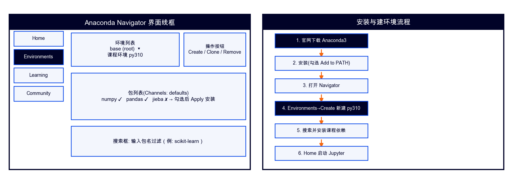

# Anaconda 安装与使用指南（课程版·详细）



> **适用课程**：02-Python编程基础 / 03-Python程序设计（项目实战）/ 05-AI应用基础（48课时版）
> **核心原则**：**每门课用 conda 创建独立环境**——一门课一套依赖互不打架（02的matplotlib不覆盖05的torch）
> **配套指南**：`05-PyCharm使用指南.md`（在 PyCharm 中选择 conda 环境详见本文第六章 + 该指南第三章）

---

## 一、它是什么

Anaconda 是**Python发行版 + 环境管理器**：
- **Python发行版**：自带 Python 3.12+ 和常用科学计算库（numpy/pandas/matplotlib/scikit-learn），装一次不用逐个 pip install
- **环境管理器**：用 `conda create` 创建多个独立环境，每个环境有独立的 Python 版本和包，互不干扰

**为什么所有课程都要用 conda 环境而非 venv**：

| 对比项 | conda 环境 | venv 虚拟环境 |
|---|---|---|
| 创建命令 | `conda create -n 环境名 python=3.12` | `python -m venv 环境名` |
| 激活命令 | `conda activate 环境名` | `source 环境名/bin/activate` |
| 切换环境 | `conda activate 另一个环境`（秒切） | 先 `deactivate` 再激活另一个 |
| 管理包 | `conda install` + `pip install` 都行 | 只能 `pip install` |
| Python版本 | 每个环境可指定不同 Python 版本 | 跟随 base Python |
| GUI管理 | Anaconda Navigator 可视化管理 | 纯命令行 |
| **课程统一口径** | **✅ 所有课程统一用 conda** | ~~不再使用~~ |

> 统一用 conda 的好处：学生只需学一套命令，换课不换工具；教师检查环境只需 `conda env list` 一条命令看到所有课程环境

---

## 二、安装（第1周装机课完成）

### 第1步：下载

1. 打开 https://www.anaconda.com/download
2. 下载对应系统的安装包（Windows 约 500MB，macOS 约 700MB）
3. **国内访问慢**：用清华镜像 https://mirrors.tuna.tsinghua.edu.cn/anaconda/archive/ 选最新版

### 第2步：安装

**Windows**：
1. 双击 `Anaconda3-xxxx.exe` → Next → I Agree
2. 选择 **Just Me**（不需要 All Users）
3. 安装路径**不要有中文和空格**（如 `C:\Users\你的用户名\anaconda3`）
4. **高级选项**（重要）：
   - ✅ 勾选 **Add Anaconda3 to my PATH environment variable**（虽然 installer 不推荐，但课程需要命令行用 conda）
   - ✅ 勾选 **Register Anaconda3 as my default Python**
5. 点击 Install → 等待安装完成（约5-10分钟）

**macOS**：
1. 双击 `.pkg` → 按提示安装
2. 或终端 `brew install --cask anaconda`

### 第3步：验证安装

打开终端（Windows 按 `Win+R` → 输入 `cmd`；macOS 打开 Terminal）：

```
conda --version
```

看到 `conda 25.x.x` = 成功 ✅

> ⚠️ 如果看到 "conda 不是内部命令"：环境变量没配好。手动添加 `anaconda3\Scripts` 和 `anaconda3` 到系统 PATH（见00-总指南第一部分故障排查）

### 第4步：配置镜像加速（国内必做）

```
conda config --add channels https://mirrors.tuna.tsinghua.edu.cn/anaconda/pkgs/main/
conda config --add channels https://mirrors.tuna.tsinghua.edu.cn/anaconda/pkgs/free/
conda config --set show_channel_urls yes
```

pip 镜像（装 Python 包用）：
```
pip config set global.index-url https://pypi.tuna.tsinghua.edu.cn/simple
```

---

## 三、为每门课创建独立环境（第1周装机课完成）

> **核心操作**：每门课创建一个独立的 conda 环境，课程之间包互不干扰

### 第1步：创建环境

**02-Python编程基础**：
```
conda create -n py02 python=3.12 -y
```

**03-Python程序设计（项目实战）**：
```
conda create -n pp03 python=3.12 -y
```

**05-AI应用基础（48课时版）**：
```
conda create -n ai48 python=3.12 -y
```

> 命令格式：`conda create -n 环境名 python=版本号 -y`
> - `-n 环境名`：给环境起名字（建议用课程简称+编号，方便识别）
> - `python=3.12`：指定 Python 版本（三课统一用 3.12（numpy 2.x/scipy 1.18/xgboost 3.x均要求≥3.12））
> - `-y`：自动确认，不用手动按 y

### 第2步：激活环境（切换到课程环境）

```
conda activate py02
```

激活后终端提示符会变成：
```
(py02) C:\Users\你的用户名>
```

> 提示符前面的 `(py02)` 表示当前在 py02 环境——**看到这个括号才说明环境激活了**，之后所有 `pip install` 装的包都在这个环境里

### 第3步：在环境里装课程依赖

激活环境后，cd 到课程包目录，安装依赖：
```
# 02课
conda activate py02
cd "课程包路径/02-程序设计基础"
pip install numpy pandas matplotlib scikit-learn scipy

# 03课
conda activate pp03
cd "课程包路径/03-Python程序设计-项目实战"
pip install numpy pandas matplotlib scikit-learn streamlit plotly sqlalchemy

# 05课
conda activate ai48
cd "课程包路径/05-AI应用基础48课时版"
pip install numpy pandas scikit-learn matplotlib scipy xgboost
pip install torch torchvision --index-url https://download.pytorch.org/whl/cpu
pip install onnxruntime opencv-python notebook
```

> ⚠️ **先激活环境再装包**——如果没激活就 pip install，包装到 base 环境里，切到课程环境后找不到

### 第4步：验证

```
conda activate py02
python -c "import numpy, pandas; print('环境就绪 ✅')"
```

看到 `环境就绪 ✅` = 成功

或用课程包自带自检：
```
conda activate py02
cd "课程包路径/02-程序设计基础"
python check_env.py
```

---

## 四、conda 环境管理命令速查

### 日常操作

| 操作 | 命令 | 说明 |
|---|---|---|
| **创建环境** | `conda create -n 环境名 python=3.12 -y` | 一门课建一个 |
| **激活环境** | `conda activate 环境名` | 切换到指定环境 |
| **退出环境** | `conda deactivate` | 回到 base 环境 |
| **查看所有环境** | `conda env list` | 列出已创建的全部环境（带 *是当前环境） |
| **查看已装包** | `conda list` | 当前环境里装了哪些包 |
| **删除环境** | `conda env remove -n 环境名` | 不用某课环境时清理 |

### 装包命令

| 操作 | 命令 | 何时用 |
|---|---|---|
| conda 装包 | `conda install numpy` | 科学计算库优先用 conda（自动处理依赖） |
| pip 装包 | `pip install pandas` | conda 没有的包或课程专属包用 pip |
| 装指定版本 | `pip install --upgrade torch   # torch 2.14+已兼容numpy 2.x，升级torch而非回退numpy` | 避免新版本不兼容 |
| 从文件批量装 | `pip install -r requirements.txt` | 课程包有 requirements.txt 时 |
| 卸载包 | `pip uninstall 包名` | 装错版本时卸载重装 |

### 环境导出与复现

```
# 导出当前环境的包列表
conda activate py02
pip freeze > requirements.txt

# 在另一台电脑上复现环境
conda create -n py02 python=3.12 -y
conda activate py02
pip install -r requirements.txt
```

> 换电脑/重装系统时，只需 `conda env list` 导出列表 + `pip install -r` 批量重装，不用逐个记包名

---

## 五、Anaconda Navigator（图形界面）

不想敲命令行时，可以用 Anaconda Navigator（装 Anaconda 时自动安装）：

1. 开始菜单 / Launchpad → 打开 **Anaconda Navigator**
2. 左侧 **Environments** → 看到所有环境列表
3. 点环境名旁的 ▶ 三角箭头可以：Open Terminal（打开已激活该环境的终端）/ Open with Jupyter
4. 中间区域可以搜索包名 → 勾选 → Apply 安装

> Navigator 适合不熟悉命令行的学生；命令行 conda 更快，建议学会命令行操作

---

## 六、在 PyCharm 中使用 conda 环境

> PyCharm CE 可以直接选择 conda 环境作为项目解释器，无需手动激活。

### 6.1 新建项目时选 conda 环境

1. PyCharm → **New Project**
2. **Python Interpreter** 下拉 → 选 **Previously configured interpreter**
3. 点 **Add Interpreter** → **Add Local Interpreter**
4. 左侧选 **Conda Environment**
5. **Interpreter** 下拉选已创建的 conda 环境（如 `py02`）
6. 点 **OK** → **Create**

### 6.2 已有项目切换 conda 环境

1. 菜单 **File → Settings**（macOS **PyCharm → Settings**）
2. 左侧 **Project → Python Interpreter**
3. 点齿轮图标 → **Add Interpreter** → **Add Local Interpreter**
4. 左侧选 **Conda Environment** → 选已有环境（如 `pp03`）
5. 点 **OK** → 确认

### 6.3 PyCharm 终端里用 conda

PyCharm 底部 Terminal 默认已激活项目关联的 conda 环境——看提示符是否有 `(py02)` 等环境名。

如果没有自动激活：
1. Settings → Tools → Terminal
2. 确认 **Shell path** 指向 Anaconda 的终端（Windows 用 `cmd.exe`，macOS 用 `/bin/zsh`）
3. 手动激活：`conda activate py02`

### 6.4 确认环境正确

在 PyCharm 底部 Terminal 输入：
```
python -c "import sys; print(sys.executable)"
```

输出的路径应包含 `anaconda3\envs\py02\python.exe`——看到 `envs\py02` 说明用的就是 conda 环境 ✅

> 如果看到的是 `venv\python.exe` 或 `anaconda3\python.exe`（base 环境），说明选错了，按 6.2 重新切换

---

## 七、各课程环境配置对照表

| 课程 | 环境名 | Python版本 | 首次创建时间 | 核心依赖 |
|---|---|---|---|---|
| 02-Python编程基础 | `py02` | 3.10 | W1装机课 | numpy/pandas/matplotlib/scikit-learn/scipy |
| 03-项目实战 | `pp03` | 3.10 | W1 | numpy/pandas/matplotlib/scikit-learn/streamlit/plotly/sqlalchemy |
| 05-AI应用基础48 | `ai48` | 3.10 | W4开课前 | numpy/pandas/scikit-learn/xgboost/torch(CPU)/onnxruntime/opencv |

### 每次课前操作（5分钟）

```
# 1. 激活课程环境
conda activate py02       # 02课 / pp03 / ai48

# 2. 验证环境
python check_env.py

# 3. 如需装本周新包（按完全指南逐周表）
pip install jieba wordcloud
```

### 换课时切换环境

上完02课去05课：
```
conda deactivate          # 退出 py02
conda activate ai48       # 切到 ai48
```

---

## 八、常见问题

### Q1：conda 不是内部命令

环境变量没配好。手动添加以下路径到系统 PATH（Windows）：
- `C:\Users\你的用户名\anaconda3`
- `C:\Users\你的用户名\anaconda3\Scripts`
- `C:\Users\你的用户名\anaconda3\Library\bin`

macOS：在 `~/.zshrc` 末尾加：
```
export PATH="/opt/anaconda3/bin:$PATH"
```
然后 `source ~/.zshrc`。

### Q2：pip 装了包 import 不到

装到别的环境里了。检查：
```
conda env list             # 看当前在哪个环境
conda activate py02        # 确保在正确的环境里
pip install 包名            # 重新装
```

> 看终端提示符括号里的环境名——`(py02)` 才是02课环境

### Q3：numpy 版本冲突（matplotlib 报错）

```
pip install --upgrade torch   # torch 2.14+已兼容numpy 2.x，升级torch而非回退numpy
```

torch 2.14+/matplotlib 3.11+均已兼容 numpy 2.x（2026-09核实，50号轮校准）。

### Q4：torch 安装失败或很慢

用清华镜像 + CPU 版：
```
pip install torch torchvision --index-url https://download.pytorch.org/whl/cpu
```

> 不要装 GPU 版（`+cu118`），机房无 NVIDIA 显卡；CPU 版可跑全部 05 课实训

### Q5：Anaconda 占空间太大

每个 conda 环境约 200-500MB。不用某课环境时清理：
```
conda env remove -n py02
```

查看各环境大小：
```
conda env list
```

### Q6：Navigator 打不开/白屏

用命令行代替：
```
conda activate py02
jupyter notebook
```

### Q7：不同课程环境之间包冲突怎么办

不会冲突——conda 环境是隔离的。02 课的 `py02` 环境和 05 课的 `ai48` 环境各自独立，包版本互不影响。这正是用 conda 而非全局 pip 的好处。

---

## 九、命令速查表

| 操作 | 命令 |
|---|---|
| 创建环境 | `conda create -n 环境名 python=3.12 -y` |
| 激活环境 | `conda activate 环境名` |
| 退出环境 | `conda deactivate` |
| 查看所有环境 | `conda env list` |
| 查看已装包 | `conda list` |
| 装包（conda） | `conda install 包名` |
| 装包（pip） | `pip install 包名` |
| 批量装包 | `pip install -r requirements.txt` |
| 导出环境 | `pip freeze > requirements.txt` |
| 删除环境 | `conda env remove -n 环境名` |
| 验证Python路径 | `python -c "import sys; print(sys.executable)"` |
