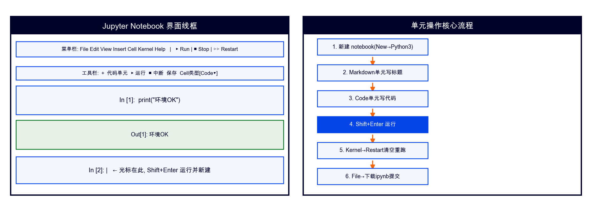

# Jupyter Notebook 使用指南（课程版）

## 一、它是什么
"单元格+即时运行"的交互笔记本：代码/文字/图表同屏——本课程Jupyter实训手册的载体。

## 二、启动
- Anaconda Navigator → Jupyter Notebook → Launch；
- 或终端：`jupyter notebook --notebook-dir=课程包路径`；
- 打开后进入 `Jupyter实训/` 目录，点击任一 `.ipynb`。

## 三、核心操作
| 操作 | 快捷键 |
|------|--------|
| 运行当前单元 | Shift+Enter（运行并下移）/ Ctrl+Enter（原地） |
| 单元转Markdown（写标题） | Esc 后按 M；转代码按 Y |
| 插入单元 | Esc 后按 B（下方）/ A（上方） |
| 删除单元 | Esc 后按 D D |
| 中断死循环 | ■ Stop 或 II |
| 重跑全部 | Kernel → Restart & Run All（提交前必做） |

## 四、本课程工作流（PRIMM）
Predict（在Markdown单元写下你的预测）→ Run（跑示例）→ Investigate（逐行读starter）→ Modify（补TODO）→ Make（独立完成）。首单元已自动定位课程目录，data/fonts路径与桌面版一致。

## 五、提交规范
提交**带输出的ipynb**（等于自带运行证据）：File→Download→.ipynb；归档可 `jupyter nbconvert --to html 文件.ipynb`。

## 六、常见问题
- 运行没反应：看左侧 `In [*]` 星号=执行中；卡死点■；
- 中文图乱码：资料包fonts/ZH_Font.ttf已注册，勿删除该目录；
- 改了代码没生效：忘了重跑上游单元——Restart & Run All。
