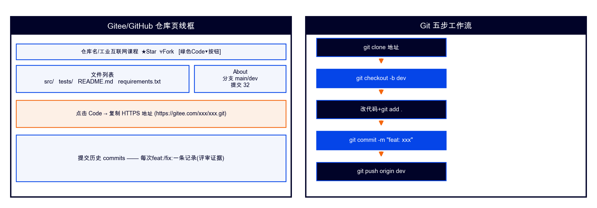

# Git 与 GitHub/Gitee 使用指南（课程版·详细）



> **适用课程**：02-Python编程基础 / 03-Python程序设计（项目实战）/ 05-AI应用基础（48课时版）
> **首选平台**：GitHub（国际通用）；**GitHub 不能正常使用时切换 Gitee**（国内访问快）
> **配套指南**：`05-PyCharm使用指南.md`（PyCharm 内置 Git 操作详见本文第六章 + 该指南第七章）

---

## 一、它是什么

Git 是**版本控制系统**——每一次提交都是一个存档点，可以随时回退到任何历史版本。GitHub/Gitee 是**代码托管平台**——把你的本地仓库同步到云端，教师可以在线审查代码、查看提交历史。

**为什么所有课程都要用**：
- **工单评审以 Git 提交记录为证据**（防搭便车、防抄作业）
- **期末代码审查**：教师看提交历史打"工程素养"分（ABCD 四层评分细则中"代码规范 20%"的直接依据）
- **团队协作**：03 课 P7 智能运维平台用分支+PR 模拟企业开发流
- **代码备份**：电脑坏了/换机，仓库 clone 下来就是全部代码

**GitHub vs Gitee 对照**：

| 对比项 | GitHub | Gitee |
|---|---|---|
| 网址 | https://github.com | https://gitee.com |
| 访问速度 | 国内偶尔慢/不稳定 | 国内快、稳定 |
| 私有仓库 | 免费无限私有仓库 | 免费无限私有仓库 |
| 学生优惠 | Student Pack（用学校邮箱注册） | 学生认证可获额外空间 |
| **何时用** | **首选**（国际通用、企业主流） | GitHub 不能正常使用时切换 |
| 操作差异 | 基本一致（clone/push 命令相同） | 基本一致（密码用私人令牌） |

> **切换策略**：先注册 GitHub 并尝试 `git push`。如果 push 超时或 clone 很慢（>30秒），按本章第十节"切换到 Gitee"操作，两步完成切换。

---

## 二、安装与配置（第1周装机课完成）

### 第1步：安装 Git

**Windows**：
1. 打开 https://git-scm.com/downloads → 点击 "Windows"
2. 下载 `Git-2.xx.x-64-bit.exe` → 双击运行
3. 安装选项**保持默认**（一路 Next 即可），特别注意：
   - "Adjusting your PATH environment" 选 **Git from the command line and also from 3rd-party software**（默认项）
   - "Choosing the default editor" 选 **Use the Notepad++** 或保持默认 Vim
4. 安装完成后关闭安装窗口

**macOS**：
1. 打开终端（Spotlight 搜索 "Terminal"）
2. 输入 `brew install git`（如果没有 brew，先装 Homebrew：https://brew.sh）
3. 或打开 https://git-scm.com/downloads → macOS → 下载 pkg 安装

### 第2步：验证安装

打开终端（Windows 按 `Win+R` → 输入 `cmd` → 回车；macOS 打开 Terminal）：

```
git --version
```

看到 `git version 2.xx.x` = 成功 ✅

### 第3步：配置用户名和邮箱（一次性，全局生效）

```
git config --global user.name "你的名字"
git config --global user.email "你的邮箱@example.com"
```

> ⚠️ 邮箱要与 GitHub/Gitee 注册邮箱一致，这样提交记录才能关联到你的账号

验证配置：
```
git config --global --list
```

看到 `user.name=你的名字` 和 `user.email=你的邮箱` = 成功 ✅

### 第4步：配置默认分支名

```
git config --global init.default branch main
```

> 新版 Git 默认主分支为 main（旧版为 master），统一用 main 保持一致

### 第5步：保存密码（避免每次输入）

**Windows**（使用 Git Credential Manager，安装 Git for Windows 时自动配置）：
```
git config --global credential.helper manager
```

**macOS**：
```
git config --global credential.helper osxkeychain
```

配置后第一次 push 输入密码，之后自动记住。

---

## 三、注册 GitHub 与建仓

### 第1步：注册 GitHub 账号

1. 打开 https://github.com → 点击 **Sign up**
2. 输入邮箱（用学校邮箱可申请 Student Pack 免费获 Pro 优惠）
3. 设置密码和用户名（用户名建议用真实拼音或学号，方便教师认人）
4. 邮箱验证 → 完成注册

### 第2步：创建仓库

1. 登录 GitHub → 右上角 **+** → **New repository**
2. 填写：
   - **Repository name**：如 `py-homework`（02课）或 `pp-projects`（03课）或 `ai48-homework`（05课）
   - **Description**：如 "Python编程基础 12周工单代码"
   - **Public / Private**：选 **Private**（私有，只有教师可见）或 Public（公开）
   - ✅ 勾选 **Add a README file**（初始化仓库）
3. 点击 **Create repository**

### 第3步：获取仓库地址

仓库创建后，点击绿色 **Code** 按钮 → 复制 HTTPS 地址：
```
https://github.com/你的用户名/py-homework.git
```

### 第4步：克隆到本地

打开终端，cd 到课程包目录：
```
cd "你的课程包路径"
git clone https://github.com/你的用户名/py-homework.git
```

看到 `Cloning into 'py-homework'...` → 成功 ✅

> **如果 clone 很慢或超时**：跳到第十节"切换到 Gitee"

---

## 四、五步工作流（背下来）

这是每周每次课的标准操作流程：

```
git clone https://github.com/你/仓库.git    # ① 克隆（只需第一次）
git checkout -b dev                          # ② 建开发分支
...写代码、改文件...
git add .                                    # ③ 暂存全部改动
git commit -m "feat: 完成第N周工单核心功能"  # ④ 提交（带前缀）
git push origin dev                          # ⑤ 推送到云端
```

### 逐步详解

**① 克隆**（只需第一次或换电脑时）：
```
git clone https://github.com/你的用户名/py-homework.git
cd py-homework
```

**② 建开发分支**（每次开工前）：
```
git checkout -b dev
```
> 为什么用分支？main 分支保持可用状态，开发在 dev 分支做。交作业时合并 dev→main。

**③ 暂存**（代码写到阶段性成果时）：
```
git add .
```
> `.` 表示暂存全部改动文件。也可以只暂存某个文件：`git add main.py`

**④ 提交**（写明做了什么）：
```
git commit -m "feat: 完成数据采集模块"
```

**⑤ 推送**（同步到云端）：
```
git push origin dev
```

### 合并到主分支（交作业时）

```
git checkout main          # 切回主分支
git merge dev              # 合并 dev 分支
git push origin main       # 推送主分支
```

或在 GitHub 网页发起 **Pull Request**（dev→main），教师审查后点击 Merge。

---

## 五、commit 前缀规范（必背）

| 前缀 | 含义 | 示例 |
|---|---|---|
| `feat:` | 新功能 | `feat: 完成W3设备类设计` |
| `fix:` | 修 bug | `fix: 修复告警系统阈值判断错误` |
| `docs:` | 文档改动 | `docs: 更新README使用说明` |
| `test:` | 测试代码 | `test: 补充数据清洗单元测试` |
| `refactor:` | 重构（不改功能） | `refactor: 提取公共采集函数` |

> 不写前缀的 commit 会被扣工程素养分（D层≤60分标准要求"跟做完成+达标自评"，不含规范提交）

---

## 六、在 PyCharm 中使用 Git（详细操作）

> PyCharm Community Edition 内置 Git 支持，无需安装插件。以下操作以 PyCharm CE 2025.x 为准。

### 6.1 打开 Git 工具窗口

PyCharm 底部工具栏有一排图标，找到 **Commit** 标签页（或快捷键 `Ctrl+K` / macOS `⌘K`）：

- **左侧栏**：Project 文件树
- **底部栏**：Terminal（终端）、Version Control（版本控制）
- **右侧栏**：Git 标签页（显示分支、提交历史）

如果没有看到底部工具栏：菜单 **View → Tool Windows → Git** 打开。

### 6.2 克隆仓库（File → New from VCS）

1. 启动 PyCharm → 欢迎界面点击 **Get from VCS**（或菜单 File → New → Project from Version Control）
2. URL 栏粘贴仓库地址：`https://github.com/你的用户名/py-homework.git`
3. Directory 选择课程包路径
4. 点击 **Clone**
5. 克隆完成后 PyCharm 自动打开项目

> ⚠️ 如果克隆超时，先在终端用 `git clone` 命令完成克隆，再用 PyCharm 的 **File → Open** 打开克隆下来的目录

### 6.3 创建分支（Git 底部栏）

1. PyCharm 右下角可以看到当前分支名（如 `main`）
2. 点击分支名 → 弹出分支菜单 → 点击 **+ New Branch**
3. 输入分支名 `dev` → 点击 **Create**
4. 右下角分支名变为 `dev` = 成功 ✅

### 6.4 查看改动（文件标色）

修改文件后，文件名会变色提示：

| 颜色 | 含义 |
|---|---|
| **蓝色** | 文件被修改（Modified） |
| **绿色** | 新文件（Added，已暂存） |
| **灰色** | 文件被忽略（.gitignore 排除） |
| **红色** | 新文件但未暂存（Untracked） |

### 6.5 暂存与提交（Ctrl+K / ⌘K）

1. 按 `Ctrl+K`（macOS `⌘K`）打开 **Commit Changes** 对话框
2. 左侧列表勾选要提交的文件（或全选）
3. **Commit Message** 框输入提交信息（带前缀）：
   ```
   feat: 完成W3设备类设计
   ```
4. 点击 **Commit** 按钮

> 💡 PyCharm 会在提交前自动检查代码（如有语法错误会提示），这是比命令行多的一层保护

### 6.6 推送（Ctrl+Shift+K / ⌘⇧K）

1. 按 `Ctrl+Shift+K`（macOS `⌘⇧K`）打开 **Push** 对话框
2. 看到要推送的提交列表 → 点击 **Push**
3. 首次推送会弹出登录框：
   - **GitHub**：输入用户名和密码/Token
   - **Gitee**：输入用户名和私人令牌（不是登录密码）
4. 推送成功后右下角弹出通知 "Push successful"

### 6.7 拉取更新（Ctrl+T / ⌘T）

当云端仓库有更新（如教师反馈修改、队友推送）：

1. 按 `Ctrl+T`（macOS `⌘T`）→ 选择 **Merge**（合并）
2. PyCharm 自动拉取并合并到当前分支
3. 如有冲突，跳到 6.9 节处理

### 6.8 查看提交历史（Git 标签页）

1. 底部 **Git** 标签页 → 左侧选择 **Log**（日志）标签
2. 看到提交历史树状图（每个提交显示：提交信息、作者、时间、哈希）
3. 双击某次提交可以查看该次改动详情（哪些文件改了哪些行）
4. 右键某次提交 → **Checkout Revision** 可以回到那个版本查看

> 教师审查代码时主要看这个提交历史——提交次数太少（整个学期只提交1次）或 commit message 都是"test"会被扣分

### 6.9 解决冲突（PyCharm 三窗合并视图）

当 `git pull` 或 `git merge` 产生冲突时：

1. PyCharm 弹出 **Merge Conflicts** 对话框
2. 选择冲突文件 → 点击 **Merge**
3. 弹出三窗合并视图：
   - **左窗**：你本地的版本（Local changes）
   - **中间**：合并结果（Result）
   - **右窗**：云端/队友的版本（Remote changes）
4. 冲突区域有 `<<<<<<<` / `=======` / `>>>>>>>` 标记
5. 点击左右窗的 **»** / **«** 箭头选择接受哪一边的改动
6. 合并完成后点击 **Apply**
7. 然后 Commit + Push

### 6.10 .gitignore 配置（哪些文件不提交）

项目根目录创建 `.gitignore` 文件（PyCharm 新建项目时会自动生成），内容参考：

```gitignore
# Python
__pycache__/
*.py[cod]
*.egg-info/

# 虚拟环境
venv/
.venv/

# PyCharm
.idea/

# Jupyter
.ipynb_checkpoints/

# 数据文件（大文件不提交）
*.csv
*.xlsx
*.pkl
*.pth

# 系统文件
.DS_Store
Thumbs.db
```

> ⚠️ 如果已经误提交了 venv/，先加 .gitignore 再执行：
> ```
> git rm -r --cached venv
> git commit -m "fix: 移除误提交的venv目录"
> git push
> ```

### 6.11 PyCharm Git 快捷键速查表

| 操作 | Windows | macOS |
|---|---|---|
| 提交（Commit） | Ctrl+K | ⌘K |
| 推送（Push） | Ctrl+Shift+K | ⌘⇧K |
| 拉取（Pull/Update） | Ctrl+T | ⌘T |
| 查看历史 | 底部 Git 标签页 | 底部 Git 标签页 |
| 新建分支 | 右下角分支名→New | 右下角分支名→New |
| 切换分支 | 右下角分支名→选择 | 右下角分支名→选择 |
| 解决冲突 | 弹窗自动提示 | 弹窗自动提示 |

---

## 七、各课程使用场景

### 02-Python编程基础（W1起每周提交）

| 周次 | Git 操作 | 提交内容 |
|---|---|---|
| W1 | clone仓库+建dev分支 | starter代码框架 |
| W2-W3 | add+commit+push | 分支循环告警系统代码 |
| W4-W6 | 每周一次提交 | 设备类/继承/异常处理代码 |
| W7-W8 | 每周一次提交 | 文件处理/数据采集代码 |
| W9-W10 | 每周一次提交 | 故障报告/图像处理代码 |
| W11-W12 | 合并dev→main+push | 综合项目完整代码 |

> 02课 Git 是"每周一提交"习惯养成——每次课的工单代码做完后 add→commit→push，不要求复杂分支操作

### 03-Python程序设计（项目实战）（W2核心周）

| 周次 | Git 操作 | 提交内容 |
|---|---|---|
| W1 | clone+建dev | P1.1 C→Python迁移五题 |
| **W2** | **五步工作流投屏演示** | **P1.2 标准工程模板（Git是核心教学内容）** |
| W3-W4 | 分支开发+PR模拟 | P2 Pandas/NumPy管道 |
| W5 | 每周提交 | P3 KPI仪表盘 |
| W6 | 每周提交 | P4 多源采集系统 |
| W7-W8 | 每周提交+PR审查 | P5 数据仓库/P6 故障诊断模型 |
| W9（选做） | 完整PR流程 | P7 智能运维平台全栈 |

> 03课 Git 是**核心教学内容**（不是工具）——W2 整周就是 Git 与工程模板；每周提交+代码审查是评分细则"代码规范20%"的直接依据

### 05-AI应用基础 48课时版（W4起每周提交）

| 周次 | Git 操作 | 提交内容 |
|---|---|---|
| W4-W5 | clone+建dev+首次提交 | M1 数据清洗/特征工程代码 |
| W6 | 分支提交 | M2 分类/集成/CNN竞标代码 |
| W7-W8 | 每周提交 | M3 ResNet/YOLO代码 |
| W9-W10 | 每周提交 | M4 LLM/RAG代码 |
| W11 | 合并dev→main | M5 多智能体代码 |
| W12 | push主分支 | 综合项目答辩材料 |

> 05课 Git 是"每周一提交"——AI项目代码量较大，养成"阶段性成果立即提交"的习惯（防止调参半天代码丢失）

---

## 八、ABCD 四层评分关联

| 层级 | 达标线 | Git 相关要求 |
|---|---|---|
| **A·师傅** ≥90 | 规范提交+分支管理+解决冲突+费曼讲解提交历史 |
| **B·组长** ≥80 | 规范提交+帮带D/C层同学提交代码 |
| **C·操作员** ≥70 | 完成提交（允许无前缀但必须有message） |
| **D·学徒** ≥60 | 至少完成一次 push（跟做保底） |

> 工单评分细则中"代码规范 20%"= Git 提交规范度；"工程素养 15%"= 提交频率与分支使用

---

## 九、常见问题

### Q1：push 要输入密码，但输了登录密码不对

**GitHub**：2021年起不再支持账号密码，需要用 **Personal Access Token**：
1. GitHub → Settings → Developer settings → Personal access tokens → Generate new token
2. 勾选 `repo` 权限 → 生成 → 复制 Token
3. push 时密码栏粘贴 Token（不是登录密码）

**Gitee**：同样用私人令牌：
1. Gitee → 设置 → 私人令牌 → 新建令牌
2. 勾选 `projects` 权限 → 提交 → 复制令牌
3. push 时密码栏粘贴令牌

### Q2：误提交了 venv/ 或 .idea/ 目录

```
git rm -r --cached venv
git rm -r --cached .idea
git commit -m "fix: 移除误提交的venv和.idea目录"
git push
```

然后确保 `.gitignore` 已包含 `venv/` 和 `.idea/`。

### Q3：冲突 CONFLICT 怎么办

```
git pull origin dev
# Auto-merging file.py
# CONFLICT (content): Merge conflict in file.py
```

打开冲突文件，找到 `<<<<<<<` 标记：
```
<<<<<<< HEAD
你的代码
=======
队友的代码
>>>>>>> origin/dev
```

选择保留哪段（删掉另一段和标记线），然后：
```
git add file.py
git commit -m "fix: 解决file.py合并冲突"
git push
```

> 在 PyCharm 中：用 6.9 节的三窗合并视图操作更直观

### Q4：想撤销最近一次提交（还没push）

```
git reset --soft HEAD~1
```
> `--soft` 保留改动在暂存区；`--hard` 会删掉改动（慎用）

### Q5：push 被拒绝（rejected）

```
git push origin dev
# ! [rejected] dev -> dev (fetch first)
```

说明云端有新提交，先拉取再推送：
```
git pull origin dev
git push origin dev
```

### Q6：clone/push 很慢或超时（GitHub 访问不稳定）

**方案一：切换到 Gitee**（跳到第十节）

**方案二：配置代理**（如果学校有VPN）：
```
git config --global http.proxy http://127.0.0.1:端口号
git config --global https.proxy http://127.0.0.1:端口号
```
取消代理：
```
git config --global --unset http.proxy
git config --global --unset https.proxy
```

---

## 十、GitHub 不能正常使用时切换到 Gitee（两步完成）

### 第1步：注册 Gitee 并建仓库

1. 打开 https://gitee.com → 注册账号
2. 右上角 **+** → **新建仓库**
3. 仓库名与 GitHub 一致（如 `py-homework`）
4. ✅ 勾选 **使用 Readme 文件初始化**
5. 点击 **创建**

### 第2步：修改远程地址

```
# 查看当前远程地址
git remote -v
# origin  https://github.com/你/py-homework.git (fetch)

# 改为 Gitee 地址
git remote set-url origin https://gitee.com/你/py-homework.git

# 验证
git remote -v
# origin  https://gitee.com/你/py-homework.git (fetch)
```

之后所有 `git push` 自动推送到 Gitee。

> **PyCharm 中切换**：菜单 VCS → Git → Remotes → 编辑 origin 的 URL 为 Gitee 地址

### Gitee 私人令牌配置

Gitee push 需要用私人令牌代替密码：
1. Gitee → 设置 → 私人令牌 → 新建令牌
2. 勾选 `projects` 权限 → 提交 → 复制令牌
3. push 时用户名输入 Gitee 用户名，密码粘贴令牌

---

## 十一、.gitignore 模板（三课通用）

> 资料包 `p12` 已含此模板，复制到仓库根目录即可

```gitignore
# ===== Python =====
__pycache__/
*.py[cod]
*$py.class
*.egg-info/
dist/
build/

# ===== 虚拟环境 =====
venv/
.venv/
env/

# ===== IDE =====
.idea/
.vscode/
*.swp

# ===== Jupyter =====
.ipynb_checkpoints/

# ===== 数据文件（大文件不提交）=====
*.csv
*.xlsx
*.json
*.pkl
*.pth
*.pt
*.onnx

# ===== 模型缓存 =====
.cache/

# ===== 系统文件 =====
.DS_Store
Thumbs.db

# ===== 项目专属 =====
*.log
*.silent.mp4
```

---

## 十二、命令速查表

| 操作 | 命令 | PyCharm 快捷键 |
|---|---|---|
| 克隆 | `git clone <url>` | File → New from VCS |
| 建分支 | `git checkout -b dev` | 右下角分支名→New Branch |
| 暂存 | `git add .` | Ctrl+K 勾选文件 |
| 提交 | `git commit -m "msg"` | Ctrl+K → Commit |
| 推送 | `git push origin dev` | Ctrl+Shift+K |
| 拉取 | `git pull origin dev` | Ctrl+T |
| 查看状态 | `git status` | 底部 Git 标签页 |
| 查看历史 | `git log --oneline` | Git 标签页 → Log |
| 合并 | `git merge dev` | Git → Merge |
| 撤销提交 | `git reset --soft HEAD~1` | — |
| 解决冲突 | 编辑冲突文件后 add+commit | 弹窗三窗合并 |
| 切换远程 | `git remote set-url origin <url>` | VCS → Remotes |
