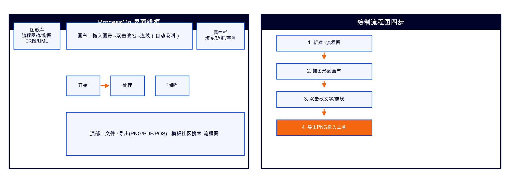

# ProcessOn 在线绘图指南（课程版）

## 一、它是什么
国产免费在线绘图（流程图/架构图/ER图/UML），课程中用于：告警流程图(W02)、继承类图(W05)、系统架构图(W12/P4)。

## 二、四步上手
1. processon.com 注册（免费版10张图足够）；
2. 新建→流程图；3. 左侧图形库拖入画布，双击改名，悬停图形边缘拖出连线（自动吸附）；4. 文件→导出PNG插入工单/PPT。

## 三、课程专属用法
| 周 | 图 | 要点 |
|----|----|------|
| W02 | 两级告警流程图 | 菱形=判断，先危险后预警 |
| W05 | 设备继承类图 | 矩形分三栏(类名/属性/方法)，空心三角=继承 |
| P4/W12 | 系统架构图 | 分层框+箭头标数据流 |

## 四、常见问题
- 连线变折线：右键连线→样式→直线；
- 导出模糊：导出时选2x倍率；
- 打不开：换 draw.io（开源替代）操作同理。
