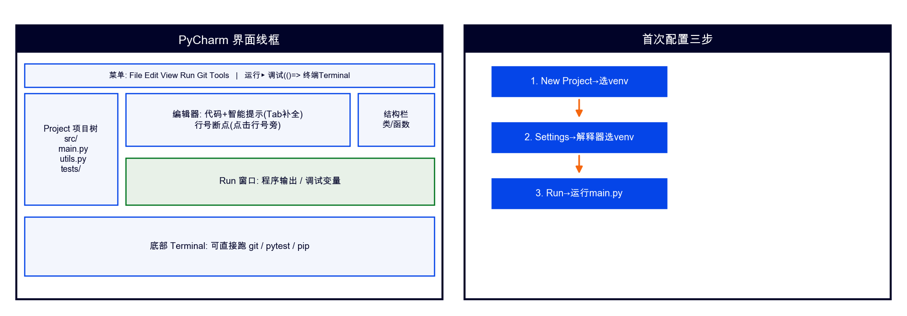

# PyCharm 使用指南（课程版·详细）



> **适用课程**：02-Python编程基础 / 03-Python程序设计（项目实战）/ 05-AI应用基础（48课时版）
> **版本**：PyCharm Community Edition 2025.x（免费开源版，无需注册）
> **配套指南**：`03-Git与GitHub-Gitee使用指南.md`（Git 操作在 PyCharm 中的详细步骤见本文第七章 + 该指南第六章）

## 一、它是什么

专业 Python IDE：智能补全 / 调试 / 内置 Git 版本控制 / 虚拟环境管理。适合中大型工程（《项目实战》首选，《编程基础》全程主编辑器，《AI应用基础》starter 编码）。

**为什么不用 VS Code**：VS Code 需要装扩展才能用 Python，配置较复杂；PyCharm CE 开箱即用，内置 Git/Jupyter/调试，更适合零基础新生。

## 二、安装

### 第1步：下载

1. 打开 https://www.jetbrains.com/pycharm/download/
2. 下载 **Community Edition**（左侧，免费版 — 不要下右侧的 Professional 试用版）
3. **Windows**：下载 `.exe` → 双击运行 → 一路 Next，注意勾选：
   - ✅ **Add launchers dir to the PATH**（加入环境变量）
   - ✅ **.py 关联**（双击 .py 文件用 PyCharm 打开）
4. **macOS**：下载 `.dmg` → 拖入 Applications 文件夹

### 第2步：首次启动

1. 启动 PyCharm → 勾选 "I confirm that I have read..." → Continue
2. 主题选择（Light/Darcula 自选，不影响功能）
3. 跳过插件安装（Default plugins 够用）

## 三、首次配置三步

> 前提：已安装 Anaconda 并用 `conda create -n 环境名 python=3.12` 创建了课程环境（见 `01-Anaconda安装与使用指南.md` 第三章）

### 第1步：新建项目

1. 欢迎界面点击 **New Project**
2. **Location**：选择课程包路径（如 `D:\现代制造\Python编程实战\02-程序设计基础`）
3. **Python Interpreter**：选择 **Previously configured interpreter** → 点 **Add Interpreter** → **Add Local Interpreter**
4. 左侧选 **Conda Environment**
5. **Interpreter** 下拉选已创建的 conda 环境（如 `py02`）
   - 如果下拉没看到 conda 环境：点 **System Interpreter** → 手动指向 `C:\Users\你的用户名\anaconda3\envs\py02\python.exe`（macOS：`/opt/anaconda3/envs/py02/bin/python`）
6. 点击 **OK** → **Create**

> ⚠️ **不要选 "New environment using Virtualenv"**——本课程统一用 conda 环境，不用 venv

> ⚠️ 如果看到 "No Python interpreter" 红色提示：先确认 Anaconda 已装好 → 在终端 `conda env list` 看环境是否创建成功 → 再回到 PyCharm 选

### 第2步：确认解释器

1. 菜单 **File → Settings**（macOS：**PyCharm → Settings**）
2. 左侧 **Project: 项目名 → Python Interpreter**
3. 确认显示的是 conda 环境的 Python（路径含 `anaconda3\envs\py02\python.exe`），不是系统 Python 或 base 环境
4. 如果不对：点齿轮图标 → **Add Interpreter** → **Conda Environment** → 选已有环境

### 第3步：运行第一个文件

1. 在项目树中找到 `main.py`（或任意 .py 文件）
2. 右键 → **Run '文件名'**（或打开文件后点右上角 ▶ 运行按钮）
3. 底部 Run 窗口看到输出 = 成功 ✅

### 第4步：验证 conda 环境

PyCharm 底部 Terminal 输入：
```
python -c "import sys; print(sys.executable)"
```

输出路径含 `envs\py02` = conda 环境生效 ✅

## 四、调试三板斧

### 断点

点击行号右侧的空白处 → 出现**红点**（断点）。程序运行到这里会暂停。

### 调试

点右上角 🐛 **Debug 图标**（或 Shift+F9）启动调试。程序在断点处暂停。

### 看变量

- 底部 **Debugger** 面板显示当前所有变量值
- **Step Over (F8)**：逐行执行（不进函数内部）
- **Step Into (F7)**：进入函数内部
- **Step Out (Shift+F8)**：跳出当前函数
- **Resume (F9)**：继续到下一个断点

> 调试是排查 bug 的核心技能——比 print() 更直观，可以逐行看变量变化

## 五、Jupyter Notebook 在 PyCharm 中

PyCharm CE 支持打开和编辑 `.ipynb` 文件（需安装 Jupyter 插件）：

1. 打开任意 `.ipynb` 文件 → PyCharm 提示安装 Jupyter 插件 → 点 **Install Plugin**
2. 选择解释器为课程 conda 环境（如 `py02`）
3. 每个 Cell 可以单独运行（Ctrl+Enter 运行当前 Cell / Shift+Enter 运行并跳到下一个）

> 05-AI 课全程用 Jupyter 实训；02/03 课部分周次用 Jupyter 做数据探索

## 六、常用快捷键速查表

| 操作 | Windows | macOS |
|---|---|---|
| 运行 | Shift+F10 | ^R |
| 调试 | Shift+F9 | ^D |
| 智能补全 | Ctrl+Space | ^Space |
| 格式化代码 | Ctrl+Alt+L | ⌘⌥L |
| 查找 | Ctrl+F | ⌘F |
| 全局查找 | Ctrl+Shift+F | ⌘⇧F |
| 重命名 | Shift+F6 | ⇧F6 |
| 注释/取消注释 | Ctrl+/ | ⌘/ |
| 复制行 | Ctrl+D | ⌘D |
| 删除行 | Ctrl+Y | ⌘⌫ |

## 七、在 PyCharm 中使用 Git（详细）

> PyCharm CE 内置 Git 支持，无需安装插件。以下操作以 2025.x 版为准（以官网最新为准）。
> 完整的 Git 操作指南见 `03-Git与GitHub-Gitee使用指南.md`，此处聚焦 PyCharm 中的操作细节。

### 7.1 克隆仓库

1. 启动 PyCharm → 欢迎界面点击 **Get from VCS**（或菜单 File → New → Project from Version Control）
2. URL 栏粘贴仓库地址：`https://github.com/你的用户名/py-homework.git`
3. Directory 选择课程包路径
4. 点击 **Clone** → 克隆完成后自动打开项目

> ⚠️ 克隆超时？先在终端用 `git clone` 命令完成，再用 File → Open 打开克隆目录

### 7.2 提交代码（Ctrl+K / ⌘K）

1. 按 `Ctrl+K`（macOS `⌘K`）打开 **Commit Changes** 对话框
2. 左侧列表勾选要提交的文件
3. **Commit Message** 输入提交信息（带前缀 `feat:`/`fix:`/`docs:` 等）
4. 点击 **Commit**

> 💡 PyCharm 会在提交前自动检查代码（语法错误会提示），比命令行多一层保护

### 7.3 推送代码（Ctrl+Shift+K / ⌘⇧K）

1. 按 `Ctrl+Shift+K`（macOS `⌘⇧K`）打开 **Push** 对话框
2. 看到要推送的提交列表 → 点击 **Push**
3. 首次推送弹出登录框：
   - GitHub：输入用户名和 Personal Access Token（不是登录密码）
   - Gitee：输入用户名和私人令牌
4. 推送成功后右下角弹出 "Push successful" ✅

### 7.4 拉取更新（Ctrl+T / ⌘T）

1. 按 `Ctrl+T`（macOS `⌘T`）→ 选择 **Merge**
2. PyCharm 自动拉取并合并

### 7.5 分支管理

- **右下角**显示当前分支名（如 `main` 或 `dev`）
- 点击分支名 → 弹出分支菜单：
  - **+ New Branch**：新建分支
  - 选择已有分支切换
  - **Delete**：删除分支

### 7.6 查看提交历史

底部 **Git** 标签页 → **Log** 子标签：
- 树状图显示所有提交（提交信息、作者、时间、哈希）
- 双击某次提交查看该次改动详情
- 右键提交 → **Checkout Revision** 回到那个版本

> 教师审查代码时主要看提交历史——提交次数太少或 message 都是 "test" 会被扣分

### 7.7 解决冲突（三窗合并视图）

当 pull/merge 产生冲突时：
1. PyCharm 弹出 **Merge Conflicts** 对话框
2. 选择冲突文件 → 点击 **Merge**
3. 三窗合并视图：
   - **左窗**：你本地的版本
   - **中间**：合并结果
   - **右窗**：云端/队友的版本
4. 点击左右窗的 **»** / **«** 箭头选择接受哪一边
5. 合并完成 → **Apply** → Commit + Push

### 7.8 Git 快捷键速查

| 操作 | Windows | macOS |
|---|---|---|
| 提交 | Ctrl+K | ⌘K |
| 推送 | Ctrl+Shift+K | ⌘⇧K |
| 拉取 | Ctrl+T | ⌘T |
| 查看历史 | 底部 Git 标签页 | 底部 Git 标签页 |
| 新建分支 | 右下角分支名→New | 右下角分支名→New |

## 八、常见问题

- **解释器标红**：删掉 `.idea` 文件夹重新打开项目（File → Open → 重新选目录）
- **运行灰色**：没配置运行目标——右键文件 → Run
- **太卡**：关掉多余插件（Settings → Plugins），或轻量场景用 Jupyter
- **commit 按钮灰色**：没有改动或改动未暂存——先按 Ctrl+K 勾选文件
- **push 报 403/401**：GitHub 不再支持密码，需用 Personal Access Token（见 `03-Git与GitHub-Gitee使用指南.md` 第九节Q1）
- **push 报 rejected**：云端有新提交，先 Ctrl+T 拉取更新再推送
