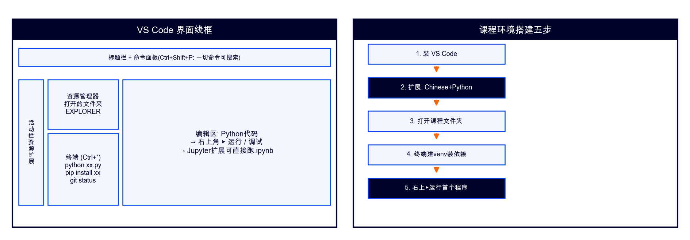

# VS Code 使用指南（课程版·轻量首选）

## 一、它是什么

微软开源轻量编辑器：装上Python扩展≈小型IDE；**三课程默认编辑器**。

## 二、五步上手
1. code.visualstudio.com 下载安装；
2. 扩展(Ctrl+Shift+X)：装 Chinese(中文) + Python(ms-python)；
3. 文件→打开文件夹→选课程包；
4. 终端(Ctrl+`)：`python -m venv venv` 建环境并 `pip install -r requirements.txt`（选解释器：Ctrl+Shift+P→Python: Select Interpreter→venv）；
5. 打开任一.py→右上▶运行。

## 三、高频快捷键
| 键 | 功能 |
|----|------|
| Ctrl+` | 开关终端 |
| Ctrl+P | 快速打开文件 |
| Ctrl+Shift+P | 命令面板 |
| Alt+↑/↓ | 整行上下移 |
| Ctrl+/ | 注释切换 |

## 四、Jupyter扩展
装Python扩展后直接点开.ipynb即可运行（等同Notebook）——机房无Anaconda时的备选路径。

## 五、常见问题
- 运行用了系统Python：Ctrl+Shift+P→Select Interpreter→选venv；
- 终端中文乱码：设置搜 terminal.integrated.profiles 按系统配置；
- Pylance报一堆波浪线：先跑一遍代码，真错误看终端。
