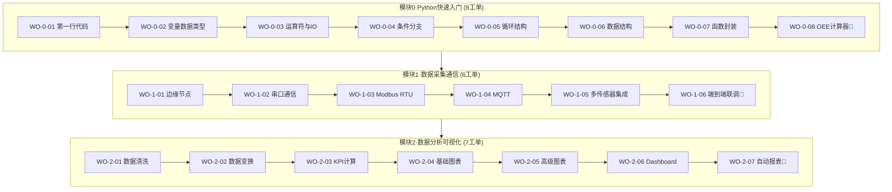
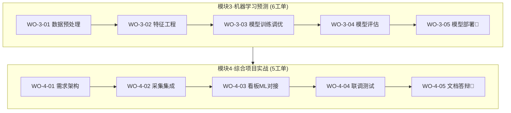
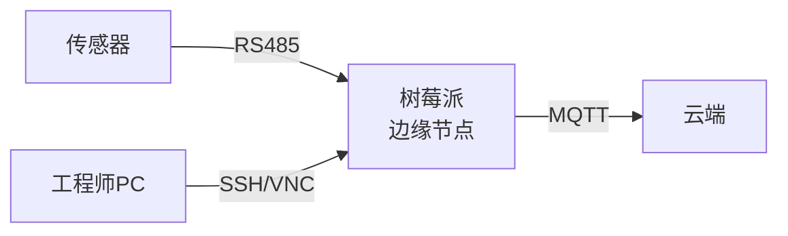
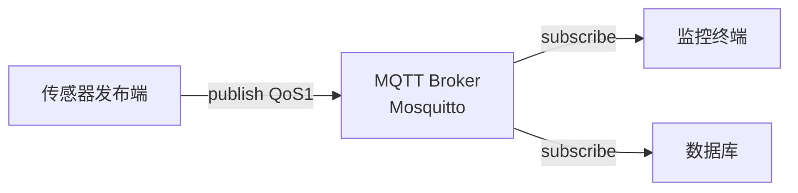
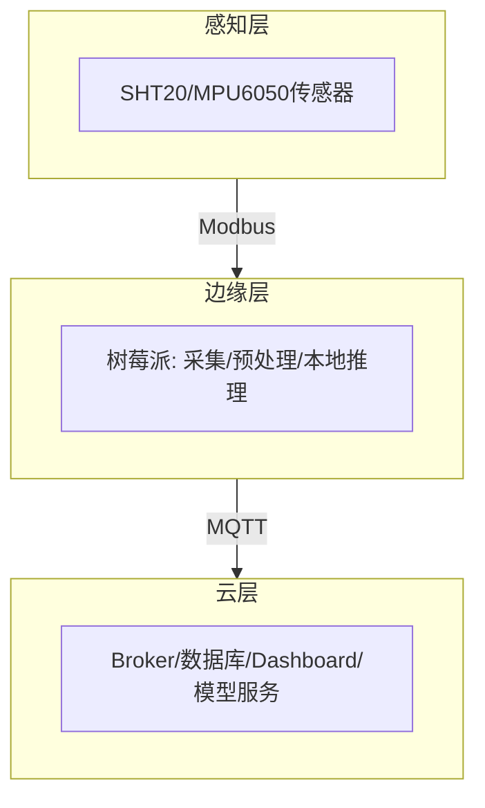

# 《Python工业互联网应用实战案例集》
## ——32工单·64课时·大一新生版

**主编：** 宫宇伟　　**配套课程：** Python编程基础（64课时）

---

## 案例集导航地图





---
---

# 模块0　Python快速入门（8工单）

---

## 🔹 WO-0-01　零基础第一行代码

| 要素 | 内容 |
|---|---|
| **学时/难度** | 1学时 / ★☆☆☆☆ |
| **任务场景** | 新入职工程师快速搭建Python开发环境，运行第一个程序验证工具链 |
| **知识点** | Anaconda、Jupyter Notebook、print()、Kernel运行机制 |
| **技能点** | 环境安装、Jupyter操作 |
| **素质点** | 破除零基础壁垒，建立编程自信 |

```python
# 【D/C层】第一行代码
print("Hello, Industrial IoT!")
print(3 + 5, 10 * 2, 100 / 7)
# 【A层】f-string输出设备状态
device = "CNC-001"; temp = 65.5
print(f"设备{device} 当前温度{temp}℃")
```

**✅ 检查验收：** 环境启动□ 代码无报错□ 输出正确□
**📦 交付物：** .ipynb + 环境配置截图

---

## 🔹 WO-0-02　变量与数据类型

| 要素 | 内容 |
|---|---|
| **学时/难度** | 1学时 / ★☆☆☆☆ |
| **任务场景** | 录入设备ID、温度、运行状态等基础信息 |
| **知识点** | int/float/str/bool、type()、类型转换、f-string、PEP8命名 |
| **技能点** | 变量定义、类型转换 |
| **素质点** | 代码规范即工匠品质 |

```python
device_id = "CNC-001"     # str
temperature = 65.5        # float
run_hours = 128           # int
is_running = True         # bool
print(type(device_id), type(temperature))
# 类型转换
temp_str = str(temperature)
print(f"设备{device_id} 温度{temperature}℃ 运行{run_hours}h")
```

**✅ 检查验收：** 四类型正确□ 转换无误□ 命名规范□
**📦 交付物：** 设备信息录入脚本

---

## 🔹 WO-0-03　运算符与人机交互

| 要素 | 内容 |
|---|---|
| **学时/难度** | 1学时 / ★★☆☆☆ |
| **任务场景** | 交互式录入温度并计算温差、判断是否超限 |
| **知识点** | 算术/比较/逻辑/赋值运算符、优先级、input()、print() |
| **技能点** | 运算符运用、人机交互 |
| **素质点** | 严谨的输入校验意识 |

```python
temp = float(input("请输入当前温度℃: "))  # input返回str需转换
standard = 70
diff = temp - standard
is_over = temp > standard
print(f"温差={diff}℃, 是否超限: {is_over}")
# 逻辑运算符组合
print("需要报警" if temp > 85 or temp < 0 else "正常范围")
```

**✅ 检查验收：** 运算符正确□ input转换□ 逻辑判断□
**📦 交付物：** 交互式温差计算脚本

---

## 🔹 WO-0-04　条件分支决策

| 要素 | 内容 |
|---|---|
| **学时/难度** | 1学时 / ★★☆☆☆ |
| **任务场景** | 根据温度自动判断设备"正常/预警/故障"三档状态 |
| **知识点** | if/elif/else、缩进规则、比较与逻辑运算、嵌套条件 |
| **技能点** | 条件分支编写、边界处理 |
| **素质点** | "一次做对"的边界思维 |

```python
def check_status(temp, humidity=50):
    # 【A层】异常输入校验
    if temp < -20 or temp > 200:
        return "传感器异常"
    if temp > 85 or humidity > 90:
        return "故障"
    elif temp >= 70:            # 边界70℃归入预警(闭区间)
        return "预警"
    return "正常"

for t in [65, 70, 85, 88]:
    print(f"温度{t}℃ → {check_status(t)}")
```

**✅ 检查验收：** 三档判断□ 边界值正确□ 异常处理□
**📦 交付物：** 设备状态判断脚本

---

## 🔹 WO-0-05　循环与批量处理

| 要素 | 内容 |
|---|---|
| **学时/难度** | 1学时 / ★★☆☆☆ |
| **任务场景** | 批量遍历多台设备温度，累计统计与异常计数 |
| **知识点** | for/range、while、break/continue、循环嵌套 |
| **技能点** | 循环批处理、流程控制 |
| **素质点** | 批量自动化处理意识 |

```python
temps = [65.5, 88.0, 72.3, 91.2, 68.0]
total, fault_count = 0, 0
for i, t in enumerate(temps):
    total += t
    if t > 85:
        fault_count += 1
        print(f"设备{i+1} 温度{t}℃ 超限!")
        continue
print(f"平均温度{total/len(temps):.1f}℃, 故障{fault_count}台")
```

**✅ 检查验收：** 遍历完整□ break/continue正确□ 统计准确□
**📦 交付物：** 多设备批量统计脚本

---

## 🔹 WO-0-06　内置数据结构

| 要素 | 内容 |
|---|---|
| **学时/难度** | 1学时 / ★★☆☆☆ |
| **任务场景** | 组织多台设备的ID、类型、温度、状态等结构化数据 |
| **知识点** | list/dict/tuple特性、增删改查、推导式、.get()安全访问 |
| **技能点** | 数据结构选型、推导式 |
| **素质点** | 工作过程导向的数据组织思维 |

```python
devices = [
    {"id": "CNC-001", "temp": 65.5, "status": "正常"},
    {"id": "CNC-002", "temp": 88.0, "status": "故障"},
]
sensor_cfg = ("Modbus", 9600, 8, 1)   # tuple不可变配置
for d in devices:
    print(f"{d['id']}: {d.get('temp')}℃ - {d['status']}")
# 推导式筛选高温设备
high_temp = [d["id"] for d in devices if d["temp"] > 70]
print("高温设备:", high_temp)
```

**✅ 检查验收：** 结构选型合理□ 增删改查□ 推导式正确□
**📦 交付物：** 数据结构操作脚本

---

## 🔹 WO-0-07　函数封装与模块化

| 要素 | 内容 |
|---|---|
| **学时/难度** | 1学时 / ★★★☆☆ |
| **任务场景** | 将重复的状态判断逻辑封装为可复用函数与模块 |
| **知识点** | 函数定义、参数、返回值、默认参数、import、单一职责 |
| **技能点** | 函数封装、模块化 |
| **素质点** | 模块化工程思维 |

```python
# device_utils.py
def check_status(temp, warn=70, fault=85):
    if temp > fault: return "故障"
    elif temp >= warn: return "预警"
    return "正常"

def format_report(device_id, temp):
    return f"[报告] {device_id} {temp}℃ 状态:{check_status(temp)}"

# main.py
from device_utils import format_report
print(format_report("CNC-001", 78.5))
```

**✅ 检查验收：** 函数定义□ 模块导入□ 默认参数□
**📦 交付物：** 函数模块 + 调用测试脚本

---

## 🔹 WO-0-08　综合实战：OEE计算器　🏁 M0

| 要素 | 内容 |
|---|---|
| **学时/难度** | 2学时 / ★★★☆☆ |
| **任务场景** | 开发OEE计算器，输入可用性/性能/质量，批量计算并分级评价 |
| **知识点** | OEE=A×P×Q、输入验证、边界处理、函数综合 |
| **技能点** | 综合编程、异常处理 |
| **素质点** | 精益生产、工匠精神 |

```python
def calculate_oee(a, p, q):
    for v in (a, p, q):
        if not (0 <= v <= 1):
            raise ValueError("比率须在0-1之间")
    oee = a * p * q
    level = "世界级" if oee >= 0.85 else "良好" if oee >= 0.60 else "待改进"
    return round(oee*100, 2), level

data = [{"id":"CNC-001","A":0.90,"P":0.95,"Q":0.99},
        {"id":"INJ-001","A":0.80,"P":0.85,"Q":0.92}]
for d in data:
    oee, lv = calculate_oee(d["A"], d["P"], d["Q"])
    print(f"{d['id']}: OEE={oee}% ({lv})")
```

**✅ 检查验收：** OEE公式□ 批量处理□ 异常捕获□ 分级正确□
**📦 交付物：** OEE脚本 + 测试数据集 + Jupyter笔记本 **（里程碑M0）**

---
---

# 模块1　数据采集与工业通信（6工单）

---

## 🔹 WO-1-01　边缘节点搭建与串口通信基础

| 要素 | 内容 |
|---|---|
| **学时/难度** | 1学时 / ★★★☆☆ |
| **任务场景** | 将树莓派配置为边缘采集节点 |
| **知识点** | OSI模型、现场总线层次、OS烧录、SSH/VNC |
| **技能点** | 树莓派配置、远程连接 |
| **素质点** | IT/OT融合使命、电气安全 |

**🔧 边缘节点架构：**


**✅ 检查验收：** SSH/VNC连接□ 环境搭建□
**📦 交付物：** 树莓派配置截图

---

## 🔹 WO-1-02　PySerial串口通信

| 要素 | 内容 |
|---|---|
| **学时/难度** | 1学时 / ★★★☆☆ |
| **任务场景** | 通过USB-TTL实现PC与树莓派双向串口通信 |
| **知识点** | 波特率/数据位/停止位/校验位、串口设备号 |
| **技能点** | 串口通信编程 |
| **素质点** | 参数匹配的严谨意识 |

```python
import serial
ser = serial.Serial(port='/dev/ttyUSB0', baudrate=9600,
                    bytesize=8, stopbits=1, parity='N', timeout=1)
ser.write(b'Hello Device\n')
data = ser.readline()
print("收到:", data.decode('utf-8', errors='ignore'))
ser.close()
```

**✅ 检查验收：** 参数一致□ 双向收发□
**📦 交付物：** 串口通信脚本 + 验证截图

---

## 🔹 WO-1-03　Modbus RTU协议与温湿度采集

| 要素 | 内容 |
|---|---|
| **学时/难度** | 1学时 / ★★★★☆ |
| **任务场景** | 通过Modbus RTU读取SHT20温湿度传感器寄存器 |
| **知识点** | Modbus帧结构、FC03、CRC校验、大端序解析 |
| **技能点** | Modbus帧解析、物理量换算 |
| **素质点** | 协议规范意识 |

**📡 Modbus RTU帧结构：**

| 从机地址 | 功能码 | 寄存器地址 | 寄存器数量 | CRC校验 |
|---|---|---|---|---|
| 1 Byte | 1 Byte(0x03) | 2 Byte | 2 Byte | 2 Byte |

```python
import minimalmodbus
instr = minimalmodbus.Instrument('/dev/ttyUSB0', 1)
instr.serial.baudrate = 9600
temp = instr.read_register(1, 1, functioncode=3)     # 温度
humidity = instr.read_register(2, 1, functioncode=3) # 湿度
print(f"温度:{temp}℃ 湿度:{humidity}%RH")
```

**✅ 检查验收：** 帧构建□ 大端解析□ 物理量合理□
**📦 交付物：** Modbus采集脚本 + 解析日志

---

## 🔹 WO-1-04　MQTT Broker与发布订阅

| 要素 | 内容 |
|---|---|
| **学时/难度** | 1学时 / ★★★☆☆ |
| **任务场景** | 搭建MQTT中间件，设计Topic实现数据发布订阅 |
| **知识点** | 发布/订阅模型、QoS 0/1/2、Topic分层、通配符、LWT |
| **技能点** | Mosquitto部署、paho-mqtt编程 |
| **素质点** | 工业数据安全意识 |

**📨 MQTT发布订阅模型：**


```python
import paho.mqtt.client as mqtt
import json, time
client = mqtt.Client("sensor_pub")
client.connect("localhost", 1883)
payload = json.dumps({"device":"CNC-001","temp":65.5,"timestamp":time.time()})
client.publish("factory/workshop1/CNC-001/temp", payload, qos=1)
```

**✅ 检查验收：** Broker运行□ 发布订阅互通□ QoS1□
**📦 交付物：** MQTT发布/订阅脚本 + Broker配置截图

---

## 🔹 WO-1-05　多传感器采集集成

| 要素 | 内容 |
|---|---|
| **学时/难度** | 1学时 / ★★★★☆ |
| **任务场景** | 整合温湿度/光照/CO₂多传感器，多线程并行采集发布 |
| **知识点** | 模块整合、threading多线程、JSON Payload规范 |
| **技能点** | 多模块集成、多线程并行 |
| **素质点** | 统一数据规范习惯 |

```python
import threading, json, time
import paho.mqtt.client as mqtt
client = mqtt.Client("multi"); client.connect("localhost", 1883)
def collect(name, topic, read_func):
    while True:
        payload = json.dumps({"sensor":name,"value":read_func(),
                              "timestamp":time.time()})
        client.publish(topic, payload, qos=1)
        time.sleep(1)
sensors = [("temp","f/temp",lambda:65.5),("co2","f/co2",lambda:420)]
for n,t,f in sensors:
    threading.Thread(target=collect, args=(n,t,f), daemon=True).start()
```

**✅ 检查验收：** 三模块集成□ 多传感器□ 多线程□ JSON规范□
**📦 交付物：** 集成采集脚本 + 多传感器日志

---

## 🔹 WO-1-06　数据上云端到端联调　🏁 M1

| 要素 | 内容 |
|---|---|
| **学时/难度** | 2学时 / ★★★★☆ |
| **任务场景** | 打通全链路，实现断线重连等健壮性，验证延迟≤100ms |
| **知识点** | 端-边-云数据流、断线重连、超时重试、数据校验 |
| **技能点** | 全链路联调、健壮性编程 |
| **素质点** | 全链路质量意识 |

**🔗 端-边-云全链路：**


```python
def on_disconnect(client, userdata, rc):
    if rc != 0:
        while True:
            try: client.reconnect(); break
            except: time.sleep(2)
client = mqtt.Client("gateway")
client.on_disconnect = on_disconnect
client.reconnect_delay_set(min_delay=1, max_delay=30)
```

**✅ 检查验收：** 全链路贯通□ 延迟≤100ms□ 断线重连□ 无丢包□
**📦 交付物：** 端到端脚本 + 测试报告 + 架构图 **（里程碑M1）**

---
---

# 模块2　数据分析与可视化（7工单）

---

## 🔹 WO-2-01　工业数据集导入与清洗

| 要素 | 内容 |
|---|---|
| **学时/难度** | 1学时 / ★★★☆☆ |
| **任务场景** | 清洗注塑机日志CSV（含缺失值、异常值） |
| **知识点** | read_csv、ffill填充、3σ法则、类型转换 |
| **技能点** | 数据清洗三板斧 |
| **素质点** | "先清洗后分析"习惯 |

```python
import pandas as pd
df = pd.read_csv("injection_log.csv", parse_dates=["timestamp"])
df["temperature"] = df["temperature"].ffill()        # 前向填充
mean, std = df["temperature"].mean(), df["temperature"].std()
df = df[(df["temperature"] > mean-3*std) & (df["temperature"] < mean+3*std)]
print(df.describe())
```

**✅ 检查验收：** 导入成功□ ffill填充□ 3σ过滤□
**📦 交付物：** 清洗脚本 + 前后对比报告

------

## 🔹 WO-2-02　数据变换与GroupBy分组

| 要素          | 内容                                                       |
| ------------- | ---------------------------------------------------------- |
| **学时/难度** | 1学时 / ★★★☆☆                                              |
| **任务场景**  | 按产线/班次/时间维度对清洗后数据分组聚合与重采样           |
| **知识点**    | 标准化、时间索引、GroupBy、resample、rolling、跨夜班次处理 |
| **技能点**    | 分组聚合、时间序列变换                                     |
| **素质点**    | 多维数据组织思维                                           |

```python
import pandas as pd
df = df.set_index("timestamp")
# 按产线分组统计
line_stats = df.groupby("line_id")["output"].agg(["mean", "sum", "count"])
# 每小时重采样
hourly = df["output"].resample("1H").sum()
# 滚动窗口(5点移动平均)
df["temp_ma5"] = df["temperature"].rolling(window=5).mean()
# 【A层】跨夜班次(22:00-06:00)日期归属修正
df["shift_date"] = (df.index - pd.Timedelta(hours=6)).date
print(line_stats)
```

**✅ 检查验收：** GroupBy聚合□ resample重采样□ rolling窗口□ 跨夜处理□ **📦 交付物：** 数据变换与分组聚合脚本

------

## 🔹 WO-2-03　工业KPI指标计算

| 要素          | 内容                                            |
| ------------- | ----------------------------------------------- |
| **学时/难度** | 1学时 / ★★★☆☆                                   |
| **任务场景**  | 按产线/班次计算OEE、MTBF、MTTR、良品率等多维KPI |
| **知识点**    | OEE、MTBF、MTTR、良品率公式、多维分组统计       |
| **技能点**    | KPI计算、汇总表输出                             |
| **素质点**    | "让数据创造价值"意识                            |

**📊 核心KPI公式：**

| 指标   | 公式                | 世界级基准 |
| ------ | ------------------- | ---------- |
| OEE    | 可用性×性能×质量    | ≥85%       |
| MTBF   | 总运行时间÷故障次数 | 越大越好   |
| MTTR   | 总维修时间÷维修次数 | 越小越好   |
| 良品率 | 良品数÷总产量       | ≥99%       |

```python
def calc_kpi(group):
    availability = group["run_time"].sum() / group["planned_time"].sum()
    performance = group["actual_output"].sum() / group["ideal_output"].sum()
    quality = group["good_parts"].sum() / group["total_parts"].sum()
    return pd.Series({
        "OEE": round(availability*performance*quality*100, 2),
        "MTBF": round(group["run_time"].sum()/group["fault_count"].sum(), 2),
        "良品率": round(quality*100, 2)
    })
kpi_table = df.groupby(["line_id", "shift"]).apply(calc_kpi)
print(kpi_table)
```

**✅ 检查验收：** OEE计算□ MTBF/MTTR□ 良品率□ 汇总表□ **📦 交付物：** KPI计算脚本 + 统计汇总表

------

## 🔹 WO-2-04　Pyecharts基础工业图表

| 要素          | 内容                                              |
| ------------- | ------------------------------------------------- |
| **学时/难度** | 1学时 / ★★★☆☆                                     |
| **任务场景**  | 绘制OEE趋势折线图与产线对比柱状图                 |
| **知识点**    | Line折线图、Bar柱状图、交通灯配色、markline目标线 |
| **技能点**    | 图表开发、配色规范                                |
| **素质点**    | 看板设计规范意识                                  |

```python
from pyecharts.charts import Line, Bar
from pyecharts import options as opts
# OEE趋势折线图 + 85%目标线
line = (Line()
    .add_xaxis(["周一","周二","周三","周四","周五"])
    .add_yaxis("OEE", [82, 78, 85, 88, 80],
        markline_opts=opts.MarkLineOpts(
            data=[opts.MarkLineItem(y=85, name="世界级目标")]))
    .set_global_opts(title_opts=opts.TitleOpts(title="OEE周趋势")))
line.render("oee_trend.html")
```

**✅ 检查验收：** 折线图□ 柱状图□ 交通灯配色□ 目标线□ **📦 交付物：** 折线图+柱状图HTML

------

## 🔹 WO-2-05　高级工业图表

| 要素          | 内容                                           |
| ------------- | ---------------------------------------------- |
| **学时/难度** | 1学时 / ★★★★☆                                  |
| **任务场景**  | 开发实时KPI仪表盘与设备状态热力图              |
| **知识点**    | Gauge仪表盘、HeatMap热力图、分段配色、多图布局 |
| **技能点**    | 高级图表开发                                   |
| **素质点**    | 数据可视化审美                                 |

```python
from pyecharts.charts import Gauge, HeatMap
from pyecharts import options as opts
gauge = (Gauge()
    .add("OEE", [("设备综合效率", 82)],
        axisline_opts=opts.AxisLineOpts(
            linestyle_opts=opts.LineStyleOpts(
                color=[(0.6,"#f00"),(0.8,"#ff0"),(1,"#0f0")], width=30)))
    .set_global_opts(title_opts=opts.TitleOpts(title="实时OEE仪表盘")))
gauge.render("gauge.html")
```

**✅ 检查验收：** 仪表盘分段配色□ 热力图矩阵□ 布局合理□ **📦 交付物：** 仪表盘+热力图HTML

------

## 🔹 WO-2-06　厂级监控Dashboard集成

| 要素          | 内容                                             |
| ------------- | ------------------------------------------------ |
| **学时/难度** | 1学时 / ★★★★☆                                    |
| **任务场景**  | 将多图表集成为厂级监控大屏，实现实时刷新         |
| **知识点**    | Page组件、页面布局、MQTT订阅→缓存→渲染→Flask推送 |
| **技能点**    | Dashboard集成、实时刷新                          |
| **素质点**    | "3秒规则"看板理念                                |

**🖥️ 实时刷新链路：**


```
from pyecharts.charts import Page
page = Page(layout=Page.SimplePageLayout)
page.add(line, bar, gauge, heatmap)   # 整合多图表
page.render("dashboard.html")
```

**✅ 检查验收：** 多图集成□ 布局美观□ 实时刷新□ **📦 交付物：** 集成Dashboard HTML + 刷新配置

------

## 🔹 WO-2-07　自动化报表与数据洞察　🏁 M2

| 要素          | 内容                                          |
| ------------- | --------------------------------------------- |
| **学时/难度** | 2学时 / ★★★☆☆                                 |
| **任务场景**  | 生成含图表的Excel周报并邮件推送，撰写洞察报告 |
| **知识点**    | OpenPyXL、图表嵌入、SMTP邮件、定时任务        |
| **技能点**    | 自动报表、邮件推送、洞察分析                  |
| **素质点**    | 绿色智造、碳达峰碳中和                        |

```python
import openpyxl
from openpyxl.chart import LineChart, Reference
wb = openpyxl.Workbook(); ws = wb.active
ws.append(["日期","OEE","产量","良品率"])
for row in weekly_data: ws.append(row)
chart = LineChart(); chart.title = "OEE周趋势"
chart.add_data(Reference(ws, min_col=2, min_row=1, max_row=8),
               titles_from_data=True)
ws.add_chart(chart, "F2")
wb.save("weekly_report.xlsx")
# 【A层】SMTP邮件推送(见完整工单)
```

**✅ 检查验收：** Excel图表□ 邮件推送□ 洞察报告□ **📦 交付物：** 报表脚本 + 周报样本 + 数据洞察报告 **（里程碑M2）**

------

------

# 模块3　机器学习与预测维护（6工单）

------

## 🔹 WO-3-01　工业数据集探索与预处理

| 要素          | 内容                                                         |
| ------------- | ------------------------------------------------------------ |
| **学时/难度** | 1学时 / ★★★☆☆                                                |
| **任务场景**  | 探索CWRU轴承故障数据集并完成预处理                           |
| **知识点**    | 数据探索、LabelEncoder、StandardScaler、train_test_split(stratify) |
| **技能点**    | 数据预处理全流程                                             |
| **素质点**    | 数据质量校核严谨性                                           |

```python
import pandas as pd
from sklearn.preprocessing import StandardScaler, LabelEncoder
from sklearn.model_selection import train_test_split
df = pd.read_csv("cwru_bearing.csv")
print(df.info(), df["fault_type"].value_counts())
le = LabelEncoder()
df["label"] = le.fit_transform(df["fault_type"])
X = StandardScaler().fit_transform(df.drop(["fault_type","label"], axis=1))
X_train, X_test, y_train, y_test = train_test_split(
    X, df["label"], test_size=0.2, stratify=df["label"], random_state=42)
```

**✅ 检查验收：** 数据探索□ 标签编码□ 归一化□ 分层划分□ **📦 交付物：** 预处理脚本 + 数据质量报告

------

## 🔹 WO-3-02　时频域特征提取

| 要素          | 内容                                 |
| ------------- | ------------------------------------ |
| **学时/难度** | 1学时 / ★★★★☆                        |
| **任务场景**  | 从振动信号提取10维时频域特征并可视化 |
| **知识点**    | 时域6维、频域4维、FFT、峰度敏感性    |
| **技能点**    | 特征工程、FFT频谱分析                |
| **素质点**    | "特征决定模型上限"认知               |

**🔬 特征维度表：**

| 类别    | 特征                                     |
| ------- | ---------------------------------------- |
| 时域(6) | 均值/标准差/峰值/峰度/波峰因子/均方根    |
| 频域(4) | FFT主频/频率中心/均方频率/故障频带能量比 |

```python
import numpy as np
from scipy.stats import kurtosis
from scipy.fft import fft
def time_features(sig):
    return {"mean":np.mean(sig), "std":np.std(sig),
            "peak":np.max(np.abs(sig)), "kurtosis":kurtosis(sig),  # 早期故障敏感
            "rms":np.sqrt(np.mean(sig**2)),
            "crest":np.max(np.abs(sig))/np.sqrt(np.mean(sig**2))}
def freq_features(sig, fs=12000):
    n=len(sig); fv=np.abs(fft(sig))[:n//2]
    fr=np.fft.fftfreq(n,1/fs)[:n//2]
    return {"main_freq":fr[np.argmax(fv)],
            "freq_center":np.sum(fr*fv)/np.sum(fv)}
```

**✅ 检查验收：** 时域6维□ 频域4维□ 可视化□ **📦 交付物：** 特征提取模块 + 可视化图表

------

## 🔹 WO-3-03　SVM/随机森林训练与调优

| 要素          | 内容                                         |
| ------------- | -------------------------------------------- |
| **学时/难度** | 1学时 / ★★★★☆                                |
| **任务场景**  | 训练两类故障分类模型并网格搜索调优           |
| **知识点**    | SVM、随机森林、GridSearchCV、StratifiedKFold |
| **技能点**    | 模型训练、超参数调优                         |
| **素质点**    | "用数据说话"科学态度                         |

```python
from sklearn.svm import SVC
from sklearn.ensemble import RandomForestClassifier
from sklearn.model_selection import GridSearchCV, StratifiedKFold
cv = StratifiedKFold(n_splits=5)
rf_grid = GridSearchCV(RandomForestClassifier(random_state=42),
    {"n_estimators":[50,100,200], "max_depth":[10,20,None]},
    cv=cv, scoring="f1_weighted", n_jobs=-1)
rf_grid.fit(X_train, y_train)
print("RF最优:", rf_grid.best_params_, rf_grid.best_score_)
```

**✅ 检查验收：** 双模型□ 网格搜索□ 5折交叉验证□ 最优记录□ **📦 交付物：** 训练脚本 + 最优参数记录

------

## 🔹 WO-3-04　模型评估与对比分析

| 要素          | 内容                                    |
| ------------- | --------------------------------------- |
| **学时/难度** | 1学时 / ★★★☆☆                           |
| **任务场景**  | 评估对比两模型性能，为选型提供依据      |
| **知识点**    | 混淆矩阵、精确率/召回率/F1、ROC、加权F1 |
| **技能点**    | 模型评估、多维对比                      |
| **素质点**    | "宁可误报勿漏报"安全意识                |

```python
from sklearn.metrics import classification_report, confusion_matrix
from sklearn.metrics import ConfusionMatrixDisplay, f1_score
import matplotlib.pyplot as plt
y_pred = rf_grid.best_estimator_.predict(X_test)
print(classification_report(y_test, y_pred))
ConfusionMatrixDisplay(confusion_matrix(y_test, y_pred)).plot()
plt.savefig("confusion_matrix.png")
print(f"RF加权F1={f1_score(y_test, y_pred, average='weighted'):.3f}")
```

**✅ 检查验收：** 混淆矩阵□ 各指标□ 加权F1≥0.88□ 对比报告□ **📦 交付物：** 评估图表 + 模型对比报告

------

## 🔹 WO-3-05　模型持久化与推理服务部署　🏁 M3

| 要素          | 内容                                          |
| ------------- | --------------------------------------------- |
| **学时/难度** | 2学时 / ★★★★☆                                 |
| **任务场景**  | 将最优模型部署为Flask推理服务供实时诊断       |
| **知识点**    | joblib序列化、版本号命名、Flask API、响应优化 |
| **技能点**    | 模型持久化、API部署                           |
| **素质点**    | 算法到工程的落地交付                          |

```python
import joblib
from flask import Flask, request, jsonify
joblib.dump(rf_grid.best_estimator_, "rf_v1.2.pkl")
app = Flask(__name__)
model = joblib.load("rf_v1.2.pkl")
@app.route("/predict", methods=["POST"])
def predict():
    try:
        X = [request.json["features"]]
        pred = int(model.predict(X)[0])
        proba = round(float(model.predict_proba(X).max()), 3)
        return jsonify({"fault_type": pred, "confidence": proba})
    except Exception as e:
        return jsonify({"error": str(e)}), 400
app.run(host="0.0.0.0", port=5000)
```

**✅ 检查验收：** .pkl生成□ API返回□ 响应≤100ms□ 异常处理□ **📦 交付物：** 模型.pkl + Flask推理服务 + API测试截图 **（里程碑M3）**

------

------

# 模块4　综合项目实战与答辩（5工单）

------

## 🔹 WO-4-01　需求分析与系统架构设计

| 要素          | 内容                                       |
| ------------- | ------------------------------------------ |
| **学时/难度** | 2学时 / ★★★★☆                              |
| **任务场景**  | 组建项目组，完成AIoT系统需求分析与架构设计 |
| **知识点**    | 端-边-云架构、技术选型、架构四原则、WBS    |
| **技能点**    | 需求分析、架构设计                         |
| **素质点**    | "安全第一"设计责任、工业互联网战略认知     |

**🏗️ 端-边-云三层架构：**



**✅ 检查验收：** 需求清单□ 架构图三层□ 技术选型□ WBS□ **📦 交付物：** 需求规格说明书 + 架构图 + WBS甘特图

------

## 🔹 WO-4-02　数据采集与通信模块集成

| 要素          | 内容                                                 |
| ------------- | ---------------------------------------------------- |
| **学时/难度** | 2学时 / ★★★★☆                                        |
| **任务场景**  | 复用模块1组件构建项目采集管道并抓包验证              |
| **知识点**    | Modbus采集、MQTT发布、JSON schema、抓包验证、Git协作 |
| **技能点**    | 模块集成、数据管道构建                               |
| **素质点**    | 模块化协作工程习惯                                   |

```python
import json, time, minimalmodbus
import paho.mqtt.client as mqtt
instr = minimalmodbus.Instrument('/dev/ttyUSB0', 1)
instr.serial.baudrate = 9600
client = mqtt.Client("project_collector")
client.connect("cloud-broker", 1883)
while True:
    temp = instr.read_register(1, 1, functioncode=3)
    client.publish("project/line01/temp",
        json.dumps({"device":"LINE-01","temp":temp,"timestamp":time.time()}),
        qos=1)
    time.sleep(1)
```

**✅ 检查验收：** Modbus采集□ MQTT发布□ 抓包验证□ Git提交□ **📦 交付物：** 采集脚本 + Broker配置 + 抓包截图

------

## 🔹 WO-4-03　数据分析看板与ML模型对接

| 要素          | 内容                                                  |
| ------------- | ----------------------------------------------------- |
| **学时/难度** | 2学时 / ★★★★☆                                         |
| **任务场景**  | 集成采集、看板与故障预测模型实现在线诊断报警          |
| **知识点**    | Pandas管道、Pyecharts看板、模型调用、阈值报警、松耦合 |
| **技能点**    | 系统集成、ML对接                                      |
| **素质点**    | 复合工程能力                                          |

```python
import requests, json
import paho.mqtt.client as mqtt
def on_message(client, userdata, msg):
    data = json.loads(msg.payload)
    resp = requests.post("http://localhost:5000/predict",
                         json={"features": data["features"]}).json()
    if resp.get("fault_type", 0) != 0:
        print(f"⚠️报警: {data['device']} 故障类型{resp['fault_type']} "
              f"置信度{resp['confidence']}")
sub = mqtt.Client("diagnosis")
sub.on_message = on_message
sub.connect("cloud-broker", 1883)
sub.subscribe("project/+/features", qos=1)
sub.loop_forever()
```

**✅ 检查验收：** 数据管道□ Dashboard□ 模型报警□ 全链路贯通□ **📦 交付物：** Dashboard截图 + 推理脚本 + 报警日志

------

## 🔹 WO-4-04　系统联调、测试与优化

| 要素          | 内容                                          |
| ------------- | --------------------------------------------- |
| **学时/难度** | 2学时 / ★★★★☆                                 |
| **任务场景**  | 端到端全链路测试、性能优化与Bug修复           |
| **知识点**    | 端到端测试、压力测试、延迟/丢包统计、性能优化 |
| **技能点**    | 系统测试、性能调优                            |
| **素质点**    | 工程交付闭环质量意识                          |

**📋 测试指标表：**

| 指标       | 目标值 | 实测值 |
| ---------- | ------ | ------ |
| 端到端延迟 | ≤100ms | ___    |
| 丢包率     | <0.1%  | ___    |
| 并发量     | ≥100路 | ___    |
| API响应    | ≤100ms | ___    |

**✅ 检查验收：** 端到端测试□ 性能达标□ 压力测试□ Bug修复□ **📦 交付物：** 系统测试报告 + 优化方案 + Bug修复记录

------

## 🔹 WO-4-05　技术文档撰写与项目路演答辩　🏁 M4

| 要素          | 内容                                               |
| ------------- | -------------------------------------------------- |
| **学时/难度** | 2学时 / ★★★★★                                      |
| **任务场景**  | 汇总技术文档，制作路演材料，面向校企评审团答辩交付 |
| **知识点**    | SDS/API文档/运维手册、路演PPT、Demo视频、答辩技巧  |
| **技能点**    | 文档编写、路演表达、答辩应变                       |
| **素质点**    | 工匠精神、团队协作、职业荣誉感                     |

**🎤 路演逻辑框架：**


**📊 答辩Rubric评分量表：**

| 评审项     | 权重 |
| ---------- | ---- |
| 功能完整性 | 30%  |
| 技术难度   | 25%  |
| 文档规范   | 20%  |
| 答辩表现   | 15%  |
| 创新性     | 10%  |

**ABCD分工：** A项目经理主讲架构与难点 / B演示Demo / C编写文档录视频 / D整理测试素材

**✅ 检查验收：** 文档包完整□ PPT+Demo□ 答辩表现□ 源码提交□ **📦 交付物：** 技术文档包(SDS/API/运维手册) + 路演PPT + Demo视频 + Git源码 + KSA能力自评表 **（里程碑M4）**

------

------

## 【附录】32工单交付物与里程碑总览

| 工单     | 名称         | 学时   | 核心交付物          | 里程碑      |
| -------- | ------------ | ------ | ------------------- | ----------- |
| WO-0-01  | 第一行代码   | 1      | .ipynb+环境截图     |             |
| WO-0-02  | 变量数据类型 | 1      | 信息录入脚本        |             |
| WO-0-03  | 运算符与IO   | 1      | 温差计算脚本        |             |
| WO-0-04  | 条件分支     | 1      | 状态判断脚本        |             |
| WO-0-05  | 循环结构     | 1      | 批量统计脚本        |             |
| WO-0-06  | 数据结构     | 1      | 数据结构脚本        |             |
| WO-0-07  | 函数封装     | 1      | 函数模块            |             |
| WO-0-08  | OEE计算器    | 2      | OEE脚本+笔记本      | **M0**      |
| WO-1-01  | 边缘节点     | 1      | 树莓派配置截图      |             |
| WO-1-02  | 串口通信     | 1      | 串口脚本            |             |
| WO-1-03  | Modbus RTU   | 1      | Modbus脚本+日志     |             |
| WO-1-04  | MQTT         | 1      | MQTT脚本+配置       |             |
| WO-1-05  | 多传感器集成 | 1      | 集成采集脚本        |             |
| WO-1-06  | 端到端联调   | 2      | 测试报告+架构图     | **M1**      |
| WO-2-01  | 数据清洗     | 1      | 清洗脚本+报告       |             |
| WO-2-02  | 数据变换     | 1      | 变换聚合脚本        |             |
| WO-2-03  | KPI计算      | 1      | KPI脚本+汇总表      |             |
| WO-2-04  | 基础图表     | 1      | 折线+柱状HTML       |             |
| WO-2-05  | 高级图表     | 1      | 仪表盘+热力图HTML   |             |
| WO-2-06  | Dashboard    | 1      | 集成看板HTML        |             |
| WO-2-07  | 自动报表     | 2      | 报表脚本+洞察报告   | **M2**      |
| WO-3-01  | 数据预处理   | 1      | 预处理脚本+质量报告 |             |
| WO-3-02  | 特征工程     | 1      | 特征模块+图表       |             |
| WO-3-03  | 模型训练调优 | 1      | 训练脚本+参数记录   |             |
| WO-3-04  | 模型评估     | 1      | 评估图表+报告       |             |
| WO-3-05  | 模型部署     | 2      | .pkl+推理API        | **M3**      |
| WO-4-01  | 需求架构     | 2      | 需求书+架构图       |             |
| WO-4-02  | 采集集成     | 2      | 采集脚本+抓包       |             |
| WO-4-03  | 看板ML对接   | 2      | 看板+报警日志       |             |
| WO-4-04  | 联调测试     | 2      | 测试报告+优化方案   |             |
| WO-4-05  | 文档答辩     | 2      | 文档包+PPT+源码     | **M4**      |
| **合计** | **32工单**   | **64** |                     | **5里程碑** |

------

*《Python工业互联网应用实战案例集》（32工单·64课时·大一新生版）全部编制完毕。本案例集配合《课程标准》与《授课计划表》使用，实行ABCD分层任务与双元制六步教学法，对接1+X《工业互联网数据采集与边缘计算》职业技能等级证书。*

**主编：** 宫宇伟　　**审核：** 工业互联网教研室
---

## JupyterHub 平台功能更新 (2026-09-04)

> **所有新功能已同步到此文件。以下为 JupyterHub 平台最新功能概要。**

### 访问方式
- **URL**: `https://10.167.2.175:31825/ide/`
- **密码**: `ide2026`（所有账户共享）

### 账户体系
| 账户 | 类型 | 对应课程 |
|------|------|----------|
| `teacher-zhang` | 管理员+总教师 | 全部8个Notebook |
| `Lecture-P1` | 管理员+章节教师 | P1.1 Python基础 + P1.2 标准Python工程 |
| `Lecture-P2` | 管理员+章节教师 | P2.1 Pandas数据处理 + P2.2 NumPy故障特征 |
| `Lecture-P3` | 管理员+章节教师 | P3 产线KPI仪表盘 |
| `Lecture-P4` | 管理员+章节教师 | P4.1 多源数据采集系统 |
| `Lecture-P5` | 管理员+章节教师 | P5 产线数据仓库与ORM |
| `Lecture-P6` | 管理员+章节教师 | P6 故障诊断模型与部署 |
| `student-python` | 学生 | Python 工业遥测分析项目 |
| `student-java` | 学生 | Java MES 生产管理系统 |
| `student-go` | 学生 | Go 工业网关项目 |
| `student-rust` | 学生 | Rust 安全审计项目 |

### AI 功能
- **jupyter-ai 聊天**: 登录后直接使用（左侧栏AI面板，无需配置）
- **LLM模型**: qwen2.5-coder:7b (Ollama CPU推理, 响应6-21秒)
- **内联补全**: LSP+pylsp 弹窗补全 + AI FIM缓存

### 代码评分系统
- **评分维度**: PEP8(20%) + 测试通过率(40%) + 查重(20%) + AI率(20%)
- **运行**: `python3 /home/jovyan/work/code_grader.py`
- **等级**: A(≥90) / B(80-89) / C(70-79) / D(60-69) / F(<60)

### 测试结果
- **功能测试**: 13/13 通过 (100%)
- **50并发用户**: 100% 成功, 24.5秒
- **LLM Chat**: PASS (21秒)
- **Notebook执行**: PASS (1.4秒)

### 管理面板
- **URL**: `https://10.167.2.175:31825/ide/hub/admin`
- **功能**: 查看用户/服务器状态、启动/停止服务器、作业发布与检查

---

## 19. 多语言代码审查系统 (v2.1 新增)

### 支持语言与工具

| 语言 | 工具 | 检查内容 |
|------|------|----------|
| Python | pycodestyle + pyflakes | PEP8 规范、语法错误 |
| Java | Checkstyle / javac | 代码规范、编译错误 |
| Go | gofmt + go vet | 格式化、静态分析 |
| Rust | cargo clippy + rustfmt | 代码质量、格式化 |
| C/C++ | cppcheck | 内存泄漏、未初始化变量 |
| JavaScript | node --check | 语法错误 |

### 使用方式

```bash
# 单文件审查
python3 code_review.py src/main.py

# 目录审查（自动检测语言，递归所有源文件）
python3 code_review.py /home/jovyan/work/industrial-analytics/src/
python3 code_review.py /home/jovyan/work/mes-system/production-service/src/
python3 code_review.py /home/jovyan/work/industrial-gateway/
python3 code_review.py /home/jovyan/work/security-audit/
```

### 输出格式（JSON）

```json
{
  "language": "Python",
  "tool": "pycodestyle",
  "issues": ["src/main.py:10:1: E302 expected 2 blank lines"],
  "score": 85
}
```

### 评分规则

| 语言 | 每个问题扣分 | 满分 |
|------|-------------|------|
| Python | 100/总行数 | 100 |
| Java | 5分/问题 | 100 |
| Go | 10分/问题 | 100 |
| Rust | 5分/问题 | 100 |
| C/C++ | 5分/问题 | 100 |

---

## 20. 指南分发规则 (v2.1 新增)

| 用户类型 | 教师版指南 | 学生版指南 | 评分系统 | AI助手 |
|----------|-----------|-----------|----------|--------|
| teacher-zhang | ✅ | ✅ | ✅ | ✅ |
| Lecture-* (16个) | ✅ | ✅ | ✅ | ✅ |
| 学生（任何注册） | ❌ | ✅ | ✅ | ✅ |

---

## 21. CockroachDB K8s 部署确认 (v2.1 新增)

### 部署方式

CockroachDB 已从裸金属迁移到 K8s Pod 部署：

| 项目 | 旧（裸金属） | 新（K8s Pod） |
|------|-------------|--------------|
| 二进制路径 | /opt/cockroach/cockroach | /cockroach-binary/cockroach（容器内） |
| 数据路径 | /home/crdb-data/a | /cockroach/cockroach-data（hostPath） |
| systemd | cockroach-node1/2.service | StatefulSet |
| systemd 状态 | — | disabled + inactive (dead) |
| 管理方式 | systemctl | kubectl / Rancher |
| 网络模式 | 宿主机直接 | hostNetwork: true |

> **说明**：由于使用 `hostNetwork: true`，Pod 进程在宿主机 `ps aux` 中可见，
> 但实际运行在容器内（二进制路径为 `/cockroach-binary/`，非 `/opt/cockroach/`）。
> 旧 systemd 服务已 disable + stopped。

### 局域网连接（读写分离）

| 用途 | 地址 | 端口 |
|------|------|------|
| 写连接 | 10.167.2.175 | 26257 |
| 读连接 | 10.167.2.175 | 26267 |
| NodePort 写 | 10.167.2.175 | 30257 |
| NodePort 读 | 10.167.2.175 | 30267 |
| 管理界面 | http://10.167.2.175 | 30259 |
| K8s 内写 | cockroachdb.infra.svc | 26257 |
| K8s 内读 | cockroachdb-read.infra.svc | 26267 |

---

## 22. 多教师同课程+班级关联体系 (v2.2 新增)

### 体系架构

```
teacher-zhang (总管理员)
├── 02-程序设计基础
│   ├── teacher-b1-01 → class-b1-01-A, class-b1-01-B
│   ├── teacher-b2-01 → class-b2-01-A
│   ├── teacher-b3-01 → class-b3-01-A
│   ├── teacher-b4-01 → class-b4-01-A
│   ├── teacher-b5-01 → class-b5-01-A
│   └── teacher-b6-01 → class-b6-01-A
├── 01-AI应用基础
│   ├── teacher-a1-01 → class-a1-01-A, class-a1-01-B
│   ├── teacher-a2-01 → class-a2-01-A
│   ├── teacher-a3-01 → class-a3-01-A
│   └── teacher-a4-01 → class-a4-01-A
└── 03-Python项目实战
    ├── teacher-p1-01 → class-p1-01-A, class-p1-01-B
    ├── teacher-p2-01 → class-p2-01-A
    ├── teacher-p3-01 → class-p3-01-A
    ├── teacher-p4-01 → class-p4-01-A
    ├── teacher-p5-01 → class-p5-01-A
    └── teacher-p6-01 → class-p6-01-A
```

### 同一课程多个教师

同一课程可以有多位教师同时授课，每位教师管理自己的班级：

| 课程 | 教师 | 负责班级 | 可管理学生 |
|------|------|----------|-----------|
| B1 (设备初始化) | teacher-b1-01 | class-b1-01-A, class-b1-01-B | A班+B班学生 |
| B1 (设备初始化) | teacher-b1-02 (新增) | class-b1-02-A | 新教师A班学生 |

> 教师使用 `https://10.167.2.175:31825/ide/hub/admin` 管理面板查看自己班级的学生。

### 学生登录格式

学生用户名格式: `{课程}-{班级}-{学号}`

| 格式 | 含义 | 关联教师 |
|------|------|----------|
| `b1-A-01` | 程序设计基础 B1 A班 01号 | teacher-b1-01 |
| `b1-B-05` | 程序设计基础 B1 B班 05号 | teacher-b1-01 |
| `a1-A-03` | AI应用基础 A1 A班 03号 | teacher-a1-01 |
| `p1-B-10` | Python项目实战 P1 B班 10号 | teacher-p1-01 |

### 教师管理学生流程

1. 教师登录 (`teacher-b1-01`, 密码 `ide2026`)
2. 访问管理面板: `https://10.167.2.175:31825/ide/hub/admin`
3. 查看自己班级的学生服务器状态
4. 启动/停止学生服务器
5. 使用 `code_grader.py` 评分学生代码

### 新增教师流程

1. 总管理员 `teacher-zhang` 在终端创建新教师:
   ```bash
   # 新教师登录即可自动创建 (密码 ide2026)
   # 然后在 hub pod 中将其加入对应课程组和班级组
   ```

2. 将新教师加入课程教师组和班级组（示例）:
   ```bash
   kubectl exec -n jupyterhub <hub-pod> -c jupyterhub -- python3 -c "
   import sqlite3
   conn = sqlite3.connect('/srv/jupyterhub/jupyterhub.sqlite')
   c = conn.cursor()
   # 创建教师
   c.execute('INSERT INTO users (name, admin) VALUES (?, 1)', ('teacher-b1-02',))
   # 加入课程教师组
   c.execute('SELECT id FROM groups WHERE name="course-b-teachers"')
   gid = c.fetchone()
   c.execute('SELECT id FROM users WHERE name="teacher-b1-02"')
   uid = c.fetchone()
   c.execute('INSERT INTO users_groups VALUES (?, ?)', (uid[0], gid[0]))
   # 创建新班级组
   c.execute('INSERT INTO groups (name) VALUES (?)', ('class-b1-02-A',))
   # 加入班级组
   c.execute('SELECT id FROM groups WHERE name="class-b1-02-A"')
   cg = c.fetchone()
   c.execute('INSERT INTO users_groups VALUES (?, ?)', (uid[0], cg[0]))
   conn.commit()
   "
   ```


---

## 23. OAuth 400 修复 + 测试报告 (v2.3)

### OAuth 400 修复
- 根因: Hub重启导致OAuth客户端丢失
- 修复: 清除stale oauth codes + 重新登录
- 验证: teacher-zhang登录成功

### 数据保留
- PVC Bound | 76 Notebook | 8 Code | 双指南 | 评分系统
- 结论: 零数据丢失

### LLM测试
- master: 59s | teacher pod: 28s | qwen2.5-coder:7b
- 瓶颈: CPU-only推理

### CRDB测试
- 3节点 Running | 27+数据库 | 读写分离

### 资源优化
- milvus/nebula/pulsar stopped | Worker CPU 79% -> 57%


---

## 24. nbgrader 原生作业系统 (v2.4 新增)

### 概述

JupyterHub 已安装 **nbgrader 0.9.5**，提供原生的作业分发、收集、自动评分和反馈功能，替代了之前的手动 code_grader.py。

### 教师操作流程

```bash
cd ~/work/nbgrader

# 1. 创建作业（在 source/ 目录下创建 Notebook）
#    在 JupyterLab 中使用 nbgrader 工具栏标记单元格类型:
#    - 答案区（Solution）: 学生需要填写的代码
#    - 测试区（Test）: assert 断言（自动评分用）
#    - 只读区（Read-only）: 题目描述

# 2. 生成学生版（自动去除解决方案）
python3 -m nbgrader generate_assignment ps1

# 3. 发布作业到 exchange
python3 -m nbgrader release_assignment ps1

# 4. 查看已发布的作业
python3 -m nbgrader list

# 5. 学生提交后，自动评分
python3 -m nbgrader autograde ps1

# 6. 生成反馈
python3 -m nbgrader generate_feedback ps1
python3 -m nbgrader release_feedback ps1

# 7. 导出成绩 CSV
python3 -m nbgrader export
```

### 学生操作流程

```bash
cd ~/work/nbgrader

# 1. 查看可用作业
python3 -m nbgrader list

# 2. 获取作业
python3 -m nbgrader fetch ps1

# 3. 完成作业后提交
python3 -m nbgrader submit ps1
```

### nbgrader 元数据要求

每个 nbgrader 单元格需要完整的 v3 元数据:
- `grade`: True/False（是否评分）
- `solution`: True/False（是否答案区）
- `task`: False
- `locked`: True/False（是否锁定）
- `points`: 浮点数（分值）
- `grade_id`: 唯一标识符
- `schema_version`: 3
- `cell_type`: "code"

### Exchange 目录

| 路径 | 说明 |
|------|------|
| `~/work/nbgrader/exchange/` | 共享交换目录 |
| `exchange/default/outbound/` | 教师发布的作业 |
| `exchange/default/inbound/` | 学生提交的作业 |

---

## 25. 多教师多课程账户体系 (v2.4 完整版)

### 完整对照表

```
teacher-zhang (总管理员, 密码: ide2026)
├── 02-程序设计基础
│   ├── Lecture-B1~B6 (原始管理员)
│   ├── teacher-b1-01 → class-b1-01-A, class-b1-01-B
│   ├── teacher-b2-01 → class-b2-01-A
│   ├── teacher-b3-01 → class-b3-01-A
│   ├── teacher-b4-01 → class-b4-01-A
│   ├── teacher-b5-01 → class-b5-01-A
│   └── teacher-b6-01 → class-b6-01-A
├── 01-AI应用基础
│   ├── Lecture-A1~A4
│   ├── teacher-a1-01 → class-a1-01-A, class-a1-01-B
│   ├── teacher-a2-01 → class-a2-01-A
│   ├── teacher-a3-01 → class-a3-01-A
│   └── teacher-a4-01 → class-a4-01-A
└── 03-Python项目实战
    ├── Lecture-P1~P6
    ├── teacher-p1-01 → class-p1-01-A, class-p1-01-B
    ├── teacher-p2-01 → class-p2-01-A
    ├── teacher-p3-01 → class-p3-01-A
    ├── teacher-p4-01 → class-p4-01-A
    ├── teacher-p5-01 → class-p5-01-A
    └── teacher-p6-01 → class-p6-01-A
```

### 学生登录格式

| 格式 | 含义 | 关联教师 |
|------|------|----------|
| `b1-A-01` | 程序设计基础 B1 A班 01号 | teacher-b1-01 |
| `a1-B-03` | AI应用基础 A1 B班 03号 | teacher-a1-01 |
| `p1-A-05` | Python项目实战 P1 A班 05号 | teacher-p1-01 |

### 账户总计

- 33 个教师/管理员账户
- 43 个分组
- 56 个 Notebook
- 28 个代码框架
- 3 门课程
