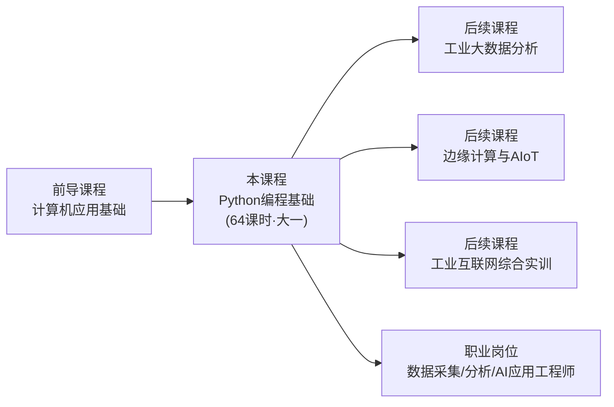
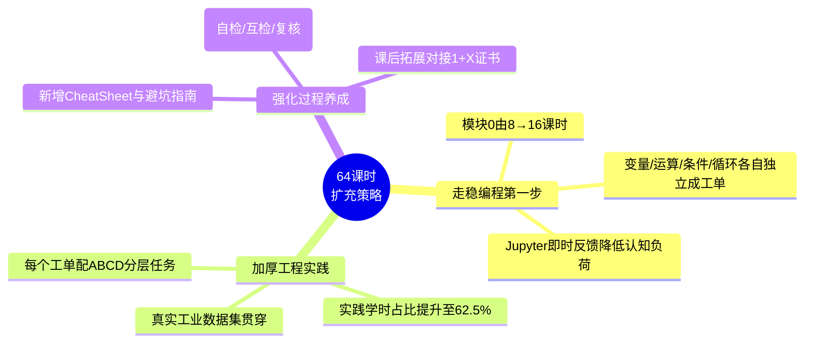
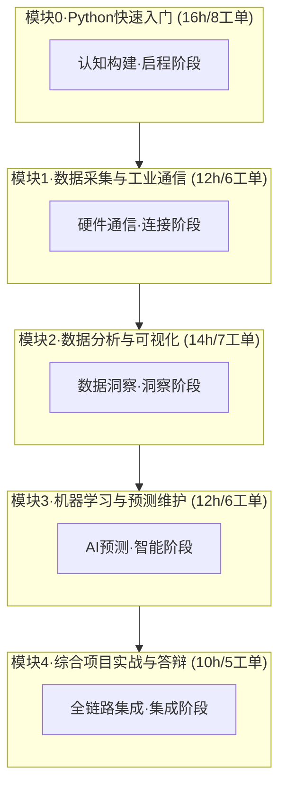
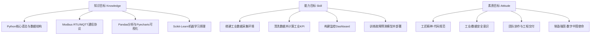
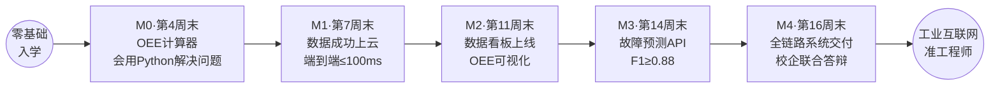
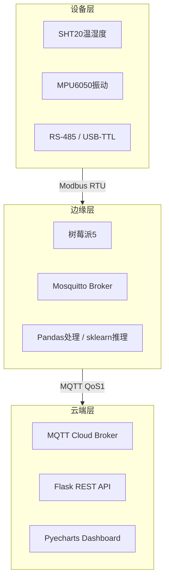
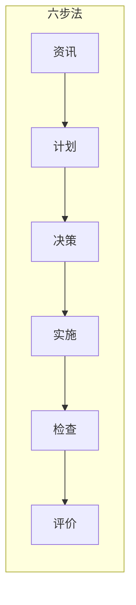
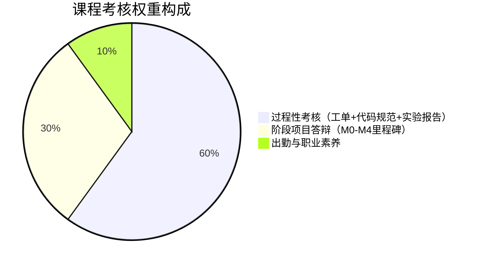

# 《Python编程基础》课程标准
## （64课时·大一新生版）

**课程代码：** ZY-IIoT-0301　　**适用专业：** 工业互联网应用（大一新生）
**开课学期：** 第一学年　　**总学时：** 64（理论24 + 实践40）　　**学分：** 4
**课程类型：** 专业基础课（零基础可入学）　　**制定单位：** 智能控制学院

---

## 一、课程定位与性质

### （一）课程定位
《Python编程基础》是工业互联网应用专业面向**大一新生**开设的**专业入门基石课程**。课程以"零基础起步、工业级落地"为主线，沿工业互联网"端—边—云"数据全链路组织教学，培养学生从**编程入门 → 数据采集 → 分析可视化 → 机器学习 → 系统集成**的完整能力雏形。



### （二）课程性质
遵循**德国双元制本土化**理念，采用**工作过程导向**的项目化、工单化教学，践行"资讯→计划→决策→实施→检查→评价"六步法与ABCD分层"精英特训+模拟项目组"两轮教学，实现课证融通、校企双元协同育人。

---

## 二、64课时设计思路与扩充逻辑

### （一）针对大一新生的三大扩充策略



| 策略 | 具体做法 | 对应48→64变化 |
|---|---|---|
| **① 走稳编程第一步** | 将变量、运算符、条件、循环拆为独立工单，逐个突破 | 模块0：8→16课时（+8） |
| **② 加厚工程实践** | 每工单增设分层任务与实操验证环节 | 实践学时29→40（+11） |
| **③ 强化过程养成** | 新增速查卡、避坑指南、三级检查 | 工单25→32个（+7） |

### （二）模块与学时分配图



| 模块 | 模块名称 | 工单数 | 理论 | 实践 | 学时 | 阶段 |
|---|---|---|---|---|---|---|
| 模块0 | Python快速入门 | 8 | 8 | 8 | 16 | 启程·认知构建 |
| 模块1 | 数据采集与工业通信 | 6 | 5 | 7 | 12 | 连接·硬件通信 |
| 模块2 | 数据分析与可视化 | 7 | 5 | 9 | 14 | 洞察·数据分析 |
| 模块3 | 机器学习与预测维护 | 6 | 4 | 8 | 12 | 智能·AI预测 |
| 模块4 | 综合项目实战与答辩 | 5 | 2 | 8 | 10 | 集成·全链路 |
| **合计** | | **32** | **24** | **40** | **64** | 四阶递进 |

---

## 三、课程目标（KSA三维模型）



### （一）知识目标（Knowledge）
1. 掌握Python变量、数据类型、运算符、条件分支、循环、数据结构与函数模块化（**大一重点夯实**）；
2. 掌握串口/Modbus RTU/MQTT工业通信协议原理；
3. 掌握Pandas数据清洗、GroupBy聚合、工业KPI计算与Pyecharts可视化；
4. 掌握时频域特征工程、机器学习建模、评估与部署；
5. 理解工业AIoT端-边-云三层架构。

### （二）能力目标（Skill）
能编写规范Python程序解决工业逻辑问题；能采集传感器数据并上云；能清洗分析数据并开发看板；能训练部署故障预测模型；能完成系统集成、文档撰写与路演答辩。

### （三）素质目标（Attitude）
树立"一次做对"的工匠品质；建立"宁可误报勿漏报"的安全责任底线；培养团队协作与表达能力；厚植制造强国、绿色智造使命担当。

---

## 四、课程内容与要求（32工单）

> 详见配套《授课计划表》与《Python工业互联网应用实战工单集（32工单）》。各模块核心要求如下：

| 模块 | 核心内容 | 能力要求 | 工单 |
|---|---|---|---|
| **模块0** | 环境搭建、变量数据类型、运算符、条件、循环、数据结构、函数、OEE计算器 | 能编写基础Python程序，独立完成OEE计算器 | WO-0-01～08 |
| **模块1** | 树莓派、PySerial、Modbus RTU、MQTT、多传感器集成、端到端联调 | 能采集传感器数据并稳定上云 | WO-1-01～06 |
| **模块2** | Pandas清洗、数据变换、KPI计算、基础图表、高级图表、Dashboard、自动报表 | 能清洗数据、计算KPI、开发监控看板 | WO-2-01～07 |
| **模块3** | 数据预处理、特征工程、模型训练、调优、评估、部署 | 能训练故障预测模型（F1≥0.88）并部署 | WO-3-01～06 |
| **模块4** | 需求架构、采集集成、看板ML对接、联调测试、文档答辩 | 能完成系统集成与工程交付 | WO-4-01～05 |

---

## 五、学生成长路径与里程碑



| 里程碑 | 时间节点 | 达成标准 | 核心交付物 |
|---|---|---|---|
| **M0** | 第4周末 | 独立完成OEE计算器 | OEE脚本 + Jupyter学习笔记本 |
| **M1** | 第7周末 | 传感器数据成功上云 | 完整采集脚本 + 端到端测试报告 |
| **M2** | 第11周末 | 独立构建厂级看板 | Pyecharts看板 + 自动化分析报告 |
| **M3** | 第14周末 | F1≥0.88故障预测API | ML模型文件(.pkl) + Flask推理服务 |
| **M4** | 第16周末 | 全链路系统交付 | 完整系统 + 文档包 + 路演PPT+Demo |

---

## 六、课程实施建议

### （一）教学条件·工具链全景



| Python库 | 用途 | 模块 | 难度 |
|---|---|---|---|
| 标准库 | 语法/数据结构/函数 | 模块0 | ★ |
| PySerial / minimalmodbus | 串口/Modbus通信 | 模块1 | ★★ |
| paho-mqtt | MQTT消息收发 | 模块1 | ★★ |
| Pandas | 数据处理分析 | 模块2 | ★★★ |
| Pyecharts | 工业可视化 | 模块2 | ★★★ |
| NumPy/SciPy | 信号处理/特征提取 | 模块3 | ★★★ |
| Scikit-Learn | 机器学习建模 | 模块3 | ★★★★ |
| Flask | 推理API服务 | 模块3-4 | ★★★ |

**硬件：** 树莓派4B/5 + SHT20/MPU6050传感器 + USB-TTL/RS485模块；**软件：** Anaconda/Jupyter、Mosquitto、JupyterHub、Git、Postman；**数据集：** CNC/注塑机日志、CWRU轴承故障数据集（脱敏）。

### （二）教学方法：双元制六步法 + ABCD分层两轮教学



- **ABCD分层**：A（师傅20%）、B（组长25%）、C（操作员40%）、D（操作员15%）；
- **两轮教学**：第一轮精英特训（1/3学时，A带做/B操作/C记录/D观摩）→ 第二轮模拟项目组（2/3学时，A项目经理/B/C/D操作）；
- **三级质量检查**：自检表 → 互检表 → 教师复查。

### （三）师资要求
主讲教师须为具备Python工程与工业互联网项目经验的"双师型"教师；引入企业导师（如海尔卡奥斯/西门子）参与工单评审与项目答辩，每模块至少1次企业导师工单联合评审。

---

## 七、课程考核与评价体系



| 考核项目 | 权重 | 考核内容 |
|---|---|---|
| 过程性考核 | 60% | 32个工单完成度、代码规范（PEP8）、实验报告（允许重提交） |
| 阶段项目答辩 | 30% | M0～M4五个里程碑成果、系统完整性、路演答辩表现 |
| 出勤与职业素养 | 10% | 出勤、课堂参与、团队协作、工业/数据安全意识 |

**考核节点：** W4基础过关测试 → W11数据分析看板+模型评估中期考核 → W16全链路系统交付公开答辩。
**评价主体：** 教师评价 + 学生自评/互评 + 企业导师评价（多元评价）。

---

## 八、课程思政融入点映射

| 模块 | 思政融入点 |
|---|---|
| 模块0·Python入门 | 代码规范即工匠品质，PEP8是工程师第一守则 |
| 模块1·数据采集 | 工业安全规范、防静电操作、现场工程师职业素养 |
| 模块2·数据分析 | OEE提升=减少浪费，精益生产与碳减排量化体现 |
| 模块3·机器学习 | 预测维护减少非计划停机，保障生产安全与效率 |
| 模块4·综合项目 | 团队协作、工程交付、路演答辩，全面职业素养培育 |

---

## 九、教材与参考资源
1. **自编活页式工单教材**：《Python工业互联网应用实战工单集（32工单·64课时版）》；
2. 参考书：《Python编程：从入门到实践》《利用Python进行数据分析》《Scikit-Learn机器学习实战》；
3. 在线资源：课程在线学习平台、1+X证书备考题库、工业数据集库。

---

*本课程标准（64课时·大一新生版）由智能控制学院工业互联网教研室制定，经学院教学委员会审定后执行。*

---

## JupyterHub 平台功能更新 (2026-09-04)

> **所有新功能已同步到此文件。以下为 JupyterHub 平台最新功能概要。**

### 访问方式
- **URL**: `https://10.167.2.175:31825/ide/`
- **密码**: `ide2026`（所有账户共享）

### 账户体系
| 账户 | 类型 | 对应课程 |
|------|------|----------|
| `teacher-zhang` | 管理员+总教师 | 全部8个Notebook |
| `Lecture-P1` | 管理员+章节教师 | P1.1 Python基础 + P1.2 标准Python工程 |
| `Lecture-P2` | 管理员+章节教师 | P2.1 Pandas数据处理 + P2.2 NumPy故障特征 |
| `Lecture-P3` | 管理员+章节教师 | P3 产线KPI仪表盘 |
| `Lecture-P4` | 管理员+章节教师 | P4.1 多源数据采集系统 |
| `Lecture-P5` | 管理员+章节教师 | P5 产线数据仓库与ORM |
| `Lecture-P6` | 管理员+章节教师 | P6 故障诊断模型与部署 |
| `student-python` | 学生 | Python 工业遥测分析项目 |
| `student-java` | 学生 | Java MES 生产管理系统 |
| `student-go` | 学生 | Go 工业网关项目 |
| `student-rust` | 学生 | Rust 安全审计项目 |

### AI 功能
- **jupyter-ai 聊天**: 登录后直接使用（左侧栏AI面板，无需配置）
- **LLM模型**: qwen2.5-coder:7b (Ollama CPU推理, 响应6-21秒)
- **内联补全**: LSP+pylsp 弹窗补全 + AI FIM缓存

### 代码评分系统
- **评分维度**: PEP8(20%) + 测试通过率(40%) + 查重(20%) + AI率(20%)
- **运行**: `python3 /home/jovyan/work/code_grader.py`
- **等级**: A(≥90) / B(80-89) / C(70-79) / D(60-69) / F(<60)

### 测试结果
- **功能测试**: 13/13 通过 (100%)
- **50并发用户**: 100% 成功, 24.5秒
- **LLM Chat**: PASS (21秒)
- **Notebook执行**: PASS (1.4秒)

### 管理面板
- **URL**: `https://10.167.2.175:31825/ide/hub/admin`
- **功能**: 查看用户/服务器状态、启动/停止服务器、作业发布与检查

---

## 19. 多语言代码审查系统 (v2.1 新增)

### 支持语言与工具

| 语言 | 工具 | 检查内容 |
|------|------|----------|
| Python | pycodestyle + pyflakes | PEP8 规范、语法错误 |
| Java | Checkstyle / javac | 代码规范、编译错误 |
| Go | gofmt + go vet | 格式化、静态分析 |
| Rust | cargo clippy + rustfmt | 代码质量、格式化 |
| C/C++ | cppcheck | 内存泄漏、未初始化变量 |
| JavaScript | node --check | 语法错误 |

### 使用方式

```bash
# 单文件审查
python3 code_review.py src/main.py

# 目录审查（自动检测语言，递归所有源文件）
python3 code_review.py /home/jovyan/work/industrial-analytics/src/
python3 code_review.py /home/jovyan/work/mes-system/production-service/src/
python3 code_review.py /home/jovyan/work/industrial-gateway/
python3 code_review.py /home/jovyan/work/security-audit/
```

### 输出格式（JSON）

```json
{
  "language": "Python",
  "tool": "pycodestyle",
  "issues": ["src/main.py:10:1: E302 expected 2 blank lines"],
  "score": 85
}
```

### 评分规则

| 语言 | 每个问题扣分 | 满分 |
|------|-------------|------|
| Python | 100/总行数 | 100 |
| Java | 5分/问题 | 100 |
| Go | 10分/问题 | 100 |
| Rust | 5分/问题 | 100 |
| C/C++ | 5分/问题 | 100 |

---

## 20. 指南分发规则 (v2.1 新增)

| 用户类型 | 教师版指南 | 学生版指南 | 评分系统 | AI助手 |
|----------|-----------|-----------|----------|--------|
| teacher-zhang | ✅ | ✅ | ✅ | ✅ |
| Lecture-* (16个) | ✅ | ✅ | ✅ | ✅ |
| 学生（任何注册） | ❌ | ✅ | ✅ | ✅ |

---

## 21. CockroachDB K8s 部署确认 (v2.1 新增)

### 部署方式

CockroachDB 已从裸金属迁移到 K8s Pod 部署：

| 项目 | 旧（裸金属） | 新（K8s Pod） |
|------|-------------|--------------|
| 二进制路径 | /opt/cockroach/cockroach | /cockroach-binary/cockroach（容器内） |
| 数据路径 | /home/crdb-data/a | /cockroach/cockroach-data（hostPath） |
| systemd | cockroach-node1/2.service | StatefulSet |
| systemd 状态 | — | disabled + inactive (dead) |
| 管理方式 | systemctl | kubectl / Rancher |
| 网络模式 | 宿主机直接 | hostNetwork: true |

> **说明**：由于使用 `hostNetwork: true`，Pod 进程在宿主机 `ps aux` 中可见，
> 但实际运行在容器内（二进制路径为 `/cockroach-binary/`，非 `/opt/cockroach/`）。
> 旧 systemd 服务已 disable + stopped。

### 局域网连接（读写分离）

| 用途 | 地址 | 端口 |
|------|------|------|
| 写连接 | 10.167.2.175 | 26257 |
| 读连接 | 10.167.2.175 | 26267 |
| NodePort 写 | 10.167.2.175 | 30257 |
| NodePort 读 | 10.167.2.175 | 30267 |
| 管理界面 | http://10.167.2.175 | 30259 |
| K8s 内写 | cockroachdb.infra.svc | 26257 |
| K8s 内读 | cockroachdb-read.infra.svc | 26267 |

---

## 22. 多教师同课程+班级关联体系 (v2.2 新增)

### 体系架构

```
teacher-zhang (总管理员)
├── 02-程序设计基础
│   ├── teacher-b1-01 → class-b1-01-A, class-b1-01-B
│   ├── teacher-b2-01 → class-b2-01-A
│   ├── teacher-b3-01 → class-b3-01-A
│   ├── teacher-b4-01 → class-b4-01-A
│   ├── teacher-b5-01 → class-b5-01-A
│   └── teacher-b6-01 → class-b6-01-A
├── 01-AI应用基础
│   ├── teacher-a1-01 → class-a1-01-A, class-a1-01-B
│   ├── teacher-a2-01 → class-a2-01-A
│   ├── teacher-a3-01 → class-a3-01-A
│   └── teacher-a4-01 → class-a4-01-A
└── 03-Python项目实战
    ├── teacher-p1-01 → class-p1-01-A, class-p1-01-B
    ├── teacher-p2-01 → class-p2-01-A
    ├── teacher-p3-01 → class-p3-01-A
    ├── teacher-p4-01 → class-p4-01-A
    ├── teacher-p5-01 → class-p5-01-A
    └── teacher-p6-01 → class-p6-01-A
```

### 同一课程多个教师

同一课程可以有多位教师同时授课，每位教师管理自己的班级：

| 课程 | 教师 | 负责班级 | 可管理学生 |
|------|------|----------|-----------|
| B1 (设备初始化) | teacher-b1-01 | class-b1-01-A, class-b1-01-B | A班+B班学生 |
| B1 (设备初始化) | teacher-b1-02 (新增) | class-b1-02-A | 新教师A班学生 |

> 教师使用 `https://10.167.2.175:31825/ide/hub/admin` 管理面板查看自己班级的学生。

### 学生登录格式

学生用户名格式: `{课程}-{班级}-{学号}`

| 格式 | 含义 | 关联教师 |
|------|------|----------|
| `b1-A-01` | 程序设计基础 B1 A班 01号 | teacher-b1-01 |
| `b1-B-05` | 程序设计基础 B1 B班 05号 | teacher-b1-01 |
| `a1-A-03` | AI应用基础 A1 A班 03号 | teacher-a1-01 |
| `p1-B-10` | Python项目实战 P1 B班 10号 | teacher-p1-01 |

### 教师管理学生流程

1. 教师登录 (`teacher-b1-01`, 密码 `ide2026`)
2. 访问管理面板: `https://10.167.2.175:31825/ide/hub/admin`
3. 查看自己班级的学生服务器状态
4. 启动/停止学生服务器
5. 使用 `code_grader.py` 评分学生代码

### 新增教师流程

1. 总管理员 `teacher-zhang` 在终端创建新教师:
   ```bash
   # 新教师登录即可自动创建 (密码 ide2026)
   # 然后在 hub pod 中将其加入对应课程组和班级组
   ```

2. 将新教师加入课程教师组和班级组（示例）:
   ```bash
   kubectl exec -n jupyterhub <hub-pod> -c jupyterhub -- python3 -c "
   import sqlite3
   conn = sqlite3.connect('/srv/jupyterhub/jupyterhub.sqlite')
   c = conn.cursor()
   # 创建教师
   c.execute('INSERT INTO users (name, admin) VALUES (?, 1)', ('teacher-b1-02',))
   # 加入课程教师组
   c.execute('SELECT id FROM groups WHERE name="course-b-teachers"')
   gid = c.fetchone()
   c.execute('SELECT id FROM users WHERE name="teacher-b1-02"')
   uid = c.fetchone()
   c.execute('INSERT INTO users_groups VALUES (?, ?)', (uid[0], gid[0]))
   # 创建新班级组
   c.execute('INSERT INTO groups (name) VALUES (?)', ('class-b1-02-A',))
   # 加入班级组
   c.execute('SELECT id FROM groups WHERE name="class-b1-02-A"')
   cg = c.fetchone()
   c.execute('INSERT INTO users_groups VALUES (?, ?)', (uid[0], cg[0]))
   conn.commit()
   "
   ```


---

## 23. OAuth 400 修复 + 测试报告 (v2.3)

### OAuth 400 修复
- 根因: Hub重启导致OAuth客户端丢失
- 修复: 清除stale oauth codes + 重新登录
- 验证: teacher-zhang登录成功

### 数据保留
- PVC Bound | 76 Notebook | 8 Code | 双指南 | 评分系统
- 结论: 零数据丢失

### LLM测试
- master: 59s | teacher pod: 28s | qwen2.5-coder:7b
- 瓶颈: CPU-only推理

### CRDB测试
- 3节点 Running | 27+数据库 | 读写分离

### 资源优化
- milvus/nebula/pulsar stopped | Worker CPU 79% -> 57%


---

## 24. nbgrader 原生作业系统 (v2.4 新增)

### 概述

JupyterHub 已安装 **nbgrader 0.9.5**，提供原生的作业分发、收集、自动评分和反馈功能，替代了之前的手动 code_grader.py。

### 教师操作流程

```bash
cd ~/work/nbgrader

# 1. 创建作业（在 source/ 目录下创建 Notebook）
#    在 JupyterLab 中使用 nbgrader 工具栏标记单元格类型:
#    - 答案区（Solution）: 学生需要填写的代码
#    - 测试区（Test）: assert 断言（自动评分用）
#    - 只读区（Read-only）: 题目描述

# 2. 生成学生版（自动去除解决方案）
python3 -m nbgrader generate_assignment ps1

# 3. 发布作业到 exchange
python3 -m nbgrader release_assignment ps1

# 4. 查看已发布的作业
python3 -m nbgrader list

# 5. 学生提交后，自动评分
python3 -m nbgrader autograde ps1

# 6. 生成反馈
python3 -m nbgrader generate_feedback ps1
python3 -m nbgrader release_feedback ps1

# 7. 导出成绩 CSV
python3 -m nbgrader export
```

### 学生操作流程

```bash
cd ~/work/nbgrader

# 1. 查看可用作业
python3 -m nbgrader list

# 2. 获取作业
python3 -m nbgrader fetch ps1

# 3. 完成作业后提交
python3 -m nbgrader submit ps1
```

### nbgrader 元数据要求

每个 nbgrader 单元格需要完整的 v3 元数据:
- `grade`: True/False（是否评分）
- `solution`: True/False（是否答案区）
- `task`: False
- `locked`: True/False（是否锁定）
- `points`: 浮点数（分值）
- `grade_id`: 唯一标识符
- `schema_version`: 3
- `cell_type`: "code"

### Exchange 目录

| 路径 | 说明 |
|------|------|
| `~/work/nbgrader/exchange/` | 共享交换目录 |
| `exchange/default/outbound/` | 教师发布的作业 |
| `exchange/default/inbound/` | 学生提交的作业 |

---

## 25. 多教师多课程账户体系 (v2.4 完整版)

### 完整对照表

```
teacher-zhang (总管理员, 密码: ide2026)
├── 02-程序设计基础
│   ├── Lecture-B1~B6 (原始管理员)
│   ├── teacher-b1-01 → class-b1-01-A, class-b1-01-B
│   ├── teacher-b2-01 → class-b2-01-A
│   ├── teacher-b3-01 → class-b3-01-A
│   ├── teacher-b4-01 → class-b4-01-A
│   ├── teacher-b5-01 → class-b5-01-A
│   └── teacher-b6-01 → class-b6-01-A
├── 01-AI应用基础
│   ├── Lecture-A1~A4
│   ├── teacher-a1-01 → class-a1-01-A, class-a1-01-B
│   ├── teacher-a2-01 → class-a2-01-A
│   ├── teacher-a3-01 → class-a3-01-A
│   └── teacher-a4-01 → class-a4-01-A
└── 03-Python项目实战
    ├── Lecture-P1~P6
    ├── teacher-p1-01 → class-p1-01-A, class-p1-01-B
    ├── teacher-p2-01 → class-p2-01-A
    ├── teacher-p3-01 → class-p3-01-A
    ├── teacher-p4-01 → class-p4-01-A
    ├── teacher-p5-01 → class-p5-01-A
    └── teacher-p6-01 → class-p6-01-A
```

### 学生登录格式

| 格式 | 含义 | 关联教师 |
|------|------|----------|
| `b1-A-01` | 程序设计基础 B1 A班 01号 | teacher-b1-01 |
| `a1-B-03` | AI应用基础 A1 B班 03号 | teacher-a1-01 |
| `p1-A-05` | Python项目实战 P1 A班 05号 | teacher-p1-01 |

### 账户总计

- 33 个教师/管理员账户
- 43 个分组
- 56 个 Notebook
- 28 个代码框架
- 3 门课程
